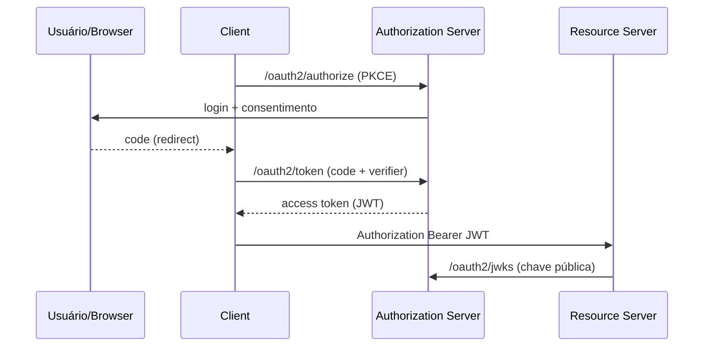

# Spring Authorization Server

> **Resumo:** implementação de servidor de autorização OAuth 2.1 / OpenID Connect 1.0 para emitir tokens. O projeto autônomo foi **arquivado (Attic)** e seu código **passou a fazer parte do Spring Security 7.0**; a funcionalidade continua, o que mudou foi onde ela vive.
> **Pré-requisitos:** [08-spring-security](../03-spring-boot/08-spring-security.md).
> **Versões:** módulo `spring-security-oauth2-authorization-server` **7.1.2** (confirmado no grafo de dependências com Boot 4.1.2). Execução funcional do fluxo OAuth2 **NÃO** realizada.

## 1. Definição

No [08-spring-security](../03-spring-boot/08-spring-security.md) a aplicação era *Resource Server* (validava JWT). Quem **emite** o JWT é o servidor de autorização: autentica o usuário, pede consentimento e entrega *access token*, *refresh token* e *ID token* (OIDC), por fluxos como Authorization Code + PKCE e Client Credentials.

## 2. Conceitos fundamentais

- **Papéis OAuth2:** resource owner (usuário), client (app), authorization server, resource server.
- **Endpoints:** `/oauth2/authorize`, `/oauth2/token`, `/oauth2/jwks`, `/.well-known/openid-configuration` (descoberta), introspecção e revogação.
- **`RegisteredClientRepository`:** clientes cadastrados (id, segredo, *redirect URIs*, grant types, scopes).
- **`JWKSource`:** chaves para assinar JWT; o Resource Server busca a chave pública em `/oauth2/jwks`.
- **Serviços de persistência:** `OAuth2AuthorizationService`, `OAuth2AuthorizationConsentService` (memória ou JDBC).

## 3. Como funciona por dentro

É um conjunto de filtros do Spring Security (`OAuth2AuthorizationEndpointFilter`, `OAuth2TokenEndpointFilter` etc.) dentro de uma `SecurityFilterChain` própria, com *authentication providers* para cada grant. Os tokens JWT são gerados por um `OAuth2TokenGenerator` configurável.



## 4. Evolução histórica

Substituiu o antigo *Spring Security OAuth* (descontinuado), a partir do projeto Authorization Server (1.0 em novembro de 2022, segundo o anúncio oficial). Em **11/09/2025** a equipe anunciou que ele seria incorporado ao Spring Security 7.0; issues e PRs passaram a ser tratados só no repositório do Spring Security, e o OAuth2 Client e o Authorization Server compartilham código-fonte, Javadoc e documentação. As coordenadas Maven (`org.springframework.security:spring-security-oauth2-authorization-server`) permanecem, mas a versão passa a seguir a do Security. Fonte: <https://spring.io/blog/2025/09/11/spring-authorization-server-moving-to-spring-security-7-0>.

## 5. Exemplos práticos

Dependência com Boot 4.1.2: `spring-boot-starter-security-oauth2-authorization-server` (existe e resolveu para `spring-boot-security-oauth2-authorization-server` 4.1.2, que traz o módulo do Security 7.1.2). Também existe no Central um starter sem o prefixo `security-` ⚠️ VERIFICAR qual é o recomendado/deprecado.

Esqueleto de configuração (**não compilado**; a API de configuração do Security 7 mudou, consulte o guia):

<!-- não compilado -->
```java
@Bean
RegisteredClientRepository clients() {
  RegisteredClient web = RegisteredClient.withId(UUID.randomUUID().toString())
      .clientId("orders-web")
      .clientAuthenticationMethod(ClientAuthenticationMethod.NONE)      // cliente público + PKCE
      .authorizationGrantType(AuthorizationGrantType.AUTHORIZATION_CODE)
      .redirectUri("http://127.0.0.1:8080/login/oauth2/code/orders-web")
      .scope(OidcScopes.OPENID).scope("orders.read")
      .build();
  return new InMemoryRegisteredClientRepository(web);
}
```

Observação do ambiente: com o starter e **sem** configuração, uma requisição MockMvc a `/.well-known/openid-configuration` respondeu **401**; é preciso configurar a cadeia do servidor de autorização e permitir o endpoint. Não foi investigado além disso.

## 6. Configurações e anotações relevantes

| Item | Para que serve | Exemplo |
|---|---|---|
| `RegisteredClientRepository` | clientes | em memória ou JDBC |
| `JWKSource<SecurityContext>` | chaves de assinatura | par RSA gerado/guardado |
| `AuthorizationServerSettings` | issuer e paths | `.issuer("https://auth.example.com")` |
| `spring.security.oauth2.authorizationserver.*` | propriedades do Boot ⚠️ VERIFICAR | clientes em YAML |

## 7. Quando usar e quando NÃO usar

- Use: precisa **emitir** tokens controlando usuários, clientes e claims, ou federar identidades internas.
- Não use: se um IdP pronto resolve (Keycloak, Okta, Entra ID, Auth0, Cognito). Operar um servidor de autorização é responsabilidade de segurança séria (rotação de chaves, MFA, auditoria, recuperação de conta). Para apenas validar tokens, basta o Resource Server.

## 8. Erros comuns e boas práticas

- Gerar chaves RSA a cada boot invalida todos os tokens: persista e rotacione chaves.
- `issuer` inconsistente entre servidor e resource server quebra a validação.
- Usar Implicit ou Password grants (removidos no OAuth 2.1): use Authorization Code + PKCE.
- Segredos de cliente em YAML versionado; coloque no cofre.

## 9. Perguntas de revisão

1. Qual o status do Spring Authorization Server como projeto?
<details><summary>Resposta</summary>Arquivado (Attic); o código foi incorporado ao Spring Security 7.0 e continua suportado lá.</details>

2. Diferença entre Authorization Server e Resource Server?
<details><summary>Resposta</summary>O primeiro emite tokens; o segundo os valida e protege a API.</details>

3. Para que serve o endpoint JWKS?
<details><summary>Resposta</summary>Publicar as chaves públicas para que resource servers verifiquem a assinatura dos JWT.</details>

4. Por que PKCE?
<details><summary>Resposta</summary>Protege o Authorization Code de interceptação em clientes públicos, sem segredo.</details>

5. Quando preferir Keycloak?
<details><summary>Resposta</summary>Quando não há necessidade de customização profunda e a equipe não quer assumir a operação de identidade.</details>

## 10. Referências oficiais

- Anúncio da incorporação: <https://spring.io/blog/2025/09/11/spring-authorization-server-moving-to-spring-security-7-0>
- Spring Security (seção OAuth2 Authorization Server): <https://docs.spring.io/spring-security/reference/>
- Projeto (Attic): <https://spring.io/projects>
- OAuth 2.1 / OIDC: <https://oauth.net/2.1/>, <https://openid.net/connect/>

Anterior: [03-spring-modulith](03-spring-modulith.md) · Próximo: [05-spring-graphql](05-spring-graphql.md)
