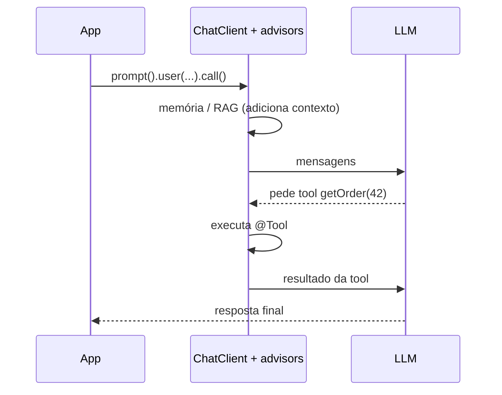

# Spring AI

> **Resumo:** abstrações portáveis do Spring para aplicações com IA generativa: `ChatClient` para modelos de linguagem, saída estruturada em objetos Java, *advisors* (memória, RAG), *tool calling*, embeddings e *vector stores*. Troca-se o provedor mudando dependência e propriedades.
> **Pré-requisitos:** [01-o-que-e-spring-boot](../03-spring-boot/01-o-que-e-spring-boot.md), [04-web-mvc](../03-spring-boot/04-web-mvc.md).
> **Versões:** Spring AI **2.0.2** GA (BOM próprio `spring-ai-bom`; 2.1.0-RC1 existe no Central); Boot 4.1.2. **Nenhum código desta página foi executado** (exige chave/serviço de um provedor de LLM); trechos extraídos da documentação oficial.

## 1. Definição

Um LLM é uma API remota (ou local, via Ollama) que recebe um *prompt* e devolve texto. O Spring AI faz o papel que o Spring Data faz para bancos: interface comum (`ChatClient`/`ChatModel`, `EmbeddingModel`, `VectorStore`), autoconfiguração por *starter* e integração com o resto do ecossistema (observabilidade, testes).

## 2. Conceitos fundamentais

| Conceito | O que é |
|---|---|
| `ChatClient` | API fluente para montar e enviar prompts |
| Prompt / mensagens | system, user, assistant; templates |
| Saída estruturada | `.entity(Tipo.class)` converte a resposta em objeto Java |
| Advisors | interceptadores da chamada (memória de conversa, RAG, log); a **ordem** importa |
| Tool calling | o modelo pede a execução de métodos Java anotados com `@Tool` |
| Embeddings + `VectorStore` | vetores semânticos para busca por similaridade |
| RAG | recuperar documentos relevantes e injetá-los no prompt |
| MCP | integração com servidores/clientes do Model Context Protocol (existe `spring-ai-starter-mcp-server`) |

Provedores listados na documentação do `ChatClient` (2026-11-04): Anthropic, OpenAI, Azure OpenAI, Amazon Bedrock Converse, Google GenAI, Mistral AI, Ollama, DeepSeek, Groq, Docker Model Runner, entre outros. Starters seguem a convenção `spring-ai-starter-model-<provedor>` (confirmados no Central: `-openai`, `-ollama`); vector stores, `spring-ai-starter-vector-store-<nome>` (ex.: `pgvector`).

## 3. Como funciona por dentro

`ChatClient.prompt()...call()` monta um `Prompt`, passa pela cadeia de *advisors* (cada um pode alterar a requisição e a resposta) e chega ao `ChatModel` do provedor, que faz a chamada HTTP. Com tools, o ciclo é: o modelo responde "chame a função X com estes argumentos" → o Spring executa o método Java → devolve o resultado ao modelo → o modelo gera a resposta final. Para `.entity()`, o Spring anexa instruções de formato (ou usa o recurso de saída estruturada do provedor) e desserializa o JSON.



## 4. Evolução histórica

Anunciado em 2023 (primeiras versões 0.x/milestones), 1.0 GA em 2025 e a série 2.x acompanha Boot 4 / Framework 7. A API do `ChatClient` mudou bastante entre as versões iniciais; **confira sempre a documentação da versão usada**. Na documentação da 2.x, por exemplo, o módulo Anthropic migrou para o SDK Java oficial. ⚠️ VERIFICAR datas (de memória).

## 5. Exemplos práticos

Mínimo (da documentação oficial; **não executado**):

<!-- não compilado -->
```java
@RestController
class AssistantController {
  private final ChatClient chatClient;
  AssistantController(ChatClient.Builder builder) { this.chatClient = builder.build(); }

  @GetMapping("/ai")
  String ask(String question) {
    return chatClient.prompt().user(question).call().content();
  }
}
```

Saída estruturada com o domínio de pedidos:

<!-- não compilado -->
```java
record OrderSummary(String customer, List<String> items, double total) {}

OrderSummary s = chatClient.prompt()
    .user("Resuma este pedido: " + text)
    .call()
    .entity(OrderSummary.class);
```

Tool e memória (conforme a documentação; pacotes `org.springframework.ai.tool.annotation.Tool` e `...chat.client.advisor.*` ⚠️ VERIFICAR):

<!-- não compilado -->
```java
class OrderTools {
  @Tool(description = "Busca o status de um pedido pelo id")
  String status(String orderId) { return "PAID"; }
}
chatClient.prompt().user("Qual o status do pedido 42?").tools(new OrderTools()).call().content();
```

Memória de conversa exige `ChatMemory.CONVERSATION_ID` em cada chamada (sem ele, `IllegalArgumentException`, segundo a documentação).

## 6. Configurações e anotações relevantes

| Item | Para que serve | Exemplo |
|---|---|---|
| `spring-ai-starter-model-openai` | provedor | + `spring.ai.openai.api-key` ⚠️ VERIFICAR |
| `spring-ai-starter-model-ollama` | modelo local | `spring.ai.ollama.*` ⚠️ VERIFICAR |
| `ChatClient.Builder` | injetado pela autoconfiguração | `builder.build()` |
| `@Tool` | método exposto ao modelo | acima |
| `.entity(Tipo.class)` | saída estruturada | acima |
| `spring-ai-bom` | versões coerentes | `dependencyManagement` |

## 7. Quando usar e quando NÃO usar

- Use: chat, resumo, extração para objetos, classificação, RAG sobre documentos internos, agentes com ferramentas.
- Não use: lógica determinística (regras de negócio, cálculo): o modelo erra e custa. Não envie dados sensíveis a provedor sem avaliar contrato/LGPD. Para uma chamada única, o SDK do provedor pode ser mais simples.

## 8. Erros comuns e boas práticas

- Confiar na saída sem validar: valide com Bean Validation e trate falhas de parsing.
- Tool com efeito colateral (cancelar pedido) acionada por prompt injection: exija confirmação e autorização na tool.
- Custos e latência: defina timeouts, limites de tokens e cache; meça com a observabilidade do Micrometer.
- Testes não determinísticos: isole o modelo atrás de interface e use *mocks* nos testes unitários.
- Versione prompts como código.

## 9. Perguntas de revisão

1. Qual o papel do `ChatClient`?
<details><summary>Resposta</summary>API fluente e portável para montar prompts e chamar o modelo, com advisors, tools e saída estruturada.</details>

2. O que são advisors?
<details><summary>Resposta</summary>Interceptadores da requisição/resposta (memória, RAG, logging); a ordem na cadeia importa.</details>

3. Como funciona o tool calling?
<details><summary>Resposta</summary>O modelo solicita a execução de uma função; o Spring executa o método `@Tool` e devolve o resultado ao modelo para a resposta final.</details>

4. O que é RAG?
<details><summary>Resposta</summary>Buscar trechos relevantes em um vector store e incluí-los no prompt para fundamentar a resposta.</details>

5. Por que não colocar regras de negócio no LLM?
<details><summary>Resposta</summary>Resultado não determinístico, custo e latência; mantenha o determinístico em código.</details>

## 10. Referências oficiais

- Documentação: <https://docs.spring.io/spring-ai/reference/>
- ChatClient: <https://docs.spring.io/spring-ai/reference/api/chatclient.html>
- Projeto: <https://spring.io/projects/spring-ai>
- Model Context Protocol: <https://modelcontextprotocol.io/>

Anterior: [05-spring-graphql](05-spring-graphql.md) · Próximo: [07-spring-session](07-spring-session.md)
