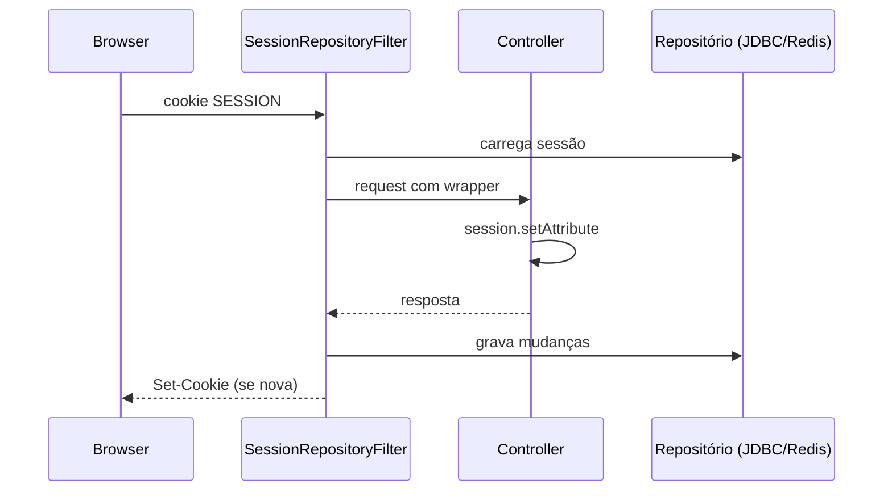

# Spring Session

> **Resumo:** troca o armazenamento da `HttpSession` (memória do servidor de aplicação) por um repositório externo (Redis, JDBC, Hazelcast, MongoDB), de forma transparente para o código. Permite escalar horizontalmente sem *sticky sessions* e sobreviver a reinícios.
> **Pré-requisitos:** [04-web-mvc](../03-spring-boot/04-web-mvc.md), [08-spring-security](../03-spring-boot/08-spring-security.md).
> **Versões:** Spring Session **4.1.1** (BOM do Boot 4.1.2). Executado em `/tmp/validacao/s12/c` com JDBC/H2.

## 1. Definição

Aplicações com estado de sessão (carrinho, login por cookie) ficam presas a uma instância. Com Spring Session, um filtro (`SessionRepositoryFilter`) **envolve** `HttpServletRequest` para que `request.getSession()` leia e grave no repositório configurado.

## 2. Conceitos fundamentais

- `SessionRepository` (e `FindByIndexNameSessionRepository`, que permite achar sessões por usuário).
- Implementações: Data Redis, JDBC, Hazelcast, MongoDB ⚠️ VERIFICAR lista atual.
- Cookie `SESSION` (padrão), com id Base64, no lugar de `JSESSIONID`.
- Serialização: o que vai na sessão precisa ser serializável (Java serialization por padrão no JDBC; JSON configurável).
- Expiração: `spring.session.timeout`; Redis cuida com TTL.

## 3. Como funciona por dentro

O filtro `SessionRepositoryFilter` cria um `HttpServletRequestWrapper` cuja `getSession()` devolve uma sessão apoiada no repositório. No fim da requisição, `commitSession` grava as mudanças e define o cookie. É o mesmo mecanismo de *wrapper* de [filtros](../03-spring-boot/04-web-mvc.md), sem proxy dinâmico.



## 4. Evolução histórica

Projeto de 2014 (Spring Session 1.0), criado para tirar a sessão do contêiner de servlets e integrar com Redis; ganhou JDBC, Hazelcast e Mongo, e suporte reativo (WebSession). A 4.x acompanha Framework 7. ⚠️ VERIFICAR datas (de memória).

## 5. Exemplos práticos

Dependência: `spring-boot-starter-session-jdbc` (ou `-data-redis`). Em `application.properties`: `spring.session.jdbc.initialize-schema=always` (cria as tabelas `SPRING_SESSION` e `SPRING_SESSION_ATTRIBUTES` em banco embutido/de teste). Controller:

```java
@GetMapping("/cart/add")
String add(HttpSession s) {
  int n = (int) Optional.ofNullable(s.getAttribute("n")).orElse(0) + 1;
  s.setAttribute("n", n);
  return "n=" + n;
}
```

Executado: após uma chamada, a tabela `spring_session` tinha linhas (consulta `select count(*) from spring_session` > 0 no H2), ou seja, a sessão é do repositório, não do Tomcat. O teste usou `MockHttpSession`; um teste com cookie real entre duas instâncias NÃO foi feito. Redis NÃO executado.

## 6. Configurações e anotações relevantes

| Item | Para que serve | Exemplo |
|---|---|---|
| `spring.session.store-type` | já não é necessário com um único starter ⚠️ VERIFICAR | — |
| `spring.session.timeout` | expiração | `30m` |
| `spring.session.jdbc.initialize-schema` | cria tabelas | `always` / `embedded` / `never` |
| `spring.session.jdbc.table-name` | nome da tabela | `SPRING_SESSION` |
| `server.servlet.session.cookie.*` | atributos do cookie | `same-site`, `secure` |

## 7. Quando usar e quando NÃO usar

- Use: várias instâncias com sessão de servidor; login por cookie em app MVC clássica; sessões "revogáveis" (invalidar por usuário).
- Não use: API stateless com JWT (não há sessão); nem para guardar objetos grandes (cada requisição lê/grava). Em Redis, planeje HA e memória.

## 8. Erros comuns e boas práticas

- Objeto de sessão não serializável → erro na gravação.
- Mutar objeto já guardado sem chamar `setAttribute` de novo: a alteração pode não ser persistida; reatribua.
- Cookie sem `Secure`/`HttpOnly`/`SameSite` adequados.
- Esquema criado automaticamente em produção; gerencie com [Flyway](../03-spring-boot/12-migracoes-de-banco.md).

## 9. Perguntas de revisão

1. Que problema o Spring Session resolve?
<details><summary>Resposta</summary>Estado de sessão preso a uma instância; externaliza para um repositório compartilhado.</details>

2. Como a `HttpSession` é substituída sem mudar o código?
<details><summary>Resposta</summary>Um filtro empacota a requisição e `getSession()` devolve uma sessão apoiada no repositório.</details>

3. Por que usar Redis em vez de JDBC?
<details><summary>Resposta</summary>Latência menor, TTL nativo e menor carga no banco relacional.</details>

4. Quando não há sessão para guardar?
<details><summary>Resposta</summary>Em APIs stateless com tokens (JWT).</details>

5. O que a mutação sem `setAttribute` pode causar?
<details><summary>Resposta</summary>A mudança pode não ser detectada e não ser persistida.</details>

## 10. Referências oficiais

- Documentação: <https://docs.spring.io/spring-session/reference/>
- Projeto: <https://spring.io/projects/spring-session>

Anterior: [06-spring-ai](06-spring-ai.md) · Próximo: [08-spring-hateoas](08-spring-hateoas.md)
