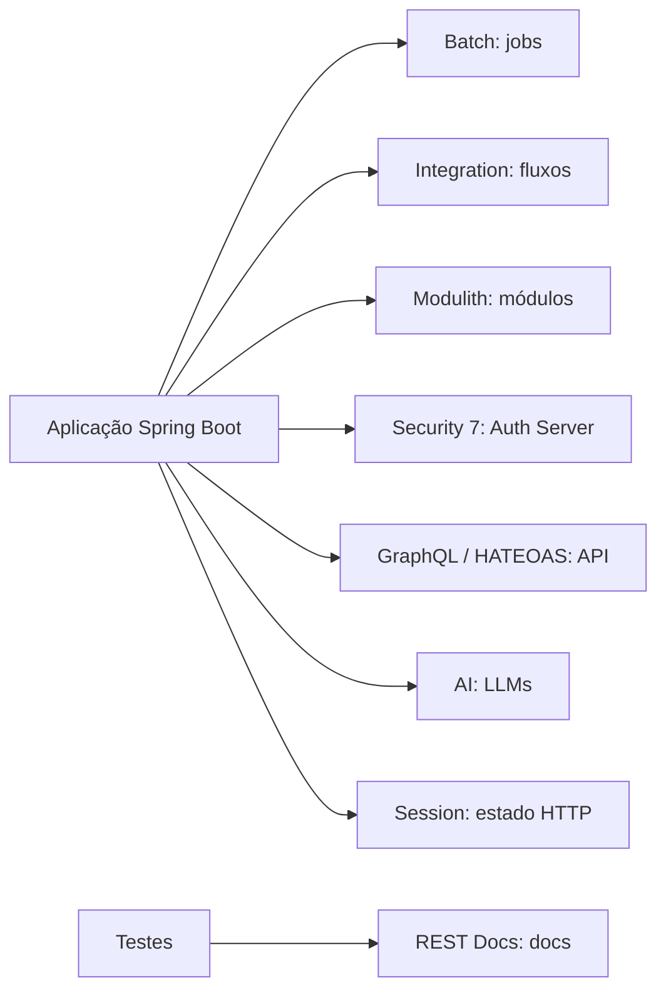

# Outros projetos Spring

> **Resumo:** o Spring tem dezenas de projetos além de Framework, Boot e Cloud. Esta pasta traz uma página curta por projeto relevante: o que é, quando usar, um exemplo mínimo e links. É material de **consulta por demanda**, não de leitura linear.
> **Pré-requisitos:** [01-o-que-e-spring-boot](../03-spring-boot/01-o-que-e-spring-boot.md) e, para Security/OAuth2, [08-spring-security](../03-spring-boot/08-spring-security.md).
> **Versões:** Boot 4.1.2, Java 25. Versões gerenciadas pelo BOM do Boot 4.1.2 (lidas do POM): Batch 6.0.6, Integration 7.1.2, GraphQL 2.0.6, HATEOAS 3.1.3, Session 4.1.1, REST Docs 4.0.2, Security 7.1.2. Modulith 2.1.2 e AI 2.0.2 são **fora do BOM do Boot** (têm BOM próprio; 2.1.2 / 2.0.2 são as últimas GA no Maven Central em 2026-11-04).

## Mapa e status (confirmado em spring.io/projects em 2026-11-04)

| Página | Projeto | Status | Para que serve |
|---|---|---|---|
| [01](01-spring-batch.md) | Spring Batch | ativo | processamento em lote (ETL, faturamento, conciliação) |
| [02](02-spring-integration.md) | Spring Integration | ativo | integração de sistemas (EIP): canais, fluxos, adaptadores |
| [03](03-spring-modulith.md) | Spring Modulith | ativo | monólito modular verificado, eventos entre módulos |
| [04](04-spring-authorization-server.md) | Spring Authorization Server | **Attic**; incorporado ao Spring Security 7 | emitir tokens OAuth2/OIDC |
| [05](05-spring-graphql.md) | Spring for GraphQL | ativo | APIs GraphQL |
| [06](06-spring-ai.md) | Spring AI | ativo | integrar LLMs, RAG, tools, MCP |
| [07](07-spring-session.md) | Spring Session | ativo | sessões HTTP fora da memória do servidor |
| [08](08-spring-hateoas.md) | Spring HATEOAS | ativo | links hipermídia em REST |
| [09](09-spring-rest-docs.md) | Spring REST Docs | ativo | documentação de API gerada por testes |

"Ativo" significa que o projeto aparece na lista principal de spring.io/projects com versão recente; a página não usa os rótulos "manutenção" ou "ativo". Só o Authorization Server aparece em "Projects in the Attic".

## Como estes projetos entram na sua aplicação

## Projetos que NÃO têm página aqui

Spring Data (ver [06](../03-spring-boot/06-spring-data-jpa.md) e [07](../03-spring-boot/07-spring-data-outros.md)), Spring Security ([08](../03-spring-boot/08-spring-security.md)), Spring Cloud ([04-spring-cloud](../04-spring-cloud/01-visao-geral.md)), Spring AMQP/Kafka/Pulsar (mensageria, ver [07-mensageria](../04-spring-cloud/07-mensageria.md)), Spring Web Services, Spring Shell, Spring Vault, Spring LDAP, Spring Statemachine, Spring Cloud Data Flow/Task. Consulte <https://spring.io/projects> para o catálogo completo e o status atual. ⚠️ VERIFICAR o status de cada um antes de adotar.

## Como estas páginas foram validadas

Exemplos de Batch, Integration, Modulith, GraphQL, HATEOAS, Session (JDBC) e REST Docs foram **compilados e executados** com Boot 4.1.2 / Java 25 em `/tmp/validacao/s12` (a: Batch + Integration; b: Modulith + GraphQL + HATEOAS; c: Session + REST Docs + Authorization Server). Spring AI **não foi executado** (exigiria um provedor de LLM); o Authorization Server só teve o grafo de dependências confirmado.

Primeira leitura sugerida: [03-spring-modulith](03-spring-modulith.md) (o que mais muda o desenho da sua aplicação) e [01-spring-batch](01-spring-batch.md).

Anterior: [09-spring-cloud-e-kubernetes](../04-spring-cloud/09-spring-cloud-e-kubernetes.md) · Próximo: [../06-padroes-de-projeto/](../06-padroes-de-projeto/)
