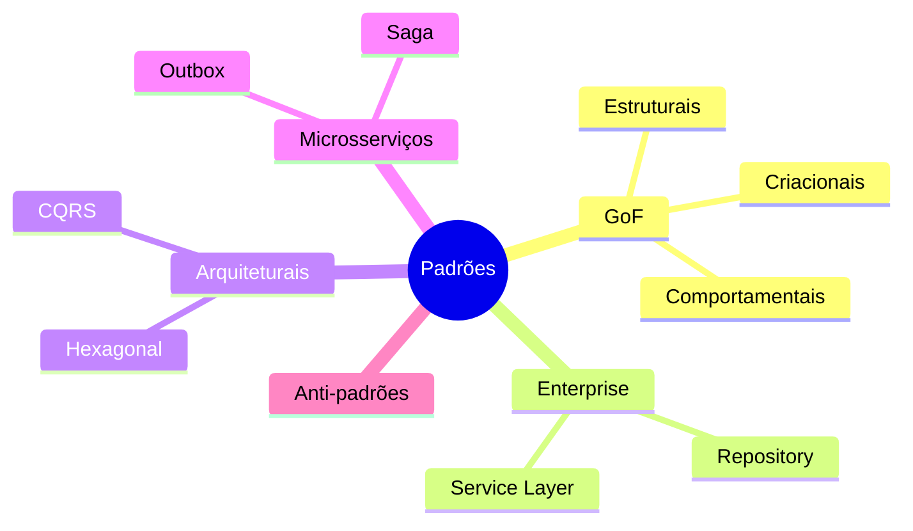
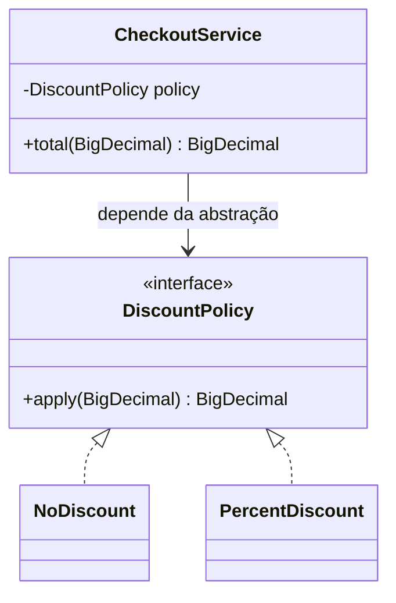
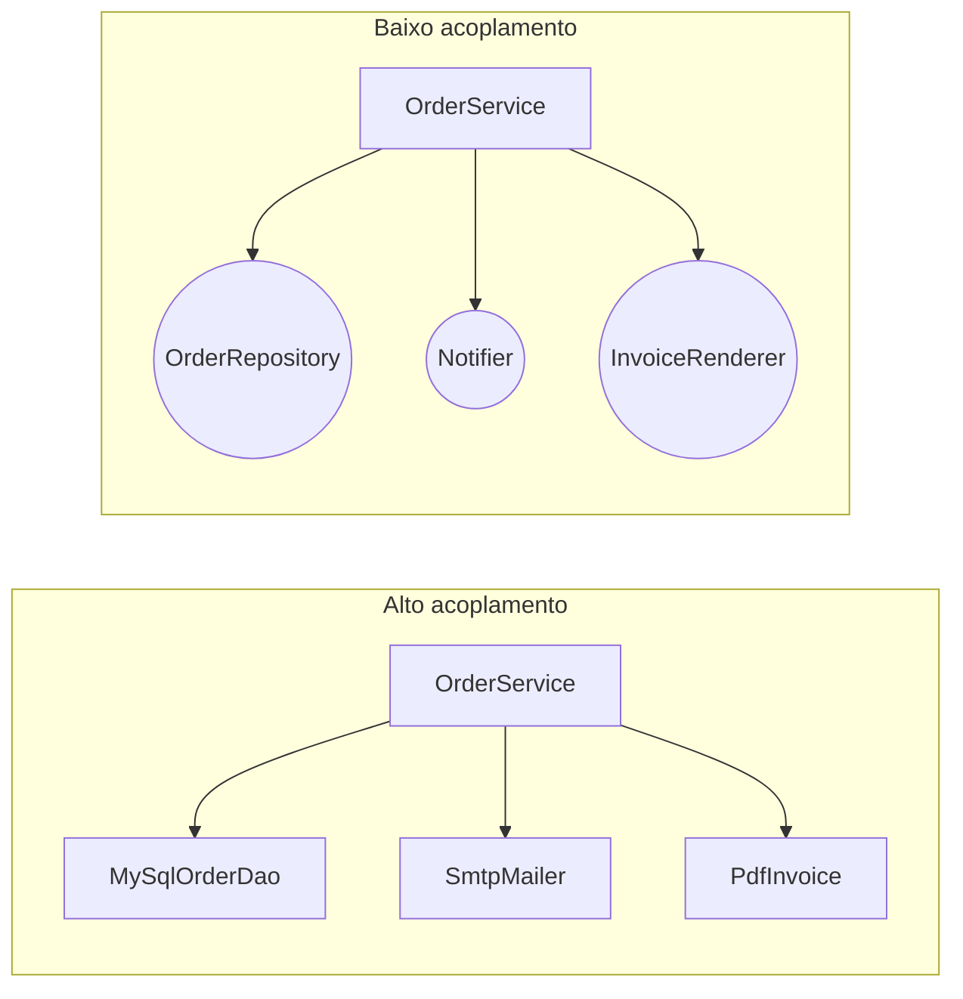
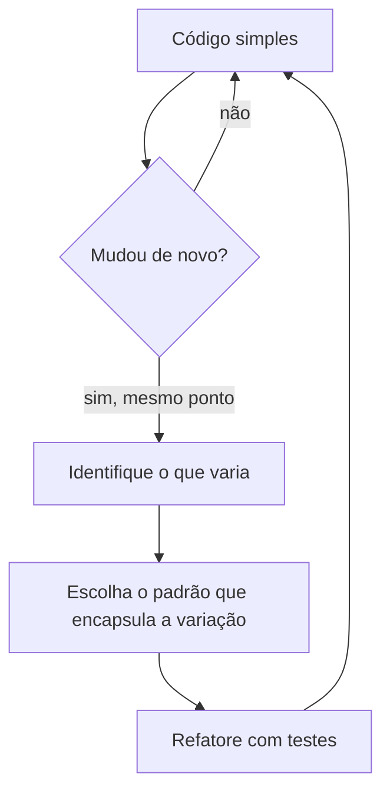

# Padrões de projeto: introdução, princípios e acoplamento

> **Resumo:** o que são padrões de projeto, de onde vieram, como classificá-los e quais princípios (SOLID, DRY, KISS, YAGNI, acoplamento e coesão) explicam *por que* um padrão funciona. É a base conceitual para os arquivos seguintes ([criacionais](02-criacionais.md), [estruturais](03-estruturais.md), comportamentais, enterprise, arquiteturais, microsserviços e anti-padrões).
> **Pré-requisitos:** [04-orientacao-a-objetos](../01-java/04-orientacao-a-objetos.md) (interfaces, herança, composição) e [02-ioc-e-injecao-de-dependencia](../02-spring-core/02-ioc-e-injecao-de-dependencia.md).
> **Versões:** Java 25. Código desta página compilado e executado em `/tmp/validacao/s13` (Java 25, Spring Framework 7.0.8 nos exemplos de Spring).

## 1. Definição

Um **padrão de projeto** (*design pattern*) é uma **solução reutilizável e nomeada para um problema recorrente de projeto de software**, dentro de um contexto. Não é código pronto nem biblioteca: é uma **descrição** (problema, solução, consequências) que você adapta ao seu código.

Três coisas distinguem um padrão de uma simples "boa ideia":

1. **Problema recorrente:** aparece em projetos diferentes, em linguagens diferentes.
2. **Solução com trade-offs explícitos:** todo padrão custa algo (mais classes, mais indireção). O catálogo descreve as **consequências**, não só a vantagem.
3. **Nome:** é vocabulário compartilhado. Dizer "isto é um *Decorator*" em uma revisão de código comunica em uma palavra o que levaria um parágrafo.

> **O que um padrão NÃO é:** não é uma meta. Padrão aplicado sem o problema correspondente é **complexidade gratuita** (ver [§7](#7-quando-usar-e-quando-não-usar)).

### 1.1 Os elementos de um padrão

O formato clássico (GoF) descreve cada padrão com: **nome**, **intenção**, **motivação** (cenário), **estrutura** (diagrama de classes), **participantes**, **colaborações**, **consequências**, **implementação** e **usos conhecidos**. Nesta base, cada padrão segue uma versão enxuta:

| Item | Pergunta que responde |
|---|---|
| Problema | Que dor aparece no código sem o padrão? |
| Solução | Qual a ideia central? |
| `classDiagram` | Quem são os participantes e como se relacionam? |
| Java puro | Como fica o código mínimo, compilável? |
| JDK / Spring | Onde eu já uso esse padrão sem perceber? |
| Jeito Spring | Como o contêiner entrega o mesmo resultado com DI? |

## 2. Conceitos fundamentais

### 2.1 Classificação GoF

O catálogo de referência é o livro *Design Patterns: Elements of Reusable Object-Oriented Software* (Gamma, Helm, Johnson, Vlissides, a "Gang of Four", 1994), com **23 padrões** em três categorias, definidas pelo **propósito**:

| Categoria | Foco | Padrões | Arquivo |
|---|---|---|---|
| **Criacionais** | *como objetos são criados*, escondendo o `new` | Singleton, Factory Method, Abstract Factory, Builder, Prototype | [02-criacionais](02-criacionais.md) |
| **Estruturais** | *como objetos e classes se compõem* em estruturas maiores | Adapter, Bridge, Composite, Decorator, Facade, Flyweight, Proxy | [03-estruturais](03-estruturais.md) |
| **Comportamentais** | *como objetos se comunicam* e dividem responsabilidades | Chain of Responsibility, Command, Iterator, Mediator, Memento, Observer, State, Strategy, Template Method, Visitor (+ Interpreter) | [04-comportamentais](04-comportamentais.md) |

O GoF tem 11 comportamentais (a lista acima mostra as 10 que esta base detalha; *Interpreter* é raro e fica só como menção).

Além do GoF, esta base cobre outros níveis de escala:

| Nível | Pergunta | Exemplos | Arquivo |
|---|---|---|---|
| **Enterprise** (Fowler, *PoEAA*) | Como organizar acesso a dados e regras de negócio em aplicações corporativas? | Repository, Service Layer, DTO, Unit of Work | [05-padroes-enterprise](05-padroes-enterprise.md) |
| **Arquiteturais** | Como organizar a aplicação inteira? | Camadas, Hexagonal, CQRS | [06-padroes-arquiteturais](06-padroes-arquiteturais.md) |
| **Microsserviços** | Como organizar um sistema distribuído? | Saga, Outbox, API Gateway | [07-padroes-de-microsservicos](07-padroes-de-microsservicos.md) |
| **Anti-padrões** | O que parece solução e vira problema? | God Class, Anemic Model | [08-anti-padroes](08-anti-padroes.md) |



### 2.2 Padrões e linguagem: nem todo padrão sobrevive intacto

Muitos padrões GoF foram escritos em 1994 para C++ e Smalltalk, **compensando falta de recursos da linguagem**. Em Java moderno, vários viraram uma linha:

| Padrão | Em 1994 / Java antigo | Java moderno |
|---|---|---|
| Strategy | interface + classes | `Function`/lambda ([09-programacao-funcional](../01-java/09-programacao-funcional.md)) |
| Command | interface `Command` + classes | `Runnable`/`Callable`/lambda |
| Iterator | interface escrita à mão | `Iterable` + `for-each` + `Stream` |
| Visitor | double dispatch com `accept()` | `switch` com pattern matching sobre `sealed` ([05-recursos-modernos](../01-java/05-recursos-modernos-da-linguagem.md)) |
| Singleton | classe com `getInstance()` | `enum` ou bean do contêiner |
| Builder | classe interna manual | `record` + *with-ers*, ou Lombok `@Builder` |
| Template Method | herança | herança **ou** callback/lambda |

Isso não invalida o catálogo: o **problema** continua existindo; só a **forma** da solução encolhe. Entender o padrão clássico explica por que o lambda funciona.

### 2.3 Os três princípios por trás de quase todos os padrões

A maioria dos padrões GoF aplica, de formas diferentes, estas ideias (também no livro):

1. **Programe para uma interface, não para uma implementação.**
2. **Prefira composição a herança** (detalhe em [04-orientacao-a-objetos §composição vs herança](../01-java/04-orientacao-a-objetos.md)).
3. **Encapsule o que varia.**

Quando um padrão "não faz sentido", volte a estes três: quase sempre ele é uma forma de aplicá-los.

## 3. Como funciona por dentro

Esta seção mostra **o mecanismo comum**: *por que* esses padrões funcionam no Java, e não apenas o que dizem.

### 3.1 Polimorfismo e despacho dinâmico

Quase todo padrão depende de **despacho dinâmico**: a chamada `policy.apply(total)` é resolvida em **tempo de execução** pela classe real do objeto (`invokeinterface`/`invokevirtual` no bytecode; ver [01-plataforma-java](../01-java/01-plataforma-java.md) e [04-orientacao-a-objetos](../01-java/04-orientacao-a-objetos.md)). O código que *usa* a abstração não conhece a implementação, e é essa ignorância que dá flexibilidade.



### 3.2 Por que o contêiner do Spring é um "meta-padrão"

O Spring não implementa *um* padrão: ele **automatiza a aplicação de vários** ([06-como-java-e-spring-conversam](../02-spring-core/06-como-java-e-spring-conversam.md)):

| Padrão | O que o Spring faz por você |
|---|---|
| Factory / Abstract Factory | `BeanFactory`/`ApplicationContext` constroem os objetos; `@Bean` é um *factory method* |
| Singleton | escopo `singleton` (um por contexto, não por JVM) |
| Prototype | escopo `prototype` |
| Proxy / Decorator | AOP: `@Transactional`, `@Cacheable`, `@Async` |
| Template Method | `JdbcTemplate`, `TransactionTemplate` |
| Observer | `ApplicationEvent`/`@EventListener` |
| Strategy | injeção de `List<T>`/`Map<String,T>` de implementações |

Por isso em Spring você raramente escreve `getInstance()` ou `new XxxFactory()`: **declara** a dependência e o contêiner entrega.

### 3.3 Acoplamento e coesão em termos mecânicos

- **Acoplamento** é o quanto uma classe *sabe* sobre outra. No bytecode, ele aparece como **referências a tipos concretos** no *constant pool*: `new PdfGenerator()` cria uma dependência de compilação e de carregamento de classe.
- **Coesão** é o quanto os membros de uma classe *pertencem juntos* (mudam pelos mesmos motivos).



**Meta:** alta coesão (classes pequenas e focadas) e baixo acoplamento (dependem de abstrações, não de implementações). Os dois reforçam-se: classe coesa tem poucos motivos para mudar e poucos colaboradores.

Tipos de acoplamento, do pior ao melhor (resumo prático):

| Tipo | Exemplo | Gravidade |
|---|---|---|
| Por conteúdo | acessar campo interno de outra classe via reflection/`public` | alta |
| Por estado global | `static` mutável compartilhado, Singleton com estado | alta |
| Por tipo concreto | `new MySqlOrderDao()` dentro do serviço | média |
| Por interface | depender de `OrderRepository` | baixa (desejável) |
| Por mensagem/evento | publicar `OrderPlaced` sem saber quem escuta | mínima |

## 4. Evolução histórica

- **Arquitetura (1977):** Christopher Alexander, *A Pattern Language*, descreve padrões para construção civil. A ideia de "solução nomeada para problema recorrente" vem daí.
- **1987:** Beck e Cunningham aplicam padrões à programação (Smalltalk).
- **1994:** livro do GoF, 23 padrões, exemplos em C++ e Smalltalk.
- **~2000:** Robert C. Martin consolida os princípios SOLID (o acrônimo é atribuído a Michael Feathers); DRY aparece em *The Pragmatic Programmer* (1999); YAGNI vem do Extreme Programming.
- **2002:** Martin Fowler publica *Patterns of Enterprise Application Architecture* (Repository, Unit of Work, DTO...).
- **2003–2004:** Spring nasce como alternativa ao EJB e populariza DI ([01-o-que-e-spring §4](../02-spring-core/01-o-que-e-spring.md)); *Domain-Driven Design* (Evans, 2003).
- **Java 8 (2014) em diante:** lambdas e streams reduzem Strategy/Command/Iterator a poucas linhas; **Java 14–21** trazem records, sealed e pattern matching, que substituem Visitor/Builder simples ([00-evolucao-do-java](../01-java/00-evolucao-do-java.md)).
- **2014 em diante:** microsserviços geram um novo catálogo (Saga, Outbox, Circuit Breaker; [07-padroes-de-microsservicos](07-padroes-de-microsservicos.md)).

⚠️ VERIFICAR: anos e atribuições desta seção foram escritos de memória (Alexander 1977, GoF 1994, SOLID ~2000, DRY 1999, PoEAA 2002, DDD 2003).

## 5. Exemplos práticos

Todos usam o domínio de pedidos (`Customer`, `Order`, `OrderItem`, `Product`; ver [PROGRESSO.md](../PROGRESSO.md)). Código completo executado.

### 5.1 SOLID, um princípio por vez

#### S: Single Responsibility Principle (responsabilidade única)

> Uma classe deve ter **um único motivo para mudar**.

"Motivo para mudar" = **ator** que pede a mudança: a regra de preço muda pelo comercial, o SQL muda pelo DBA, o HTML da nota muda pelo marketing.

```java
// ANTES: três motivos para mudar na mesma classe
class OrderServiceBad {
    BigDecimal calculateTotal(List<BigDecimal> items) { /* regra de negócio */ }
    void saveToDatabase(String order)                 { /* SQL */ }
    String toInvoiceHtml(String order)                { /* apresentação */ }
}
```

Solução: separar em `PricingService`, `OrderRepository`, `InvoiceRenderer`. Em Spring, cada um vira um bean com estereótipo próprio (`@Service`, `@Repository`, `@Component`). **Cuidado:** SRP não significa "uma classe com um método". Uma classe com 5 métodos que mudam juntos *tem* responsabilidade única.

#### O: Open/Closed Principle (aberto/fechado)

> Aberto para **extensão**, fechado para **modificação**: acrescentar comportamento sem editar código já testado.

```java
interface DiscountPolicy { BigDecimal apply(BigDecimal total); }
record NoDiscount() implements DiscountPolicy {
    public BigDecimal apply(BigDecimal t) { return t; }
}
record PercentDiscount(int pct) implements DiscountPolicy {
    public BigDecimal apply(BigDecimal t) { return t.multiply(BigDecimal.valueOf(100 - pct)).movePointLeft(2); }
}
```

Para criar `BlackFridayDiscount` basta uma nova classe; `CheckoutService` não muda. Isso é Strategy ([04-comportamentais](04-comportamentais.md)). O contrário é o `if/else if` por tipo que cresce a cada requisito.

#### L: Liskov Substitution Principle (substituição de Liskov)

> Onde se espera um tipo `T`, qualquer subtipo de `T` deve funcionar **sem surpresas**. Subtipo não pode exigir mais nem prometer menos que o tipo base.

A violação clássica:

```java
class Rectangle {
    protected int w, h;
    void setW(int w) { this.w = w; }  void setH(int h) { this.h = h; }
    int area() { return w * h; }
}
class Square extends Rectangle {          // "um quadrado é um retângulo" na geometria...
    @Override void setW(int w) { this.w = w; this.h = w; }
    @Override void setH(int h) { this.w = h; this.h = h; }
}

Rectangle r = new Square();
r.setW(5); r.setH(2);
System.out.println(r.area());   // esperado 10, obtido 4 (executado)
```

O erro é modelar por "é-um" do mundo real em vez de **contrato de comportamento**. Sinais de violação: subclasse que lança `UnsupportedOperationException`, que ignora argumentos ou que precisa de `instanceof` no chamador. O exemplo do JDK: `List.of(...)` devolve `List`, mas `add` lança `UnsupportedOperationException` (um problema de design reconhecido; ver [07-colecoes](../01-java/07-colecoes.md)).

#### I: Interface Segregation Principle (segregação de interfaces)

> Clientes não devem depender de métodos que não usam.

```java
interface OrderReader { String find(long id); }
interface OrderWriter { void save(String order); }
class InMemoryOrders implements OrderReader, OrderWriter { /* ... */ }
class ReportJob {
    ReportJob(OrderReader reader) { /* só lê: não pode gravar */ }
}
```

Interfaces pequenas também facilitam mocks e permitem CQRS leve (leitura separada de escrita; ver [06-padroes-arquiteturais](06-padroes-arquiteturais.md)).

#### D: Dependency Inversion Principle (inversão de dependência)

> Módulos de alto nível **não** dependem de módulos de baixo nível; ambos dependem de **abstrações**. Abstrações não dependem de detalhes.

```java
class CheckoutService {
    private final DiscountPolicy policy;                    // abstração
    CheckoutService(DiscountPolicy policy) { this.policy = policy; }
}
```

**DIP ≠ DI ≠ IoC.** São três conceitos diferentes:

| Termo | O que é |
|---|---|
| **DIP** (princípio) | o design depende de abstrações; a *interface pertence ao consumidor* |
| **IoC** (inversão de controle) | quem controla o fluxo/criação é o framework, não o seu código |
| **DI** (injeção de dependência) | técnica: as dependências chegam de fora (construtor, setter) |

DI é o **mecanismo** mais usado para implementar o DIP; o Spring é o contêiner de IoC que faz a DI ([02-ioc-e-injecao-de-dependencia](../02-spring-core/02-ioc-e-injecao-de-dependencia.md)).

```java
// Jeito Spring: o contêiner escolhe a implementação
@Configuration
class PricingConfig {
    @Bean DiscountPolicy discountPolicy() { return new PercentDiscount(10); }
}
@Service
class CheckoutService {
    private final DiscountPolicy policy;
    CheckoutService(DiscountPolicy policy) { this.policy = policy; }   // construtor único: sem @Autowired
}
```

### 5.2 DRY, KISS e YAGNI

| Princípio | Enunciado | Armadilha |
|---|---|---|
| **DRY** (*Don't Repeat Yourself*) | cada **conhecimento** tem uma representação única no sistema | DRY é sobre *conhecimento*, não sobre *texto*. Dois trechos parecidos que mudam por razões diferentes **não** devem ser unificados (abstração prematura é pior que duplicação) |
| **KISS** (*Keep It Simple*) | a solução mais simples que resolve o problema | simples ≠ fácil de escrever; é fácil de **ler** e de mudar |
| **YAGNI** (*You Aren't Gonna Need It*) | não construa o que não é necessário **agora** | não vale para decisões *caras de reverter* (esquema de banco, contratos públicos de API) |

Exemplo de DRY mal aplicado, em que `validateCustomer` e `validateSupplier` parecem iguais hoje:

```java
// Unificar só porque o código é parecido cria acoplamento entre dois domínios
void validatePerson(String name, String doc) { /* ... */ }   // cliente e fornecedor passam a mudar juntos
```

Se as regras evoluem por motivos distintos (cliente exige CPF; fornecedor exige CNPJ + inscrição), a duplicação inicial era mais barata. A "regra dos três": duplique uma vez, na terceira ocorrência abstraia.

### 5.3 Regra prática: padrão aparece por *refatoração*, não por planejamento

Fluxo recomendado:

1. Escreva o código simples (`if/else`).
2. Quando o **segundo** ou **terceiro** caso aparece, o problema se mostra.
3. Refatore para o padrão que resolve **aquele** problema.



## 6. Configurações e anotações relevantes

Referência rápida, relacionando **princípio/padrão** a **mecanismos do Spring** que os viabilizam (detalhes nos arquivos de Spring Core):

| Mecanismo | Para que serve | Exemplo |
|---|---|---|
| Injeção por construtor | DIP/baixo acoplamento, dependências explícitas e imutáveis | `CheckoutService(DiscountPolicy p)` |
| `@Qualifier` / `@Primary` | escolher entre várias implementações da mesma abstração (OCP) | `@Qualifier("blackFriday") DiscountPolicy p` |
| `List<T>` / `Map<String,T>` injetados | Strategy/Chain sem `if` | `Map<String, DiscountPolicy> policies` |
| `@Profile` / `@ConditionalOn*` | trocar implementação por ambiente | `@Profile("pdf")` |
| `@Bean` | *factory method* explícito | `@Bean DiscountPolicy discountPolicy()` |
| `@Scope("prototype")` | Prototype | `@Scope("prototype")` |
| `ApplicationEventPublisher` | Observer: baixo acoplamento por evento | `publisher.publishEvent(new OrderPlaced(id))` |

## 7. Quando usar e quando NÃO usar

**Use padrões quando:**
- o problema que ele resolve **já aconteceu** (ou é praticamente certo que acontecerá);
- o time precisa de **vocabulário comum** para discutir o design;
- você quer **testar** em isolamento (interfaces permitem *test doubles*).

**Não use quando:**
- só existe **uma** implementação e nenhuma razão concreta para outra (uma interface `FooService` com uma `FooServiceImpl` "por convenção" é cerimônia, não DIP);
- o padrão exige 5 classes para o que um `if` e um `record` resolvem;
- você está usando para "parecer profissional" (*patternitis*);
- a linguagem já tem o recurso (lambda no lugar de Strategy de um método).

> **Sinal de alerta:** se explicar o código exige explicar o padrão, antes de explicar o negócio, o padrão está atrapalhando.

## 8. Erros comuns e boas práticas

| Erro | Por quê é problema | Prática melhor |
|---|---|---|
| Aplicar SOLID como dogma, criando interfaces para tudo | custo de indireção sem ganho | abstraia quando houver **variação real** ou necessidade de teste |
| Confundir DI com DIP | injetar uma classe concreta (`@Autowired MySqlDao`) continua acoplado | injete a **abstração** |
| Herança para reaproveitar código | LSP violado, acoplamento forte | composição + delegação |
| Singleton com estado mutável | estado global, difícil de testar e *thread-unsafe* | beans stateless; estado em objeto por requisição/transação |
| DRY entre domínios diferentes | acoplamento acidental | duplique até o padrão se confirmar |
| YAGNI aplicado a decisões irreversíveis | migração cara depois | decida cedo o que é caro de mudar (contratos públicos, esquema) |
| "Manager", "Helper", "Util" com tudo dentro | baixa coesão (sintoma de God Class; ver [08-anti-padroes](08-anti-padroes.md)) | nomes por responsabilidade (`PriceCalculator`) |
| Padrão por *planejamento* | complexidade especulativa | refatore quando a variação aparece |

## 9. Perguntas de revisão

1. **Qual a diferença entre DIP, DI e IoC?**
   <details><summary>Resposta</summary>DIP é o princípio (depender de abstrações); DI é a técnica de receber as dependências de fora; IoC é a inversão do controle do fluxo/criação para um framework. O Spring (IoC) faz DI para você implementar o DIP.</details>
2. **Por que `Square extends Rectangle` viola o LSP?**
   <details><summary>Resposta</summary>Porque o subtipo muda o contrato de `setW`/`setH` (largura e altura deixam de ser independentes). Código escrito para `Rectangle` (`setW(5); setH(2); area()==10`) quebra com `Square`. Herdar por "é-um" do mundo real não garante substituibilidade comportamental.</details>
3. **Quando DRY atrapalha?**
   <details><summary>Resposta</summary>Quando se unifica código parecido que representa conhecimentos diferentes: eles evoluem por motivos distintos, e a abstração comum passa a exigir flags e condicionais. Duplicação é mais barata que a abstração errada.</details>
4. **Cite três padrões GoF que o Java moderno reduziu a poucas linhas e diga como.**
   <details><summary>Resposta</summary>Strategy e Command viram lambdas/interfaces funcionais; Iterator vira `Iterable` + `for-each`/`Stream`; Visitor pode virar `switch` com pattern matching sobre `sealed`; Singleton vira `enum`.</details>
5. **Por que o singleton do Spring não é o Singleton do GoF?**
   <details><summary>Resposta</summary>O do GoF garante uma instância por classe (por *classloader*/JVM) via construtor privado. O do Spring é uma instância por **bean e por contexto**: dois `ApplicationContext` criam duas instâncias, e a classe pode ser instanciada à vontade com `new`. Detalhe em [02-criacionais](02-criacionais.md).</details>

## 10. Referências oficiais

- Gamma, Helm, Johnson, Vlissides. *Design Patterns: Elements of Reusable Object-Oriented Software*. Addison-Wesley, 1994 (livro; não há página oficial online).
- Martin Fowler, catálogo de padrões enterprise (*PoEAA*): <https://martinfowler.com/eaaCatalog/>
- Martin Fowler, *Inversion of Control Containers and the Dependency Injection pattern*: <https://martinfowler.com/articles/injection.html>
- Martin Fowler, *Yagni*: <https://martinfowler.com/bliki/Yagni.html>
- Spring Framework Reference (IoC container): <https://docs.spring.io/spring-framework/reference/core/beans.html>
- microservices.io (catálogo de padrões de microsserviços): <https://microservices.io/patterns/>
- Dev.java (Java moderno): <https://dev.java/>
