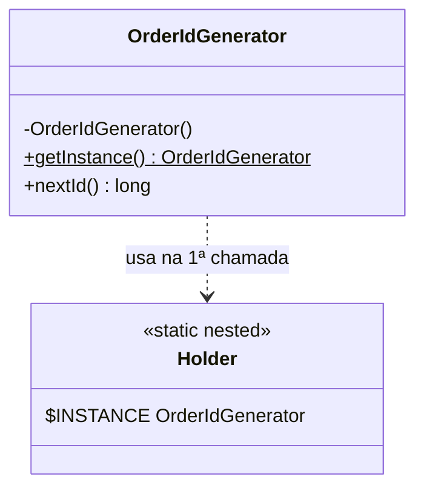
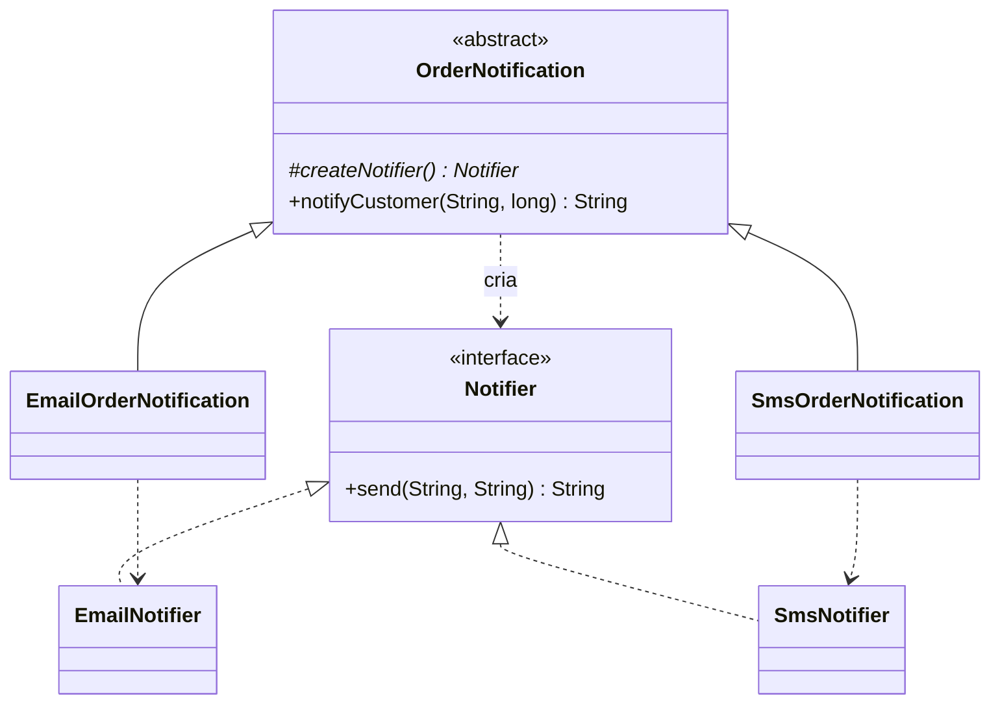
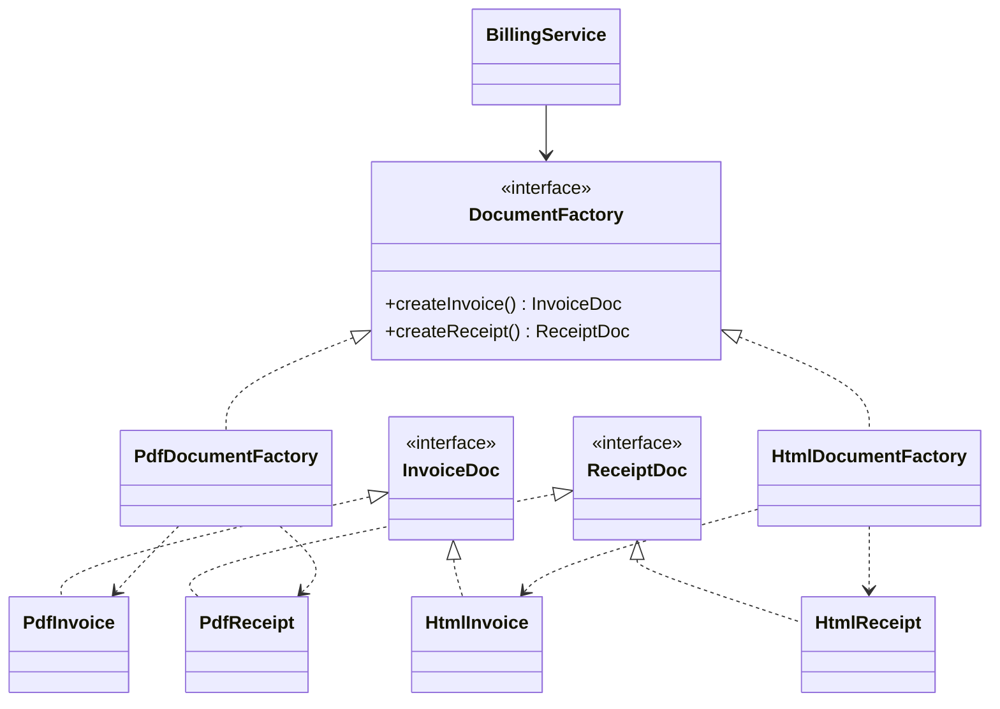
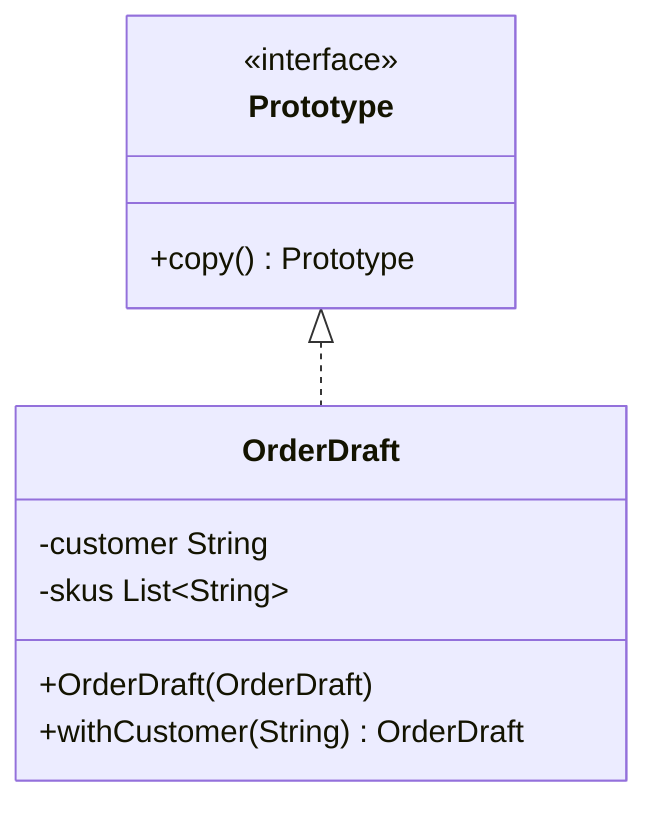

# Padrões criacionais (GoF)

> **Resumo:** Singleton, Factory Method, Abstract Factory, Builder e Prototype: padrões que controlam **como e quando objetos são criados**, tirando o `new` do código de negócio. No Spring, o contêiner assume boa parte desse papel; entender o padrão clássico mostra o que ele automatiza e onde o "singleton do Spring" difere do GoF.
> **Pré-requisitos:** [01-introducao](01-introducao.md), [04-ciclo-de-vida-e-escopos](../02-spring-core/04-ciclo-de-vida-e-escopos.md), [03-application-context-e-beans](../02-spring-core/03-application-context-e-beans.md).
> **Versões:** Java 25, Spring Framework 7.0.8. Todo o código desta página foi compilado e executado (`/tmp/validacao/s13`).

## 1. Definição

**Padrões criacionais** abstraem o processo de instanciação. Em vez de o cliente chamar `new ConcreteClass(...)`, ele pede o objeto a algo (um método, uma fábrica, um builder) que decide **qual classe** instanciar, **quantas instâncias** existem e **como** configurá-las.

Problema que resolvem: `new` acopla o chamador a uma **classe concreta**, a seus parâmetros de construtor e à política de ciclo de vida ([§3.3 de 01-introducao](01-introducao.md#33-acoplamento-e-coesão-em-termos-mecânicos)).

| Padrão | Pergunta que responde | Em uma frase |
|---|---|---|
| **Singleton** | quantas instâncias? | garante **uma** instância e um ponto de acesso |
| **Factory Method** | qual classe? | um método (sobrescrevível) decide o tipo do produto |
| **Abstract Factory** | qual *família* de classes? | cria famílias de objetos relacionados sem citar as classes |
| **Builder** | como montar passo a passo? | separa a construção de um objeto complexo da sua representação |
| **Prototype** | como copiar? | cria novos objetos **clonando** um existente |

## 2. Conceitos fundamentais

### 2.1 Por que esconder o `new`

```java
// Acoplado: o serviço conhece a classe concreta e o jeito de criá-la
class NotificationService {
    void notify(String to) { new SmtpEmailSender("smtp.corp", 587, true).send(to, "..."); }
}
```

Problemas: trocar o canal exige editar a classe; testar exige um servidor SMTP; qualquer mudança de construtor se propaga. Os padrões criacionais (e a DI do Spring) movem essa decisão para outro lugar.

### 2.2 Duas formas de escolher "qual classe"

- **Herança** (Factory Method): a subclasse decide.
- **Composição** (Abstract Factory, e a DI em geral): você recebe um *objeto fábrica* e delega.

A composição é preferida ([01-introducao §2.3](01-introducao.md#23-os-três-princípios-por-trás-de-quase-todos-os-padrões)).

## 3. Como funciona por dentro

### 3.1 Singleton e a JVM

A garantia de "uma instância" depende de **como a JVM inicializa classes**: a inicialização de uma classe (`<clinit>`) é **executada uma única vez e sob lock interno**, de forma thread-safe ([02-jvm-por-dentro, ciclo de vida da classe](../01-java/02-jvm-por-dentro.md)). Os idiomas seguros (enum, holder) usam essa garantia; o *double-checked locking* a reimplementa à mão e exige `volatile` por causa do Java Memory Model ([12-concorrencia](../01-java/12-concorrencia.md)).

### 3.2 Factory no Spring: `BeanFactory` e `FactoryBean`

O `ApplicationContext` é, literalmente, uma fábrica: `getBean(...)` devolve instâncias conforme a `BeanDefinition` ([03-application-context-e-beans](../02-spring-core/03-application-context-e-beans.md)). Um método `@Bean` é um **factory method** que o contêiner invoca por reflection ([06-como-java-e-spring-conversam](../02-spring-core/06-como-java-e-spring-conversam.md)). Para objetos cuja criação é complexa, existe a interface `FactoryBean<T>`: o bean registrado é a fábrica, mas `getBean("nome")` devolve **o produto** (`getObject()`), e `getBean("&nome")` devolve a própria fábrica (validado em §5.2).

### 3.3 Cópia: rasa vs profunda

`Object.clone()` faz **cópia rasa** (*shallow*): copia os campos; referências continuam apontando para os **mesmos** objetos. Cópia profunda (*deep*) duplica também os objetos referenciados. Esse é o centro do padrão Prototype e a razão de `Cloneable` ser considerado um design ruim (§5.5).

## 4. Evolução histórica

Os cinco padrões vêm do GoF (1994). O que mudou no Java: **enum** (Java 5) virou o Singleton recomendado; **records** (16) e `List.copyOf` simplificam imutabilidade e *with-ers*; o **contêiner de DI** substituiu a maior parte dos Singletons e Factories escritos à mão (Spring, desde 2003; ver [01-o-que-e-spring §4](../02-spring-core/01-o-que-e-spring.md)). *Static factory methods* (`List.of`, `Optional.of`) são hoje a forma mais comum de "fábrica" em Java ([00-evolucao-do-java](../01-java/00-evolucao-do-java.md)).

## 5. Exemplos práticos

### 5.1 Singleton

**Problema:** precisa existir exatamente uma instância (gerador de IDs, tabela de configuração, *registry*), acessível globalmente.

**Solução:** construtor privado + ponto de acesso estático.



Três implementações, da melhor para a pior:

```java
// 1) ENUM: thread-safe, serialização segura, resistente a reflection (recomendado quando basta)
enum AppClock { INSTANCE; long now() { return System.nanoTime(); } }

// 2) Initialization-on-demand holder: preguiçoso e thread-safe, sem synchronized
final class OrderIdGenerator {
    private OrderIdGenerator() { System.out.println("OrderIdGenerator criado"); }
    private static class Holder { static final OrderIdGenerator INSTANCE = new OrderIdGenerator(); }
    static OrderIdGenerator getInstance() { return Holder.INSTANCE; }
    private long next = 0;
    synchronized long nextId() { return ++next; }
}

// 3) Double-checked locking: correto SÓ com volatile; mais código, mesmo resultado
final class ClassicSingleton {
    private static volatile ClassicSingleton instance;
    private ClassicSingleton() {}
    static ClassicSingleton getInstance() {
        ClassicSingleton local = instance;
        if (local == null) {
            synchronized (ClassicSingleton.class) {
                local = instance;
                if (local == null) instance = local = new ClassicSingleton();
            }
        }
        return local;
    }
}
```

Saída observada: a mensagem `OrderIdGenerator criado` só aparece **na primeira chamada** a `getInstance()`, porque a classe `Holder` só é carregada e inicializada nesse momento.

**Reflection quebra o Singleton clássico; o enum resiste** (executado):

```java
Constructor<ClassicSingleton> c = ClassicSingleton.class.getDeclaredConstructor();
c.setAccessible(true);
c.newInstance() != ClassicSingleton.getInstance();     // true: segunda instância criada!

var ec = EnumSingleton.class.getDeclaredConstructors()[0];
ec.setAccessible(true);
ec.newInstance("X", 1);       // IllegalArgumentException: Cannot reflectively create enum objects
```

**Onde o JDK usa:** `Runtime.getRuntime()` (uma instância por JVM); `Desktop.getDesktop()`; `Collections.emptyList()` (instância compartilhada imutável).

**O "jeito Spring": singleton ≠ Singleton.** O escopo `singleton` é **uma instância por bean e por contexto**, sem construtor privado:

```java
class PriceTable {}
@Configuration class PricingConfig { @Bean PriceTable priceTable() { return new PriceTable(); } }

try (var ctx1 = new AnnotationConfigApplicationContext(PricingConfig.class);
     var ctx2 = new AnnotationConfigApplicationContext(PricingConfig.class)) {
    ctx1.getBean(PriceTable.class) == ctx1.getBean(PriceTable.class);   // true  (mesmo contexto)
    ctx1.getBean(PriceTable.class) == ctx2.getBean(PriceTable.class);   // false (contextos diferentes) - executado
}
```

| | Singleton GoF | `singleton` do Spring |
|---|---|---|
| Escopo | classe / *classloader* | bean / `ApplicationContext` |
| Garantia | construtor privado | só o contêiner garante |
| `new` direto | impossível | possível (e cria outra instância) |
| Testabilidade | ruim (estado global) | boa (troca por mock) |
| Estado | frequentemente mutável (problema) | deve ser *stateless* ou thread-safe |

> **Regra:** em Spring, prefira o bean `singleton` e **não** escreva `getInstance()`. Um bean singleton com estado mutável tem os mesmos problemas de concorrência do Singleton clássico ([04-ciclo-de-vida-e-escopos](../02-spring-core/04-ciclo-de-vida-e-escopos.md)).

### 5.2 Factory Method

**Problema:** uma classe tem um algoritmo fixo, mas o **tipo de objeto** que ele usa varia, e você não quer `if (tipo == ...) new ...` espalhado.

**Solução:** o algoritmo chama um método abstrato (`createNotifier`) que as subclasses implementam.



```java
interface Notifier { String send(String to, String msg); }
record EmailNotifier() implements Notifier { public String send(String to, String m) { return "EMAIL para " + to + ": " + m; } }
record SmsNotifier()   implements Notifier { public String send(String to, String m) { return "SMS para " + to + ": " + m; } }

abstract class OrderNotification {
    protected abstract Notifier createNotifier();                 // <-- Factory Method
    String notifyCustomer(String customer, long orderId) {
        return createNotifier().send(customer, "Pedido " + orderId + " confirmado");
    }
}
class EmailOrderNotification extends OrderNotification { protected Notifier createNotifier() { return new EmailNotifier(); } }
class SmsOrderNotification   extends OrderNotification { protected Notifier createNotifier() { return new SmsNotifier(); } }
```

Saída: `EMAIL para ana: Pedido 7 confirmado` e `SMS para ana: Pedido 7 confirmado`.

**A variante que você mais usa: *static factory method*** (não é o GoF literal, mas é a ideia moderna: Joshua Bloch, *Effective Java*, Item 1). Vantagens sobre construtor: tem **nome**, pode **devolver cache/subtipo** e não precisa criar objeto novo.

```java
record Money(BigDecimal amount, String currency) {
    static Money of(String amount, String currency) { return new Money(new BigDecimal(amount), currency); }
    static Money zero(String currency)               { return new Money(BigDecimal.ZERO, currency); }
}
```

**Onde o JDK usa:**
- `Integer.valueOf(127) == Integer.valueOf(127)` é `true`: a factory devolve instância em cache (ver [03-tipos-e-memoria](../01-java/03-tipos-e-memoria.md)).
- `List.of(...)`/`Map.of()` devolvem implementações internas diferentes conforme o tamanho (observado: `List12` e `MapN`), e o chamador só vê `List`/`Map`.
- `Calendar.getInstance()`, `NumberFormat.getInstance()`, `Optional.of`, `Path.of`.

**Onde o Spring usa:**
- `BeanFactory`/`ApplicationContext` (fábrica geral); métodos `@Bean` (factory methods).
- `FactoryBean<T>`: o produto é diferente da fábrica (executado):

```java
class NotifierFactoryBean implements FactoryBean<Notifier> {
    public Notifier getObject()       { return new EmailNotifier(); }   // o PRODUTO
    public Class<?> getObjectType()   { return Notifier.class; }
}
@Configuration class NotifierConfig { @Bean NotifierFactoryBean notifier() { return new NotifierFactoryBean(); } }

ctx.getBean("notifier").getClass();    // EmailNotifier        (o produto)
ctx.getBean("&notifier").getClass();   // NotifierFactoryBean  (a fábrica)
```

`getObject()` é chamado uma vez no primeiro acesso (singleton) e o produto é guardado em cache. É o mecanismo por trás de vários componentes de infraestrutura do próprio Spring (por exemplo `ProxyFactoryBean`, da AOP programática).

**O "jeito Spring":** `@Bean` + DI no lugar de fábrica escrita à mão; uma fábrica explícita só vale quando o **tipo é decidido em tempo de execução** (ex.: `Map<String, Notifier>` indexado pelo canal do pedido, ver Strategy em [04-comportamentais](04-comportamentais.md)).

### 5.3 Abstract Factory

**Problema:** o sistema precisa criar **famílias de objetos que combinam entre si** (documentos PDF *ou* HTML, nunca misturados) sem depender das classes concretas.

**Solução:** uma interface de fábrica com um método para cada produto da família; cada família tem sua implementação.



```java
interface InvoiceDoc { String render(long orderId); }
interface ReceiptDoc { String render(long orderId); }

interface DocumentFactory {                       // cria a FAMÍLIA inteira
    InvoiceDoc createInvoice();
    ReceiptDoc createReceipt();
}
class PdfDocumentFactory implements DocumentFactory {
    public InvoiceDoc createInvoice() { return new PdfInvoice(); }
    public ReceiptDoc createReceipt() { return new PdfReceipt(); }
}
class HtmlDocumentFactory implements DocumentFactory {
    public InvoiceDoc createInvoice() { return new HtmlInvoice(); }
    public ReceiptDoc createReceipt() { return new HtmlReceipt(); }
}

class BillingService {                            // só conhece as interfaces
    private final DocumentFactory docs;
    BillingService(DocumentFactory docs) { this.docs = docs; }
    String close(long orderId) {
        return docs.createInvoice().render(orderId) + " | " + docs.createReceipt().render(orderId);
    }
}
```

Saída: `[PDF] Nota fiscal 1 | [PDF] Recibo 1` com a fábrica PDF; `<h1>Nota fiscal 1</h1> | <p>Recibo 1</p>` com a HTML. A garantia do padrão é a **consistência da família**: é impossível receber uma nota PDF com recibo HTML.

**Diferença para Factory Method:** Factory Method cria **um** produto por herança; Abstract Factory cria **vários produtos relacionados** por composição (objeto fábrica).

**Onde o JDK usa:** `DocumentBuilderFactory.newInstance()`, `TransformerFactory`, `SAXParserFactory` (JAXP) escolhem a família de implementação (via `ServiceLoader`); no ambiente de teste, devolveu `com.sun.org.apache.xerces.internal.jaxp.DocumentBuilderFactoryImpl`. Também `java.sql.Connection` como fábrica de `Statement`/`PreparedStatement` da mesma implementação de driver.

**O "jeito Spring":** o contêiner escolhe a fábrica por perfil ou condição, e o serviço não muda (executado com perfis `pdf` e `web`):

```java
@Configuration
class DocumentConfig {
    @Bean @Profile("pdf")  DocumentFactory pdfFactory()  { return new PdfDocumentFactory(); }
    @Bean @Profile("!pdf") DocumentFactory htmlFactory() { return new HtmlDocumentFactory(); }
    @Bean BillingService billingService(DocumentFactory f) { return new BillingService(f); }
}
```

No Spring Boot, o equivalente em auto-configuração é `@ConditionalOnProperty`/`@ConditionalOnClass` ([02-auto-configuracao](../03-spring-boot/02-auto-configuracao.md)).

### 5.4 Builder

**Problema:** objeto com **muitos parâmetros, vários opcionais** e invariantes a validar. Alternativas ruins: construtor *telescópico* (`new Order(c, items, null, null)`) ou setters (objeto fica parcialmente válido, mutável).

**Solução:** um objeto auxiliar acumula os dados com métodos encadeados (*fluent interface*) e `build()` valida e cria o objeto final, imutável.

```mermaid
classDiagram
    class Order {
        -customerId String
        -items List~OrderItem~
        -couponCode String
        -note String
        +builder(String) Builder$
        +total() BigDecimal
    }
    class Builder {
        +item(String, int, String) Builder
        +coupon(String) Builder
        +note(String) Builder
        +build() Order
    }
    Order +-- Builder
    Builder ..> Order : cria
```

```java
record OrderItem(String sku, int quantity, BigDecimal unitPrice) {
    OrderItem {
        Objects.requireNonNull(sku);
        if (quantity <= 0) throw new IllegalArgumentException("quantity must be > 0");
    }
    BigDecimal total() { return unitPrice.multiply(BigDecimal.valueOf(quantity)); }
}

final class Order {
    private final String customerId;
    private final List<OrderItem> items;
    private final String couponCode;      // opcional
    private final String note;            // opcional

    private Order(Builder b) {
        this.customerId = b.customerId;
        this.items = List.copyOf(b.items);          // cópia imutável: o builder não vaza estado
        this.couponCode = b.couponCode;
        this.note = b.note;
    }
    static Builder builder(String customerId) { return new Builder(customerId); }
    BigDecimal total() { return items.stream().map(OrderItem::total).reduce(BigDecimal.ZERO, BigDecimal::add); }

    static final class Builder {
        private final String customerId;
        private final List<OrderItem> items = new ArrayList<>();
        private String couponCode, note;

        private Builder(String customerId) { this.customerId = Objects.requireNonNull(customerId, "customerId"); }
        Builder item(String sku, int qty, String price) { items.add(new OrderItem(sku, qty, new BigDecimal(price))); return this; }
        Builder coupon(String code) { this.couponCode = code; return this; }
        Builder note(String note)   { this.note = note; return this; }

        Order build() {
            if (items.isEmpty()) throw new IllegalStateException("order needs at least one item");  // invariante
            return new Order(this);
        }
    }
}

Order o = Order.builder("c-1").item("SKU-1", 2, "10.00").item("SKU-2", 1, "5.50").coupon("PROMO10").build();
// Order[c-1, 2 itens, total=25.50, coupon=PROMO10, note=null]
Order.builder("c-1").build();   // IllegalStateException: order needs at least one item
```

**Quando um `record` basta:** com poucos campos, use o construtor canônico do record com validação compacta; builder só compensa com **muitos opcionais** ou **construção em etapas**. Para "mudar um campo", um *with-er* (`address.withCity("Rio")`) resolve.

**Lombok:** `@Builder` gera o boilerplate. É conveniente, mas esconde o código gerado e não valida invariantes sozinho (use `@Builder` num construtor que valida).

**Onde o JDK usa:** `StringBuilder`; `HttpRequest.newBuilder(uri).header(...).GET().build()` (executado: `GET http://localhost/orders`); `Stream.builder()`, `ProcessBuilder`, `Locale.Builder`.

**Onde o Spring usa:** `UriComponentsBuilder` (executado: `UriComponentsBuilder.fromUriString("http://localhost:8080").path("/orders/{id}").queryParam("expand","items").build(42)` produz `http://localhost:8080/orders/42?expand=items`), `BeanDefinitionBuilder` ([03-application-context-e-beans](../02-spring-core/03-application-context-e-beans.md)), `RestClient.builder()`, `MockMvcRequestBuilders` ([10-testes-no-spring-boot](../03-spring-boot/10-testes-no-spring-boot.md)), `SpringApplicationBuilder` (Boot).

**Diferença para Abstract Factory:** Builder constrói **um** objeto complexo **passo a passo**; Abstract Factory entrega **famílias** prontas de uma vez.

### 5.5 Prototype

**Problema:** criar um objeto do zero é **caro** ou complicado, mas você já tem um parecido (um rascunho de pedido, uma configuração padrão) que serve de modelo.

**Solução:** o objeto sabe se copiar; o cliente clona o protótipo e ajusta.



**Armadilha de `Cloneable`/`Object.clone()`** (executado): a cópia é rasa e a lista é **compartilhada**:

```java
class Draft implements Cloneable {
    String customer;
    List<String> skus = new ArrayList<>();
    @Override public Draft clone() {
        try { return (Draft) super.clone(); } catch (CloneNotSupportedException e) { throw new AssertionError(e); }
    }
}
Draft d1 = new Draft("ana"); d1.skus.add("A");
Draft d2 = d1.clone(); d2.skus.add("B");
d1.skus;               // [A, B]   <- d1 foi alterado pelo clone!
d1.skus == d2.skus;    // true
```

`Cloneable` é considerado mal desenhado (interface sem métodos, `clone()` protegido, `final` fields incompatíveis, exceção checked). A recomendação (Bloch, *Effective Java*) é **construtor de cópia** ou *with-ers*, com cópia **profunda explícita**:

```java
class OrderDraft {
    private final String customer;
    private final List<String> skus;
    OrderDraft(String customer, List<String> skus) { this.customer = customer; this.skus = new ArrayList<>(skus); }
    OrderDraft(OrderDraft other)       { this(other.customer, other.skus); }       // construtor de cópia (cópia profunda da lista)
    OrderDraft withCustomer(String c)  { return new OrderDraft(c, skus); }
    void add(String sku) { skus.add(sku); }
}
// o1 = ana[A, X]; o2 = new OrderDraft(o1) + add("Y") -> o2 = ana[A, X, Y], o1 permanece ana[A, X] (executado)
```

Para tipos imutáveis (`record`, `String`) **não é preciso copiar**: compartilhar é seguro.

**Onde o JDK usa:** `ArrayList.clone()`, `HashMap.clone()` (rasas), `new ArrayList<>(outra)` (construtor de cópia), `List.copyOf`, arrays (`array.clone()`).

**Onde o Spring usa:** o escopo **`prototype`** (uma instância nova a cada `getBean`; executado: instâncias distintas) e `BeanUtils.copyProperties` (cópia de propriedades entre objetos, útil em mapeamento DTO). Atenção ao injetar um `prototype` num `singleton`: a injeção acontece uma vez ([04-ciclo-de-vida-e-escopos](../02-spring-core/04-ciclo-de-vida-e-escopos.md)); use `ObjectProvider<T>` para obter uma nova a cada uso ([02-ioc-e-injecao-de-dependencia](../02-spring-core/02-ioc-e-injecao-de-dependencia.md)).

```java
class ShoppingCart {
    final List<String> items = new ArrayList<>();
}
@Configuration class CartConfig { @Bean @Scope("prototype") ShoppingCart cart() { return new ShoppingCart(); } }
```

### 5.6 Comparativo

| Padrão | Cria | Mecanismo | Alternativa moderna em Java/Spring |
|---|---|---|---|
| Singleton | 1 instância | construtor privado | `enum`; bean `singleton` |
| Factory Method | 1 produto | herança | *static factory*; `@Bean` |
| Abstract Factory | família | composição | `@Profile`/`@Conditional*` + interface |
| Builder | 1 objeto complexo | passo a passo | record + compact constructor; Lombok `@Builder` |
| Prototype | cópia | clone/copy | construtor de cópia; `with-er`; escopo `prototype` |

## 6. Configurações e anotações relevantes

| Anotação / API | Para que serve | Exemplo |
|---|---|---|
| `@Bean` | *factory method* gerenciado pelo contêiner | `@Bean PriceTable priceTable() { ... }` |
| `@Scope("singleton"\|"prototype")` | define o ciclo de vida (Singleton/Prototype) | `@Scope("prototype")` |
| `FactoryBean<T>` | fábrica cujo produto é o bean exposto (`&nome` devolve a fábrica) | `class X implements FactoryBean<Notifier>` |
| `@Profile` | escolhe a *família* (Abstract Factory) por ambiente | `@Profile("pdf")` |
| `@Primary` / `@Qualifier` | desempate entre implementações | `@Qualifier("pdfFactory")` |
| `ObjectProvider<T>` | obter instância (nova se `prototype`) sob demanda | `provider.getObject()` |
| `@Lazy` | adia a criação do bean | `@Lazy @Component class X` |
| `@ConditionalOnProperty` (Boot) | escolhe implementação por propriedade | `@ConditionalOnProperty("docs.format")` |
| `enum` | Singleton seguro | `enum AppClock { INSTANCE }` |
| `record` | produto imutável com validação compacta | `record Money(...) { Money { ... } }` |

## 7. Quando usar e quando NÃO usar

| Padrão | Use quando | NÃO use quando |
|---|---|---|
| **Singleton** | recurso único realmente global e *stateless* (relógio, tabela de constantes) | for só "para economizar objeto"; em Spring (use o escopo); estado mutável compartilhado |
| **Factory Method** | tipo do produto varia e você quer nomear/cachear a criação | só há um tipo e nenhuma razão para variar (um `new` é suficiente) |
| **Abstract Factory** | há **famílias** que precisam combinar (temas de UI, drivers, formatos) | há um único produto (use Factory Method) ou famílias que não se combinam |
| **Builder** | muitos parâmetros opcionais, construção em etapas, invariantes | poucos campos (record resolve) |
| **Prototype** | criar do zero é caro, ou há configurações-modelo | os objetos são imutáveis (compartilhe) ou o grafo é cíclico/complexo (cópia profunda difícil) |

## 8. Erros comuns e boas práticas

| Erro | Consequência | Prática melhor |
|---|---|---|
| Singleton com estado mutável e sem sincronização | *race conditions* | stateless, ou estado thread-safe ([12-concorrencia](../01-java/12-concorrencia.md)) |
| Double-checked locking sem `volatile` | outra thread vê objeto parcialmente construído | holder idiom ou `enum` |
| Confundir `singleton` do Spring com GoF | duas instâncias em dois contextos (testes de integração com contextos múltiplos) | tratar singleton como "por contexto" |
| Singleton que guarda dados de **usuário/requisição** | vazamento de dados entre usuários | estado por requisição (`@RequestScope`) ou parâmetros |
| `Cloneable` com campos mutáveis | cópia rasa compartilha estado | construtor de cópia com cópia profunda |
| Prototype injetado em singleton | a mesma instância "prototype" para sempre | `ObjectProvider<T>` |
| Builder sem validação em `build()` | objetos inválidos circulando | validar invariantes no `build()` |
| Builder mutável reutilizado entre threads | estado compartilhado | um builder por construção |
| Fábrica para tudo | camadas de indireção sem variação real | só quando existe variação |
| Lombok `@Builder` em classe com invariantes | bypass das validações | validar no construtor |

## 9. Perguntas de revisão

1. **Por que o holder idiom é thread-safe sem `synchronized`?**
   <details><summary>Resposta</summary>Porque a JVM garante que a inicialização da classe `Holder` (`<clinit>`) ocorre uma única vez, sob lock interno, na primeira vez que ela é usada. Como `Holder` só é referenciada em `getInstance()`, a criação é preguiçosa.</details>
2. **Qual a diferença entre o singleton do Spring e o Singleton do GoF?**
   <details><summary>Resposta</summary>O do Spring é uma instância por bean **por contexto** e a classe continua instanciável com `new`; o GoF impõe uma instância por classe com construtor privado. Dois `ApplicationContext` produzem duas instâncias do "singleton" (validado).</details>
3. **Qual a diferença entre Factory Method e Abstract Factory?**
   <details><summary>Resposta</summary>Factory Method: um método que cria **um** produto, decidido por subclasse (herança). Abstract Factory: um objeto com **vários** métodos de criação que produzem uma **família** consistente de produtos (composição).</details>
4. **Por que `Object.clone()` é problemático e qual a alternativa?**
   <details><summary>Resposta</summary>Faz cópia rasa (campos de referência ficam compartilhados), a interface `Cloneable` não declara `clone()`, e há conflito com `final`. Prefira construtor de cópia/*with-ers* com cópia profunda explícita ou tipos imutáveis.</details>
5. **O que `getBean("&notifier")` devolve para um `FactoryBean`?**
   <details><summary>Resposta</summary>A própria fábrica (`NotifierFactoryBean`). `getBean("notifier")` devolve o produto de `getObject()` (validado).</details>

## 10. Referências oficiais

- Gamma et al., *Design Patterns* (GoF), 1994: capítulo "Creational Patterns" (livro).
- Joshua Bloch, *Effective Java* (3ª ed.): Item 1 (static factories), Item 2 (builder), Item 3 (singleton com enum), Item 13 (clone).
- Spring Framework, Bean Scopes: <https://docs.spring.io/spring-framework/reference/core/beans/factory-scopes.html>
- Spring Framework, `FactoryBean` (customizing instantiation logic): <https://docs.spring.io/spring-framework/reference/core/beans/factory-extension.html>
- Spring Framework, Container overview: <https://docs.spring.io/spring-framework/reference/core/beans.html>
- Java SE API (`HttpRequest.Builder`, `Runtime`): <https://docs.oracle.com/en/java/javase/25/docs/api/>
- Dev.java: <https://dev.java/>
