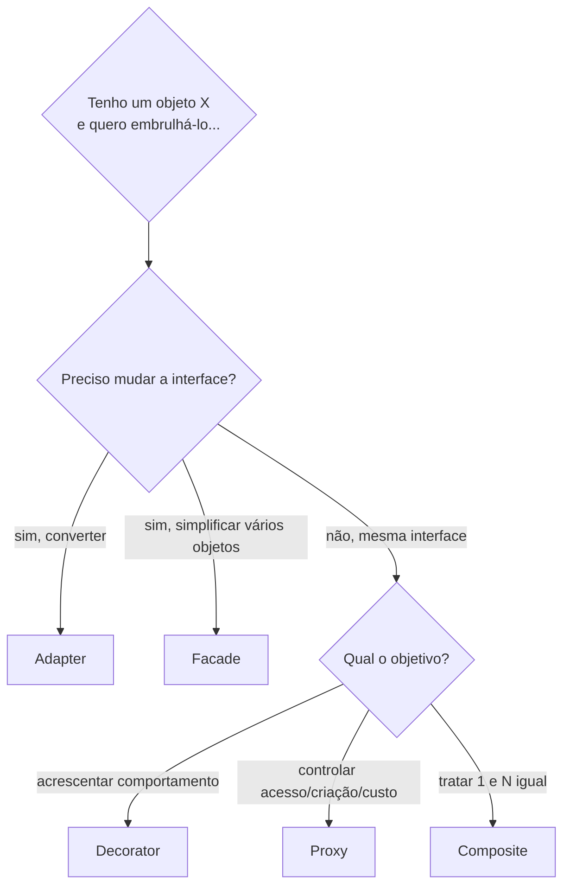
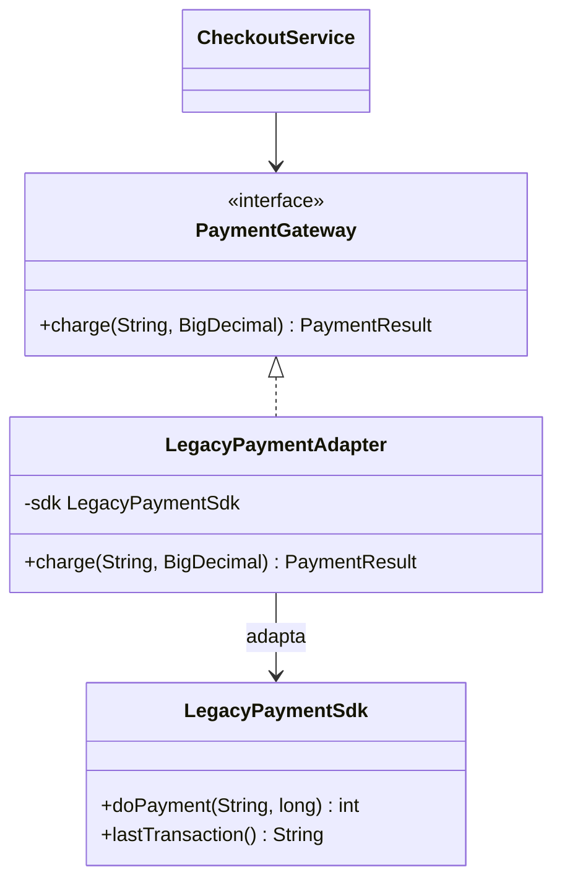
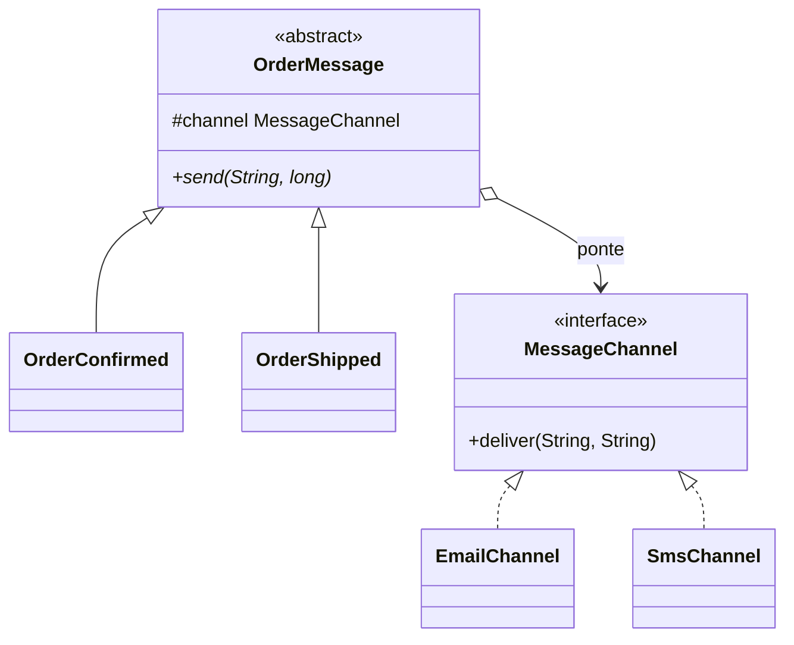
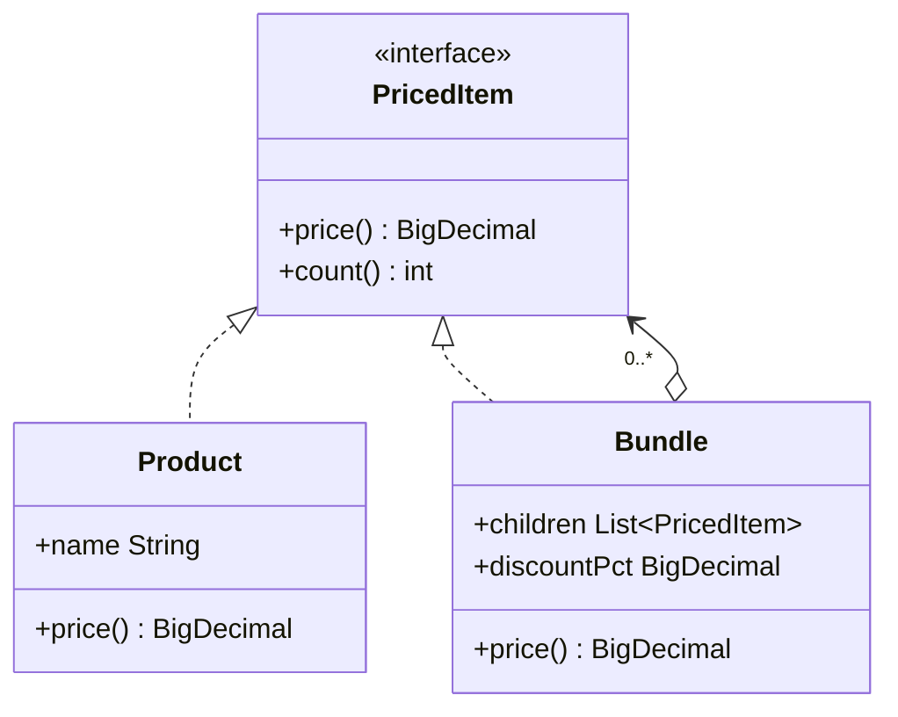
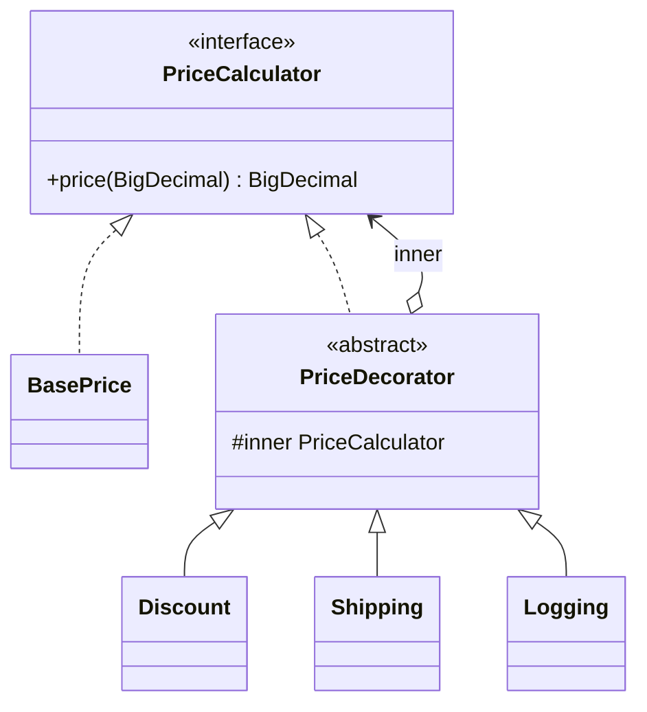
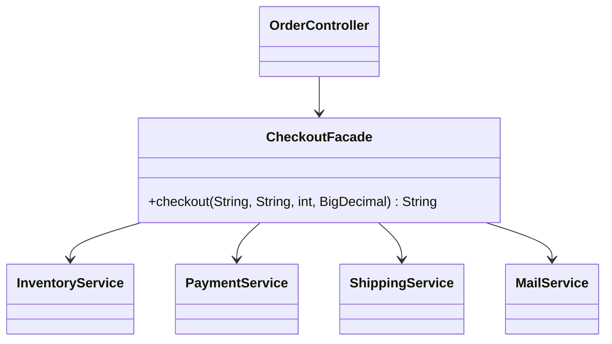
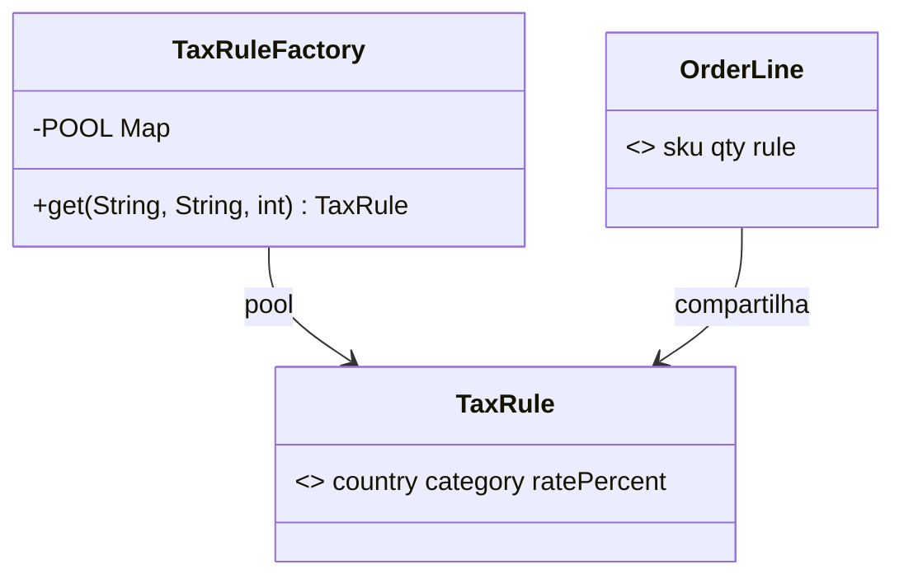
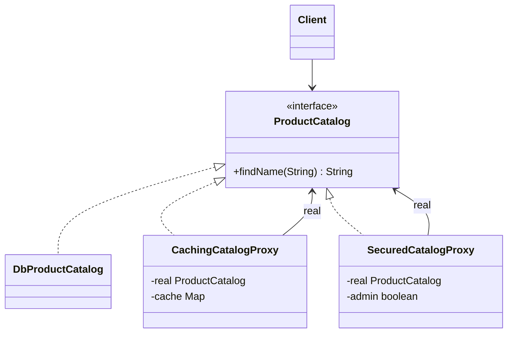

# Padrões estruturais (GoF)

> **Resumo:** Adapter, Bridge, Composite, Decorator, Facade, Flyweight e Proxy: padrões que dizem **como classes e objetos se combinam** em estruturas maiores sem acoplá-los demais. Quase todos usam **composição + interface comum**; a diferença está na *intenção*. Em Spring, vários aparecem como infraestrutura (AOP = Proxy/Decorator, `HandlerAdapter` = Adapter).
> **Pré-requisitos:** [01-introducao](01-introducao.md), [02-criacionais](02-criacionais.md), [11-proxies-dinamicos-e-bytecode](../01-java/11-proxies-dinamicos-e-bytecode.md), [07-aop-e-proxies](../02-spring-core/07-aop-e-proxies.md).
> **Versões:** Java 25, Spring Framework 7.0.8, Spring Boot 4.1.2 (somente nomes de classe citados). Todo o código desta página foi compilado e executado (`/tmp/validacao/s13`).

## 1. Definição

**Padrões estruturais** tratam da **composição**: como montar objetos e classes em estruturas maiores mantendo-as flexíveis e eficientes. A pergunta central é "como esses objetos se relacionam?".

Vários têm a **mesma forma** (um objeto que contém outro com a mesma interface) e se distinguem apenas pela **intenção**:

| Padrão | Intenção (o que busca) | Interface do wrapper vs. a do embrulhado |
|---|---|---|
| **Adapter** | fazer uma interface **incompatível** funcionar | **diferente** (converte) |
| **Bridge** | separar **abstração** de **implementação** para variarem independentemente | diferente (duas hierarquias) |
| **Composite** | tratar **parte e todo** uniformemente (árvores) | **igual** (e contém vários) |
| **Decorator** | **acrescentar** comportamento dinamicamente | **igual** |
| **Facade** | oferecer uma interface **simples** a um subsistema complexo | **nova**, mais simples |
| **Flyweight** | **compartilhar** objetos para economizar memória | igual |
| **Proxy** | **controlar o acesso** a outro objeto | **igual** |

## 2. Conceitos fundamentais

### 2.1 Como distinguir os "embrulhos"



**Decorator vs Proxy** é a confusão mais comum: o Decorator é aplicado pelo **cliente** para **enriquecer** (empilha vários, a ordem importa); o Proxy é normalmente **transparente** e **controla** o acesso (cache, segurança, carga preguiçosa, transação) a um objeto que ele geralmente gerencia ou cria.

### 2.2 Princípios por trás

Todos aplicam "composição em vez de herança" e "programe para interface" ([01-introducao §2.3](01-introducao.md#23-os-três-princípios-por-trás-de-quase-todos-os-padrões)). Decorator e Composite também sustentam o **Open/Closed**: estender sem editar.

## 3. Como funciona por dentro

### 3.1 Delegação: o mecanismo comum

Cada padrão se resume a **delegar**: o wrapper guarda uma referência (`inner`/`real`/`channel`) e repassa a chamada, antes/depois/ao invés de executá-la. No bytecode é uma chamada `invokeinterface` sobre o campo. Não há mágica; o custo é uma indireção extra por camada.

### 3.2 Proxies gerados em tempo de execução

O Proxy escrito à mão exige **uma classe por interface**. O JDK gera essas classes em tempo de execução (`java.lang.reflect.Proxy`, [11-proxies-dinamicos-e-bytecode](../01-java/11-proxies-dinamicos-e-bytecode.md)), e o Spring AOP usa isso (ou CGLIB para classes) para aplicar `@Transactional`, `@Cacheable`, etc. ([07-aop-e-proxies](../02-spring-core/07-aop-e-proxies.md)). Por isso a *self-invocation* não passa pelo proxy: `this` é o alvo, não o proxy.

### 3.3 Flyweight e a memória da JVM

Flyweight troca **memória por reuso de referência**: milhares de objetos apontam para a mesma instância imutável. O `Integer.valueOf` cacheia -128..127; o *string pool* faz o mesmo com literais ([03-tipos-e-memoria](../01-java/03-tipos-e-memoria.md), [02-jvm-por-dentro](../01-java/02-jvm-por-dentro.md)). Só é seguro se o estado compartilhado for **imutável**.

## 4. Evolução histórica

Os sete são do GoF (1994). O que mudou: o Proxy deixou de ser escrito à mão com a **API `java.lang.reflect.Proxy` (Java 1.3)** e o **CGLIB/Spring AOP (2004 em diante)**; `sealed` + `record` (Java 17/16) tornaram o **Composite** compacto e verificável pelo compilador; **`java.io`** é o exemplo canônico de Decorator desde o Java 1.0 ([13-io-nio-e-http](../01-java/13-io-nio-e-http.md)). Ver também [00-evolucao-do-java](../01-java/00-evolucao-do-java.md).

⚠️ VERIFICAR: versões do JDK em que cada API apareceu (Proxy 1.3) foram escritas de memória.

## 5. Exemplos práticos

### 5.1 Adapter

**Problema:** o domínio espera `PaymentGateway`, mas o SDK de terceiros expõe outra API (centavos em `long`, código `int`), e você **não pode alterá-lo**.

**Solução:** uma classe que implementa a interface esperada e **traduz** para o SDK.



```java
interface PaymentGateway { PaymentResult charge(String customerId, BigDecimal amount); }
record PaymentResult(boolean approved, String transactionId) {}

class LegacyPaymentSdk {                                   // não pode ser alterada
    int doPayment(String account, long cents) { return cents < 100_000 ? 0 : 51; }   // 0 = ok
    String lastTransaction() { return "TX-0001"; }
}

class LegacyPaymentAdapter implements PaymentGateway {     // Adapter por composição
    private final LegacyPaymentSdk sdk;
    LegacyPaymentAdapter(LegacyPaymentSdk sdk) { this.sdk = sdk; }
    public PaymentResult charge(String customerId, BigDecimal amount) {
        long cents = amount.movePointRight(2).longValueExact();      // BigDecimal -> centavos
        int code = sdk.doPayment(customerId, cents);                 // código 0 = aprovado
        return new PaymentResult(code == 0, code == 0 ? sdk.lastTransaction() : null);
    }
}
```

Saída: `charge("c-1", 49.90)` → `PaymentResult[approved=true, transactionId=TX-0001]`; `charge("c-1", 2000.00)` → `approved=false`. Observe `longValueExact()`: lança `ArithmeticException` se houver fração, evitando perder centavos em silêncio.

**Adapter de classe (herança) vs de objeto (composição):** o de objeto (acima) é preferível, pois não prende a uma classe base e permite adaptar subclasses.

**Onde o JDK usa:**
- `InputStreamReader` adapta `InputStream` (bytes) a `Reader` (chars): `new BufferedReader(new InputStreamReader(bytesUtf8, UTF_8)).readLine()` devolveu `olá` (executado).
- `Arrays.asList(array)` adapta um array à interface `List` e escreve **através** do array: `view.set(0, "z")` muda `arr[0]` (executado).
- `Executors.callable(Runnable)` adapta `Runnable` a `Callable`; `Collections.list(Enumeration)`.

**Onde o Spring usa:** o exemplo canônico é o **`HandlerAdapter`**. O `DispatcherServlet` precisa invocar *handlers* de tipos diferentes (`@RequestMapping` methods, `HttpRequestHandler`, `Controller`) e para isso consulta uma lista de adaptadores: `supports(handler)` + `handle(request, response, handler)` ([04-web-mvc](../03-spring-boot/04-web-mvc.md)). `RequestMappingHandlerAdapter` adapta métodos anotados; `HttpRequestHandlerAdapter` adapta `HttpRequestHandler`.

**O "jeito Spring":** um adaptador é um `@Component` que implementa a interface do domínio; trocar de fornecedor é trocar o bean (`@Primary`/`@Profile`), e o domínio não conhece o SDK (isso também é o **adaptador de saída (porta/adaptador)** da arquitetura hexagonal; ver [06-padroes-arquiteturais](06-padroes-arquiteturais.md)).

### 5.2 Bridge

**Problema:** duas dimensões de variação (tipo de mensagem × canal de envio). Com herança pura, `N × M` subclasses (`ConfirmedByEmail`, `ConfirmedBySms`, `ShippedByEmail`...).

**Solução:** duas hierarquias independentes, ligadas por **composição** (a "ponte").



```java
interface MessageChannel { void deliver(String to, String text); }           // implementação: COMO enviar
class EmailChannel implements MessageChannel { public void deliver(String to, String t) { System.out.println("email -> " + to + ": " + t); } }
class SmsChannel   implements MessageChannel { public void deliver(String to, String t) { System.out.println("sms   -> " + to + ": " + t.substring(0, Math.min(20, t.length()))); } }

abstract class OrderMessage {                                               // abstração: O QUE enviar
    protected final MessageChannel channel;
    protected OrderMessage(MessageChannel channel) { this.channel = channel; }
    abstract void send(String to, long orderId);
}
class OrderConfirmed extends OrderMessage {
    OrderConfirmed(MessageChannel c) { super(c); }
    void send(String to, long id) { channel.deliver(to, "Pedido " + id + " confirmado. Obrigado pela compra!"); }
}
class OrderShipped extends OrderMessage {
    OrderShipped(MessageChannel c) { super(c); }
    void send(String to, long id) { channel.deliver(to, "Pedido " + id + " saiu para entrega."); }
}

new OrderConfirmed(new EmailChannel()).send("ana@x.com", 1);   // email -> ana@x.com: Pedido 1 confirmado. ...
new OrderConfirmed(new SmsChannel()).send("+5511999", 1);       // sms   -> +5511999: Pedido 1 confirmado.
new OrderShipped(new SmsChannel()).send("+5511999", 1);         // qualquer combinação, sem nova classe
```

Com 2 mensagens + 2 canais, são **4 classes** em vez de 4 combinações; com 10 + 10 seriam 20 em vez de 100.

**Bridge vs Adapter:** Adapter é aplicado **depois** que duas interfaces já existem e são incompatíveis (remendo); Bridge é decidido **antes**, no design, para que as duas partes variem livremente. **Bridge vs Strategy:** a estrutura é parecida (objeto recebe outro por composição); Strategy troca **um algoritmo**, Bridge organiza **duas hierarquias** inteiras.

**Onde o JDK/ecossistema usa:** JDBC é o exemplo mais citado: `java.sql.Connection`/`Statement` (abstração) separados dos *drivers* (implementação), ligados por `DriverManager`/`DataSource`. Frameworks de log com API + *binding* (SLF4J) seguem ideia semelhante. ⚠️ VERIFICAR: a classificação desses exemplos como "Bridge" é debatida; muitos autores os chamam de "abstração por interface" ou facade. Em Spring não há um exemplo canônico evidente; o uso real é o mesmo do código acima: um serviço com um `Notifier` injetado.

**O "jeito Spring":** injete o canal (`MessageChannel` aqui é só nosso nome; **não** é o `org.springframework.messaging.MessageChannel`, evite o conflito de nomes no seu projeto):

<!-- não compilado -->
```java
@Component
class OrderConfirmedNotification {
    private final Notifier notifier;          // ponte: qual canal vem do contêiner
    OrderConfirmedNotification(Notifier notifier) { this.notifier = notifier; }
}
```

### 5.3 Composite

**Problema:** estruturas em árvore (categoria > subcategoria > produto; pacote > pacote > item) em que cliente deve tratar **um item** e **um grupo** da mesma forma (ex.: calcular preço).

**Solução:** interface comum para **folha** e **composto**; o composto delega aos filhos.



```java
sealed interface PricedItem permits Product, Bundle {
    BigDecimal price();
    default int count() { return 1; }
}
record Product(String name, BigDecimal price) implements PricedItem {}
record Bundle(String name, List<PricedItem> children, BigDecimal discountPct) implements PricedItem {
    public BigDecimal price() {
        BigDecimal sum = children.stream().map(PricedItem::price).reduce(BigDecimal.ZERO, BigDecimal::add);
        return sum.multiply(BigDecimal.ONE.subtract(discountPct.movePointLeft(2)));
    }
    @Override public int count() { return children.stream().mapToInt(PricedItem::count).sum(); }
}

var combo = new Bundle("Periféricos", List.of(mouse /*50*/, keyboard /*150*/), new BigDecimal("10"));   // 200 - 10% = 180
var kit   = new Bundle("Kit escritório", List.of(combo, monitor /*800*/), BigDecimal.ZERO);             // 180 + 800
kit.price();   // 980 (executado: "980 em 3 produtos")
```

`sealed` + `record` ([05-recursos-modernos](../01-java/05-recursos-modernos-da-linguagem.md)) deixam o compilador garantir que só existem folha e composto, e permitem também percorrer a árvore com `switch` sobre os dois casos (alternativa ao Visitor; ver [04-comportamentais](04-comportamentais.md)).

**Onde o JDK usa:** Swing/AWT (`Container` contém `Component`s e é, ele próprio, um `Component`).

**Onde o Spring usa (verificado nos JARs):**
- `CompositeCacheManager` (delega a vários `CacheManager`s): `org.springframework.cache.support`.
- `CompositeFilter` (encadeia `Filter`s como se fosse um): `org.springframework.web.filter`.
- `ViewResolverComposite` (`DispatcherServlet` consulta vários *view resolvers*).
- Spring Boot Actuator: `CompositeHealthContributor` em `org.springframework.boot.health.contributor` (um grupo de indicadores de saúde tratado como um só; ver [09-actuator-e-observabilidade](../03-spring-boot/09-actuator-e-observabilidade.md)).

**Armadilhas:** ciclos (um composto que contém a si mesmo → *stack overflow*); operações caras percorrendo a árvore inteira a cada chamada (use cache); expor `add/remove` na interface comum obriga folhas a implementar operações sem sentido (por isso aqui a lista é imutável e vive só no `Bundle`).

### 5.4 Decorator

**Problema:** acrescentar responsabilidades (desconto, frete, log) a um objeto **dinamicamente**, em combinações livres. Com herança: explosão de subclasses (`DiscountedWithShippingAndLogging...`).

**Solução:** decoradores que implementam a **mesma interface** e **contêm** outra instância dela; cada um faz sua parte e delega.



```java
interface PriceCalculator { BigDecimal price(BigDecimal base); }
class BasePrice implements PriceCalculator { public BigDecimal price(BigDecimal base) { return base; } }

abstract class PriceDecorator implements PriceCalculator {
    protected final PriceCalculator inner;
    protected PriceDecorator(PriceCalculator inner) { this.inner = inner; }
}
class Discount extends PriceDecorator {
    private final BigDecimal pct;
    Discount(PriceCalculator in, String pct) { super(in); this.pct = new BigDecimal(pct); }
    public BigDecimal price(BigDecimal base) { return inner.price(base).multiply(BigDecimal.ONE.subtract(pct.movePointLeft(2))); }
}
class Shipping extends PriceDecorator {
    private final BigDecimal fee;
    Shipping(PriceCalculator in, String fee) { super(in); this.fee = new BigDecimal(fee); }
    public BigDecimal price(BigDecimal base) { return inner.price(base).add(fee); }
}
class Logging extends PriceDecorator {
    Logging(PriceCalculator in) { super(in); }
    public BigDecimal price(BigDecimal base) {
        BigDecimal r = inner.price(base);
        System.out.println("  price(" + base + ") = " + r);
        return r;
    }
}
```

**A ordem importa** (executado, base = 100):

```java
new Logging(new Shipping(new Discount(new BasePrice(), "10"), "20")).price(new BigDecimal("100"));  // 110.00  (desconto, depois frete: 90 + 20)
new Logging(new Discount(new Shipping(new BasePrice(), "20"), "10")).price(new BigDecimal("100"));  // 108.00  (frete, depois desconto: 120 - 10%)
```

Como a composição é feita no código do cliente (ou numa configuração), é fácil esquecer que `new A(new B(x))` ≠ `new B(new A(x))`. Documente e teste a ordem.

**Onde o JDK usa:** é o exemplo mais famoso: **`java.io`**.

```java
try (var out = new BufferedWriter(new OutputStreamWriter(new GZIPOutputStream(bytes)))) {   // 3 decorators empilhados
    out.write("pedido ".repeat(100));      // 700 caracteres viram 34 bytes comprimidos (executado)
}
```

Também `Collections.unmodifiableList(...)` (decora uma `List` e lança `UnsupportedOperationException` em escrita; executado), `Collections.synchronizedList`, `Collections.checkedList`.

**Onde o Spring/Servlet usa:** `HttpServletRequestWrapper`/`HttpServletResponseWrapper` (decoram a requisição/resposta, base de muitos filtros), `ContentCachingRequestWrapper` (`org.springframework.web.util`; guarda o corpo para poder lê-lo de novo), `ServerHttpResponseDecorator` (WebFlux; `org.springframework.http.server.reactive`), `BufferingClientHttpRequestFactory` (decora um `ClientHttpRequestFactory` para bufferizar o corpo da resposta).

**Decorator vs herança:** herança fixa o comportamento em tempo de compilação; Decorator permite combinar em tempo de execução. **Decorator vs Proxy:** ver §2.1.

**Jeito Spring:** para decorar um bean existente, use um `@Bean @Primary` que recebe o original, ou, para comportamento transversal (log, transação, cache), **AOP** (proxy). Exemplo de decorator explícito:

<!-- não compilado -->
```java
@Configuration
class PricingConfig {
    @Bean BasePrice basePrice() { return new BasePrice(); }
    @Bean @Primary PriceCalculator priceCalculator(BasePrice base) {       // decora o bean base
        return new Logging(new Discount(base, "10"));
    }
}
```

### 5.5 Facade

**Problema:** concluir uma compra exige chamar estoque, pagamento, envio e e-mail na ordem certa. Cada cliente (controller, job, teste) repetiria o roteiro e dependeria de 4 subsistemas.

**Solução:** uma classe com **uma operação de alto nível** que orquestra os subsistemas e os esconde.



```java
class CheckoutFacade {
    private final InventoryService inventory; private final PaymentService payment;
    private final ShippingService shipping;   private final MailService mail;
    CheckoutFacade(InventoryService i, PaymentService p, ShippingService s, MailService m) { inventory = i; payment = p; shipping = s; mail = m; }

    String checkout(String customer, String sku, int qty, BigDecimal total) {
        if (!inventory.reserve(sku, qty)) throw new IllegalStateException("sem estoque");
        payment.charge(customer, total);
        String tracking = shipping.schedule(customer);
        mail.confirm(customer, tracking);
        return tracking;
    }
}
```

Saída: estoque, pagamento, envio e e-mail, nessa ordem, retornando `TRACK-9`. O cliente só conhece `checkout(...)`.

**Facade não esconde nem proíbe** os subsistemas: quem precisar de controle fino continua podendo usá-los. É só uma **conveniência**.

**Cuidados:** a fachada **não** deve conter regra de negócio nem virar *God Class* ([08-anti-padroes](08-anti-padroes.md)); e, em Spring, o equivalente arquitetural costuma ser a **camada de serviço / *application service*** ([05-padroes-enterprise](05-padroes-enterprise.md)). Se a fachada também controla a **transação**, anote o método com `@Transactional` e lembre-se de que o rollback depende de exceções e do proxy ([09-transacoes](../02-spring-core/09-transacoes.md)). No exemplo acima não há compensação: se `shipping.schedule` falhar depois de `payment.charge`, o cliente foi cobrado e não há desfazimento. Isso é o problema que a **Saga** resolve entre serviços ([07-padroes-de-microsservicos](07-padroes-de-microsservicos.md)).

**Onde o JDK usa:** `java.nio.file.Files` (`Files.readString(path)` esconde canais, decoder de charset e buffers; [13-io-nio-e-http](../01-java/13-io-nio-e-http.md)); `java.net.http.HttpClient` (esconde sockets, TLS e HTTP/2).

**Onde o Spring usa:** componentes que simplificam APIs verbosas, como `JdbcClient`/`JdbcTemplate` (escondem `Connection`, `PreparedStatement`, `ResultSet`; mais precisamente, `JdbcTemplate` é **Template Method**, [04-comportamentais](04-comportamentais.md)), `RestClient` (esconde o cliente HTTP subjacente) e `MockMvc` (esconde a configuração do `DispatcherServlet` nos testes). São facades por *efeito*, mas não é o nome que o Spring dá a elas.

### 5.6 Flyweight

**Problema:** 100 mil objetos `OrderLine` cada um com sua própria `TaxRule("BR","food",7)` idêntica, e só há 2 combinações distintas. Memória e GC desperdiçados.

**Solução:** separar o estado **intrínseco** (compartilhável, imutável: a regra) do **extrínseco** (por uso: sku, quantidade) e manter um *pool* de instâncias compartilhadas por uma fábrica.



```java
record TaxRule(String country, String category, int ratePercent) {}      // imutável: seguro compartilhar

final class TaxRuleFactory {
    private static final Map<String, TaxRule> POOL = new HashMap<>();
    static synchronized TaxRule get(String country, String category, int rate) {
        return POOL.computeIfAbsent(country + ":" + category + ":" + rate, k -> new TaxRule(country, category, rate));
    }
    static int size() { return POOL.size(); }
}
record OrderLine(String sku, int qty, TaxRule rule) {}                   // extrínseco: sku/qty

// 100.000 linhas criadas -> TaxRuleFactory.size() == 2 e lines[0].rule() == lines[2].rule()  (executado)
```

**Onde o JDK usa:** `Integer.valueOf`/`Long.valueOf`/`Short`/`Byte` com cache de **-128 a 127**; `Boolean.valueOf`; `String.intern()` e o *string pool*. Executado:

```java
Integer a = 127, b = 127, c = 128, d = 128;
a == b;   // true   (mesma instância do cache)
c == d;   // false  (fora do cache: instâncias diferentes; sempre use equals)
```

**Onde o Spring usa:** não há um uso canônico. Há caches de metadados por classe (reflection, anotações, `ResolvableType`), mas isso é **cache**, não necessariamente Flyweight. Prefira não forçar essa analogia.

**Flyweight vs Singleton vs cache:** Singleton = uma instância; Flyweight = **poucas** instâncias, uma por valor intrínseco distinto, imutáveis; cache = guarda resultados para evitar recomputar (pode expirar, não precisa ser imutável).

**Quando NÃO usar:** só vale se há **muitíssimos** objetos com estado intrínseco repetido (milhões). Para dezenas, só adiciona complexidade. **Nunca** compartilhe estado mutável.

### 5.7 Proxy

**Problema:** controlar o acesso a um objeto: poupar consultas (cache), restringir (segurança), adiar custo (carga preguiçosa), medir/auditar, acessar remotamente.

**Solução:** um substituto com **a mesma interface** que decide se, quando e como repassar a chamada ao objeto real.



Tipos clássicos: **virtual** (cria o real sob demanda), **de proteção** (autorização), **remoto** (esconde a rede), **de cache**, **de log/medição**.

#### Escrito à mão (um por interface)

```java
interface ProductCatalog { String findName(String sku); }

class DbProductCatalog implements ProductCatalog {
    int queries = 0;
    public String findName(String sku) { queries++; System.out.println("  SELECT ... " + sku); return "Produto " + sku; }
}

class CachingCatalogProxy implements ProductCatalog {                       // proxy de cache
    private final ProductCatalog real;
    private final Map<String, String> cache = new HashMap<>();
    CachingCatalogProxy(ProductCatalog real) { this.real = real; }
    public String findName(String sku) { return cache.computeIfAbsent(sku, real::findName); }
}

class SecuredCatalogProxy implements ProductCatalog {                       // proxy de proteção
    private final ProductCatalog real; private final boolean admin;
    SecuredCatalogProxy(ProductCatalog real, boolean admin) { this.real = real; this.admin = admin; }
    public String findName(String sku) {
        if (!admin) throw new SecurityException("acesso negado");
        return real.findName(sku);
    }
}
```

Executado: três chamadas a `findName("A")` pelo proxy de cache geram **1** consulta ao banco; o proxy de proteção lança `acesso negado` sem tocar no banco.

#### Proxy dinâmico do JDK (um *handler* para qualquer interface)

```java
ProductCatalog timed = (ProductCatalog) Proxy.newProxyInstance(
    ProductCatalog.class.getClassLoader(), new Class<?>[] { ProductCatalog.class },
    (proxy, method, args) -> {
        long t0 = System.nanoTime();
        try { return method.invoke(db, args); }
        finally { System.out.println("  " + method.getName() + " levou " + (System.nanoTime() - t0) / 1000 + " µs"); }
    });
timed.findName("B");
```

O mesmo *handler* serviria para qualquer outra interface, sem escrever uma classe por tipo. Limites: só interfaces (para classes, CGLIB/ByteBuddy), e `method.invoke` joga `InvocationTargetException` que deve ser desembrulhada ([10-anotacoes-e-reflection](../01-java/10-anotacoes-e-reflection.md)).

#### Spring: `ProxyFactory` (a base do Spring AOP)

```java
ProxyFactory pf = new ProxyFactory(new DbProductCatalog());
pf.addAdvice((MethodInterceptor) inv -> {                  // org.aopalliance.intercept.MethodInterceptor
    System.out.println("  [advice] antes de " + inv.getMethod().getName());
    return inv.proceed();
});
ProductCatalog spring = (ProductCatalog) pf.getProxy();
spring.findName("C");
AopUtils.isJdkDynamicProxy(spring);    // true: o alvo implementa interface (executado)
```

Quando o alvo **não** implementa interface, o Spring usa CGLIB (subclasse). Isso é o que `@Transactional`, `@Cacheable` e `@Async` fazem por baixo ([07-aop-e-proxies](../02-spring-core/07-aop-e-proxies.md)).

**Onde o JDK usa:** `java.lang.reflect.Proxy`; `java.rmi` (proxy remoto; tecnologia legada).

**Onde o Spring usa:**
- **AOP** (todo bean com `@Transactional`, `@Cacheable`, `@Async`, `@PreAuthorize` é entregue como proxy; [07-aop-e-proxies](../02-spring-core/07-aop-e-proxies.md)).
- `@Lazy` num ponto de injeção cria um **proxy virtual**: o alvo real só é resolvido na primeira chamada ([02-ioc-e-injecao-de-dependencia](../02-spring-core/02-ioc-e-injecao-de-dependencia.md)).
- `@Configuration` (modo *full*) vira subclasse CGLIB para fazer `@Bean` retornar o singleton ([03-application-context-e-beans](../02-spring-core/03-application-context-e-beans.md)).
- Repositórios Spring Data são proxies JDK sobre a interface ([06-spring-data-jpa](../03-spring-boot/06-spring-data-jpa.md)).
- Proxies de `DataSource` em `spring-jdbc`: `TransactionAwareDataSourceProxy` e `LazyConnectionDataSourceProxy` (verificados no JAR).

**Proxy vs Decorator:** a forma é igual; a intenção difere (§2.1). Na prática: se **você** empilha comportamentos conscientemente, é Decorator; se o objeto "falso" **gerencia o acesso** ao real de modo transparente, é Proxy.

### 5.8 Comparativo final

| Padrão | Em uma frase | Exemplo JDK | Exemplo Spring |
|---|---|---|---|
| Adapter | traduz uma interface em outra | `InputStreamReader` | `HandlerAdapter` |
| Bridge | duas hierarquias independentes ligadas por composição | JDBC (debatido) | (nenhum canônico) |
| Composite | parte e todo com a mesma interface | Swing `Container` | `CompositeCacheManager`, `CompositeFilter` |
| Decorator | empilha comportamento | `BufferedReader`/`GZIPOutputStream` | `ContentCachingRequestWrapper`, `ServerHttpResponseDecorator` |
| Facade | API simples sobre subsistema | `Files`, `HttpClient` | `RestClient`, `JdbcClient` (por efeito) |
| Flyweight | compartilha instâncias imutáveis | cache de `Integer`, *string pool* | (nenhum canônico) |
| Proxy | controla o acesso | `java.lang.reflect.Proxy` | AOP, `@Lazy`, Spring Data |

## 6. Configurações e anotações relevantes

| Anotação / API | Para que serve | Padrão |
|---|---|---|
| `@Primary` | o bean "decorado" vence na injeção por tipo | Decorator |
| `@Qualifier("nome")` | escolhe qual decorator/adaptador injetar | Adapter / Decorator |
| `@Profile` | troca o adaptador por ambiente | Adapter |
| `@Lazy` | injeta proxy que resolve o alvo no 1º uso | Proxy virtual |
| `@Transactional`, `@Cacheable`, `@Async`, `@Retryable` | comportamento aplicado por proxy | Proxy / Decorator |
| `@EnableAspectJAutoProxy(proxyTargetClass = true)` | força CGLIB | Proxy |
| `spring.aop.proxy-target-class` (Boot) | JDK vs CGLIB; Boot usa CGLIB por padrão | Proxy |
| `ProxyFactory` / `ProxyFactoryBean` | criar proxies programaticamente | Proxy |
| `java.lang.reflect.Proxy.newProxyInstance` | proxy dinâmico JDK | Proxy |
| `HandlerAdapter` | adaptar tipos de *handler* no MVC | Adapter |
| `Composite*` (`CompositeCacheManager`, `CompositeFilter`...) | agrupar implementações | Composite |
| `@Service` (camada de serviço) | ponto de entrada que orquestra subsistemas | Facade (arquitetural) |

## 7. Quando usar e quando NÃO usar

| Padrão | Use quando | NÃO use quando |
|---|---|---|
| **Adapter** | integrar API de terceiros/legado sem alterar o domínio | você controla ambas as interfaces (mude uma delas) |
| **Bridge** | duas dimensões de variação crescendo | só uma dimensão varia (use Strategy ou herança simples) |
| **Composite** | hierarquia parte-todo (menus, categorias, regras agrupadas) | a estrutura é plana (uma `List` basta) |
| **Decorator** | combinações livres de responsabilidades em tempo de execução | um só comportamento extra fixo (coloque na classe) ou ordem rígida que um *pipeline* explicita melhor |
| **Facade** | simplificar o uso de um subsistema para muitos clientes | só um cliente usa (a fachada é cerimônia) ou quando ela absorveria regra de negócio |
| **Flyweight** | milhões de objetos com estado repetido e imutável | poucos objetos, ou estado mutável |
| **Proxy** | controle de acesso, cache, laziness, aspectos | transparência total é inviável (ex.: classes `final`, `self-invocation` com Spring AOP) |

## 8. Erros comuns e boas práticas

| Erro | Consequência | Prática melhor |
|---|---|---|
| Esquecer a **ordem** dos decoradores | resultado diferente (110 vs 108 no exemplo) | documentar e testar a ordem; usar `@Order` quando forem beans |
| Chamar o método próprio e esperar o proxy | *self-invocation*: o aspecto não roda ([07-aop-e-proxies](../02-spring-core/07-aop-e-proxies.md)) | injetar o próprio bean/dividir em duas classes |
| Proxy sobre classe `final`/método `final`/`private` | CGLIB não consegue sobrescrever | usar interface ou remover `final` |
| Adapter que **vaza** tipos do SDK de terceiros para o domínio | domínio acoplado ao fornecedor | traduzir entradas e saídas (DTO/`record`) |
| Perder precisão em adapters numéricos | centavos truncados | `longValueExact()`, `BigDecimal` ([03-tipos-e-memoria](../01-java/03-tipos-e-memoria.md)) |
| Composite com ciclos | `StackOverflowError` | validar no `add` / usar estruturas imutáveis |
| Flyweight com estado mutável | alteração em um objeto afeta todos | só *records*/imutáveis |
| Facade que cresce com regras | God Class | manter só orquestração; regras no domínio |
| Facade sem tratamento de falha parcial | estados inconsistentes (cobrado e não enviado) | transação local ou Saga/compensação |
| Confundir Decorator e Proxy ao nomear | código confuso | nomear pela intenção (`CachingXxx`, `LoggingXxx`, `SecuredXxx`) |
| Usar `==` com wrappers fora do cache | falsos negativos intermitentes | `equals` sempre |
| Decorator não repassar um método novo da interface | quebra silenciosa ao evoluir a interface | decorator abstrato + testes de contrato |

## 9. Perguntas de revisão

1. **Qual a diferença de intenção entre Adapter, Decorator e Proxy, se todos "embrulham" um objeto?**
   <details><summary>Resposta</summary>Adapter **converte** uma interface em outra (interfaces diferentes). Decorator **acrescenta** responsabilidades mantendo a mesma interface, empilhável pelo cliente. Proxy **controla o acesso** (cache, segurança, laziness) mantendo a mesma interface e geralmente de forma transparente.</details>
2. **Por que o Bridge evita a explosão de subclasses?**
   <details><summary>Resposta</summary>Porque separa duas dimensões de variação em hierarquias independentes ligadas por composição: N abstrações + M implementações = N+M classes, em vez de N×M subclasses.</details>
3. **Por que `@Transactional` não funciona quando um método chama outro método `@Transactional` da mesma classe?**
   <details><summary>Resposta</summary>Porque o Spring aplica a transação por **proxy**; a chamada interna usa `this` (o alvo), e não passa pelo proxy. É a *self-invocation* do padrão Proxy ([07-aop-e-proxies](../02-spring-core/07-aop-e-proxies.md)).</details>
4. **O que `new BufferedWriter(new OutputStreamWriter(new GZIPOutputStream(os)))` ilustra?**
   <details><summary>Resposta</summary>Decorator: cada camada implementa a mesma abstração de escrita e acrescenta uma responsabilidade (compressão, conversão chars→bytes, buffer), com a ordem importando. `OutputStreamWriter` também faz papel de Adapter (bytes ↔ chars).</details>
5. **Por que o Flyweight exige objetos imutáveis?**
   <details><summary>Resposta</summary>Porque a mesma instância é compartilhada por muitos clientes; se fosse mutável, a alteração por um afetaria todos. Por isso o `Integer` em cache é imutável e `==` só é confiável dentro da faixa cacheada.</details>

## 10. Referências oficiais

- Gamma et al., *Design Patterns* (GoF), 1994: capítulo "Structural Patterns" (livro).
- Spring Framework, Spring AOP (Proxying Mechanisms): <https://docs.spring.io/spring-framework/reference/core/aop/proxying.html>
- Spring Framework, Spring MVC (`HandlerAdapter`): <https://docs.spring.io/spring-framework/reference/web/webmvc/mvc-servlet.html>
- Spring Framework, Cache abstraction: <https://docs.spring.io/spring-framework/reference/integration/cache.html>
- Spring Framework (Javadoc): <https://docs.spring.io/spring-framework/docs/current/javadoc-api/>
- Java SE: `java.lang.reflect.Proxy`, `java.io`: <https://docs.oracle.com/en/java/javase/25/docs/api/>
- Dev.java: <https://dev.java/>
