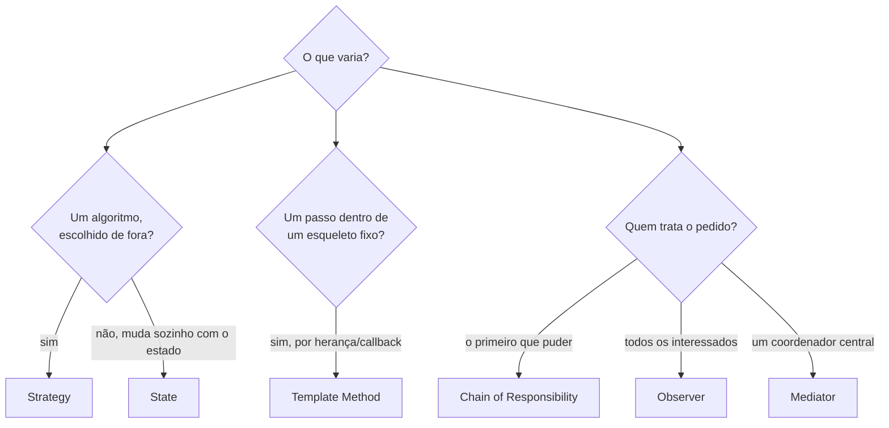
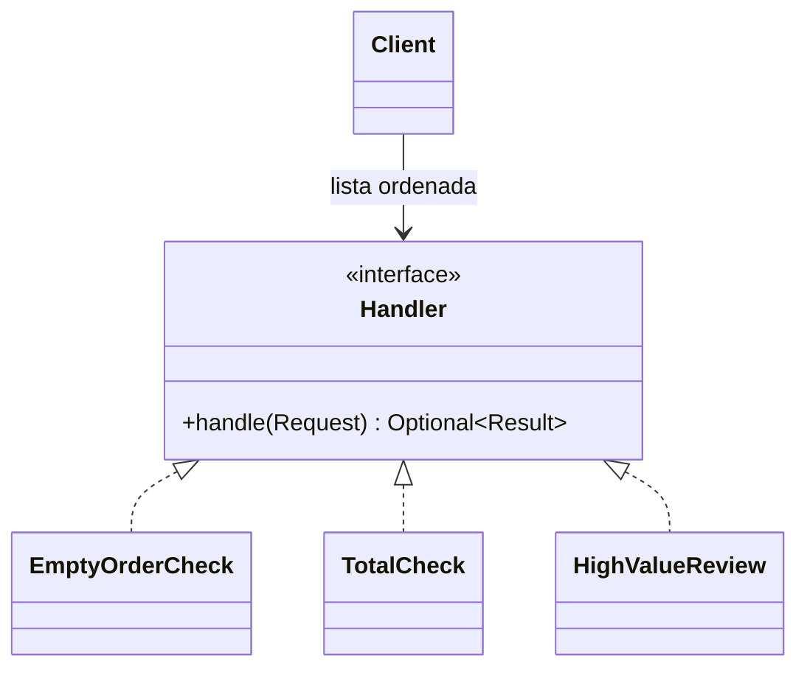
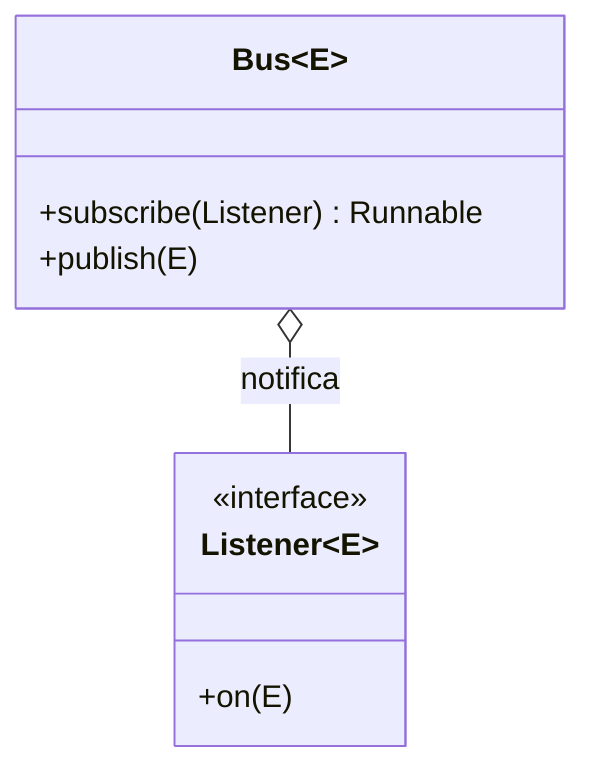

# Padrões comportamentais (GoF)

> **Resumo:** Chain of Responsibility, Command, Iterator, Mediator, Memento, Observer, State, Strategy, Template Method e Visitor: padrões sobre **como objetos se comunicam e dividem responsabilidades** em tempo de execução. Em Java moderno, vários encolheram: **Strategy** e **Command** viram *lambdas*, **State** e **Visitor** viram `sealed` + `switch`, **Iterator** é `Iterable`. No Spring aparecem como infraestrutura: `HandlerInterceptor` (cadeia), eventos (Observer), `JdbcTemplate`/`TransactionTemplate` (Template Method).
> **Pré-requisitos:** [01-introducao](01-introducao.md), [03-estruturais](03-estruturais.md), [09-programacao-funcional](../01-java/09-programacao-funcional.md), [05-recursos-modernos-da-linguagem](../01-java/05-recursos-modernos-da-linguagem.md), [08-eventos-validacao-e-conversao](../02-spring-core/08-eventos-validacao-e-conversao.md).
> **Versões:** Java 25, Spring Framework 7.0.8, Spring Boot 4.1.2 (somente nomes de classe citados). O código desta página foi compilado e executado (`/tmp/validacao/s14`), exceto onde indicado.

## 1. Definição

**Padrões comportamentais** tratam de **algoritmos e da atribuição de responsabilidades** entre objetos: quem decide, quem reage, quem guarda estado e como o fluxo de controle passa de um para outro. A pergunta central é "quem faz o quê, e como se avisam?".

| Padrão | Intenção | Forma mais compacta em Java moderno |
|---|---|---|
| **Chain of Responsibility** | passar o pedido por uma cadeia até alguém tratá-lo | lista de funções / `next` explícito |
| **Command** | transformar uma ação em **objeto** (fila, log, undo) | `Runnable`/`Callable`/lambda |
| **Iterator** | percorrer sem expor a estrutura interna | `Iterable` + `for-each`, `Stream` |
| **Mediator** | centralizar a comunicação entre colegas | objeto coordenador / *event bus* |
| **Memento** | salvar e restaurar estado sem violar encapsulamento | `record` imutável |
| **Observer** | notificar dependentes quando algo muda | listeners, eventos do Spring |
| **State** | o comportamento muda com o estado interno | `sealed` + `switch`, `enum` |
| **Strategy** | trocar um algoritmo em tempo de execução | lambda / `Map<String, Interface>` |
| **Template Method** | esqueleto fixo, passos variáveis | classe abstrata ou *callback* |
| **Visitor** | nova operação sobre uma hierarquia sem alterá-la | `switch` sobre `sealed` |

(O GoF também define **Interpreter**, raro na prática; não é coberto aqui.)

## 2. Conceitos fundamentais

### 2.1 Os que parecem iguais



- **Strategy vs State:** têm a mesma forma (objeto que delega a outro intercambiável). No Strategy o **cliente escolhe** a estratégia; no State o **próprio objeto troca** de estado conforme as transições.
- **Observer vs Mediator:** Observer é difusão (1→N, o emissor não conhece os ouvintes); Mediator é coordenação (os colegas só conhecem o mediador, que decide o que fazer).
- **Strategy vs Template Method:** ambos variam um passo; o Template usa **herança** (ou *callback*) dentro de um esqueleto, o Strategy usa **composição**.

### 2.2 Princípios por trás

Strategy, State, Command e Observer aplicam **Open/Closed** e **Dependency Inversion**: o código estável depende de uma interface e novos comportamentos entram como novas classes ([01-introducao §5.1](01-introducao.md#51-solid-um-princípio-por-vez)). Template Method é o *Hollywood principle* ("não nos chame, nós chamamos você"), o mesmo espírito do IoC do Spring ([02-ioc-e-injecao-de-dependencia](../02-spring-core/02-ioc-e-injecao-de-dependencia.md)).

## 3. Como funciona por dentro

### 3.1 Despacho dinâmico é o motor

Strategy, State, Command e Template Method dependem de **chamada virtual** (`invokeinterface`/`invokevirtual`): o JIT inlina quando só há uma ou duas implementações observadas no ponto de chamada (*monomorphic/bimorphic inline cache*), tornando a indireção barata ([01-plataforma-java](../01-java/01-plataforma-java.md), [04-orientacao-a-objetos](../01-java/04-orientacao-a-objetos.md)).

### 3.2 `switch` sobre `sealed` substitui Visitor e State

Com `sealed interface` + `record`, o compilador exige que o `switch` cubra **todos** os subtipos (exaustividade) e dispensa o *double dispatch* do Visitor clássico ([05-recursos-modernos-da-linguagem](../01-java/05-recursos-modernos-da-linguagem.md)). Se alguém adicionar um subtipo, os `switch` sem `default` **deixam de compilar**, o que é a garantia que o Visitor tradicional queria dar.

### 3.3 Eventos do Spring: Observer síncrono

`ApplicationEventPublisher.publishEvent` entrega o evento aos `ApplicationListener`/`@EventListener` **na mesma thread** do publicador, a menos que o *multicaster* tenha um `Executor` (`SimpleApplicationEventMulticaster.setTaskExecutor`) ou o ouvinte use `@Async` ([08-eventos-validacao-e-conversao](../02-spring-core/08-eventos-validacao-e-conversao.md)). Verificado abaixo (§5.6): `thread=main`.

## 4. Evolução histórica

Os dez são do GoF (1994). O que mudou na linguagem: **Java 1.0** trouxe `Observable`/`Observer` (hoje **deprecados desde o Java 9**; usar `PropertyChangeListener` ou eventos) e `Iterator`/`Enumeration`; **Java 5** acrescentou `Iterable` e `for-each`; **Java 8** transformou Strategy/Command/Template em *lambdas* (`Comparator`, `Runnable`, `Function`); **Java 16–21** (`record`, `sealed`, *pattern matching* para `switch`) tornou State e Visitor curtos e verificados. No Spring, o Template Method deu origem ao `JdbcTemplate`/`TransactionTemplate` (Spring 1.x) e os eventos acompanham o contêiner desde o início ([01-o-que-e-spring](../02-spring-core/01-o-que-e-spring.md)).

⚠️ VERIFICAR: a deprecação de `java.util.Observable`/`Observer` no Java 9 e a data de introdução dos padrões em cada API foram escritas de memória.

## 5. Exemplos práticos

Domínio comum: sistema de pedidos ([00-README](../00-README.md)).

### 5.1 Chain of Responsibility

**Problema:** um pedido passa por várias verificações (vazio? total válido? valor alto?). Um método com `if` aninhado cresce e mistura regras.

**Solução:** uma cadeia de tratadores; cada um decide **tratar e parar** ou **passar adiante**.



```java
record OrderReq(String customer, BigDecimal total, int items) {}

List<Function<OrderReq, Optional<String>>> chain = List.of(
    r -> r.items() == 0 ? Optional.of("rejeitado: vazio") : Optional.empty(),
    r -> r.total().signum() <= 0 ? Optional.of("rejeitado: total") : Optional.empty(),
    r -> r.total().compareTo(new BigDecimal("1000")) > 0 ? Optional.of("revisão manual") : Optional.empty());

String result = chain.stream().map(f -> f.apply(req))
        .flatMap(Optional::stream).findFirst().orElse("aprovado");
```

Saída (executada): total 50 e 2 itens → `aprovado`; total 5000 → `revisão manual`; total 0 e 0 itens → `rejeitado: vazio` (o primeiro que trata encerra a cadeia).

**Variante "pipeline" (estilo servlet):** cada elo recebe um `next` e pode agir **antes e depois**:

```java
interface Step { String call(String in, Function<String, String> next); }
List<Step> steps = List.of(
    (in, next) -> "[log " + next.apply(in) + " log]",     // envolve o resto
    (in, next) -> next.apply(in.toUpperCase()));          // transforma a entrada
// montada de trás para frente; core(s) é o fim da cadeia
f.apply("abc")  // => [log core(ABC) log]
```

**Onde o JDK/Jakarta usam:** `jakarta.servlet.Filter`/`FilterChain` (`chain.doFilter(req, res)`), `java.util.logging.Handler`, a cadeia de exceções `catch` (cada bloco decide se trata).

**Onde o Spring usa:**
- **`HandlerInterceptor` + `HandlerExecutionChain`:** o `DispatcherServlet` chama `applyPreHandle` (na ordem), o handler, `applyPostHandle` (ordem inversa) e `triggerAfterCompletion` (ordem inversa); `preHandle` devolvendo `false` **interrompe** a cadeia (assinaturas conferidas com `javap` em 7.0.8). Ver [04-web-mvc](../03-spring-boot/04-web-mvc.md).
- **Spring Security:** a `SecurityFilterChain` é uma cadeia ordenada de filtros ([08-spring-security](../03-spring-boot/08-spring-security.md)).
- **Advices do AOP:** os interceptores de um proxy formam uma cadeia (`MethodInvocation.proceed()`, [07-aop-e-proxies](../02-spring-core/07-aop-e-proxies.md)).

**O "jeito Spring":** injetar `List<MinhaRegra>` (ordenada por `@Order`) e iterar; cada regra é um bean.

### 5.2 Command

**Problema:** você precisa **enfileirar**, **registrar** ou **desfazer** ações; chamar o método direto não deixa rastro.

**Solução:** representar a ação como **objeto** com `execute()` (e `undo()`).

```java
interface Command { void execute(); void undo(); }
record AddItem(Cart cart, String item) implements Command {
    public void execute() { cart.items.add(item); }
    public void undo()    { cart.items.remove(item); }
}

Deque<Command> history = new ArrayDeque<>();
for (String i : List.of("a", "b", "c")) { Command c = new AddItem(cart, i); c.execute(); history.push(c); }
history.pop().undo(); history.pop().undo();
```

Saída: `[a, b, c]` → após dois *undo* `[a]`.

Sem *undo*, o Command é só `Runnable`/`Callable` (lambda): `executor.submit(() -> ...)` entrega a ação a outra thread ([12-concorrencia](../01-java/12-concorrencia.md)).

**Onde o JDK usa:** `Runnable`, `Callable`, `Executor.execute(Runnable)`, `TimerTask`.

**Onde o Spring usa:** `TransactionCallback`/`ConnectionCallback` (uma ação entregue ao template), tarefas `@Scheduled`/`@Async` (a invocação vira uma tarefa), *jobs/steps* do Spring Batch. Em arquiteturas **CQRS** ([06-padroes-arquiteturais](06-padroes-arquiteturais.md)), "comando" é a mensagem que expressa uma intenção (`PlaceOrderCommand`).

**Cuidado:** *undo* só funciona se o comando guardar o que precisa para reverter; em sistemas distribuídos isso vira compensação (Saga, [07-padroes-de-microsservicos](07-padroes-de-microsservicos.md)).

### 5.3 Iterator

**Problema:** percorrer uma coleção sem conhecer sua estrutura (array, árvore, tabela hash).

**Solução:** um objeto que expõe `hasNext()`/`next()`. Em Java basta implementar `Iterable<T>` e usar `for-each`.

```java
class Range implements Iterable<Integer> {
    final int lo, hi;
    Range(int lo, int hi) { this.lo = lo; this.hi = hi; }
    public Iterator<Integer> iterator() {
        return new Iterator<>() {
            int cur = lo;
            public boolean hasNext() { return cur < hi; }
            public Integer next() { if (!hasNext()) throw new NoSuchElementException(); return cur++; }
        };
    }
}
for (int x : new Range(1, 5)) sum += x;    // 10
```

Remover durante o `for-each` falha (*fail-fast*), mas pelo próprio iterador é seguro (executado):

```java
for (var x : list) if (x == 2) list.remove(x);          // ConcurrentModificationException
var it = list.iterator();
while (it.hasNext()) if (it.next() % 2 == 0) it.remove(); // [1, 3]
```

Por quê: `ArrayList` compara `modCount`; ver [07-colecoes](../01-java/07-colecoes.md). Iteradores de coleções concorrentes são *weakly consistent*.

**Onde o JDK usa:** toda a hierarquia `Collection`, `Iterable`, `Spliterator` (a versão "paralelizável"), `Stream` (iteração interna, em vez de externa), `Scanner`, `ResultSet` (cursor).

**Onde o Spring usa:** `Iterable` em `Page`/`Slice` do Spring Data, `CompositeIterator`, e *streaming* de consulta (`Stream<T>` em repositórios, que exige fechar o recurso).

### 5.4 Mediator

**Problema:** vários objetos se conhecem entre si (N×N referências): uma tela com campos que se habilitam mutuamente, usuários de um chat.

**Solução:** um **mediador** conhece todos; os colegas só falam com ele.

```java
class Chat implements Mediator {
    final Map<String, List<String>> inbox = new LinkedHashMap<>();
    void join(String user) { inbox.put(user, new ArrayList<>()); }
    public void notifyChange(String from, String msg) {
        inbox.forEach((user, box) -> { if (!user.equals(from)) box.add(from + ": " + msg); });
    }
}
```

Executado: `ana` envia "oi" → `{ana=[], bob=[ana: oi], cy=[ana: oi]}`.

**Onde o JDK/Spring usam:** `java.util.Timer` (coordena tarefas), o **`DispatcherServlet`** como mediador entre requisição, *handler mappings*, adaptadores, conversores e *view resolvers* ([04-web-mvc](../03-spring-boot/04-web-mvc.md)), e o próprio `ApplicationContext` (os beans pedem dependências ao contêiner em vez de se procurarem). O `ApplicationEventPublisher` também faz papel de mediador quando serviços se comunicam por eventos em vez de chamadas diretas (ver [Spring Modulith](../05-outros-projetos-spring/README.md)).

**Risco:** o mediador vira uma *God Class* que concentra toda a lógica ([08-anti-padroes](08-anti-padroes.md)).

### 5.5 Memento

**Problema:** salvar o estado de um objeto para restaurá-lo depois (desfazer, rascunho) sem expor seus campos internos.

**Solução:** o objeto cria um **snapshot imutável**; quem guarda o snapshot não consegue alterá-lo. Com `record`, é uma linha.

```java
record Snapshot(List<String> items) {}
class Editor {
    List<String> items = new ArrayList<>();
    Snapshot save()            { return new Snapshot(List.copyOf(items)); }   // cópia imutável
    void restore(Snapshot s)   { items = new ArrayList<>(s.items()); }
}
```

Executado: `[x]` → salva → `[x, y]` → `restore` → `[x]`. O `List.copyOf` é essencial: sem a cópia, o snapshot compartilharia a lista mutável e "restauraria" o estado alterado (mesma armadilha do `clone` raso em [02-criacionais](02-criacionais.md)).

**Onde o JDK/Spring usam:** serialização (`Serializable`/`ObjectOutputStream` salva o estado), `java.util.Date`/`Calendar` copiados defensivamente, *snapshots* de *entity* do Hibernate para o **dirty checking** (a cópia do estado carregado é comparada ao atual no *flush*, [06-spring-data-jpa](../03-spring-boot/06-spring-data-jpa.md)) e **Event Sourcing** ([06-padroes-arquiteturais](06-padroes-arquiteturais.md)), que reconstrói estado a partir de eventos.

### 5.6 Observer

**Problema:** quando um pedido é pago, é preciso enviar e-mail, reservar estoque e atualizar métricas. Chamar tudo direto acopla o serviço de pedidos a todos eles.

**Solução:** o emissor publica um evento; os interessados **se registram** e reagem sem que o emissor os conheça.



```java
interface Listener<E> { void on(E e); }
class Bus<E> {
    final List<Listener<E>> ls = new ArrayList<>();
    Runnable subscribe(Listener<E> l) { ls.add(l); return () -> ls.remove(l); }   // devolve "cancelar"
    void publish(E e) { new ArrayList<>(ls).forEach(l -> l.on(e)); }              // cópia: tolera remoção durante a notificação
}
```

Executado: `A` e `B` recebem `pedido-1`; após cancelar `A`, só `B` recebe `pedido-2`. `PropertyChangeSupport` do JDK: `firePropertyChange("status","NEW","PAID")` → `status NEW->PAID`.

**Armadilhas do Observer:** *memory leak* ("lapsed listener": registrou e nunca removeu, por isso o `subscribe` devolve o cancelador), ordem de notificação não garantida, exceção de um ouvinte interromper os demais, e execução **síncrona** no emissor.

**Onde o JDK usa:** `PropertyChangeListener` (`java.beans`), `Flow.Publisher/Subscriber` (versão assíncrona com *backpressure*, [05-webflux-e-reativo](../03-spring-boot/05-webflux-e-reativo.md)), Swing `ActionListener`. `java.util.Observable` está obsoleto.

**O "jeito Spring":** `ApplicationEventPublisher` + `@EventListener`:

```java
record OrderPaid(String id) {}

@Component class L1 { @EventListener void on(OrderPaid e) { ... } }

ctx.publishEvent(new OrderPaid("p-9"));
```

Executado: o ouvinte imprimiu `p-9 thread=main` **antes** de `publishEvent` retornar, ou seja, é síncrono e na thread do publicador. Para desacoplar o tempo, usar `@Async` no ouvinte ou `@TransactionalEventListener` para reagir só após o *commit* ([08-eventos-validacao-e-conversao](../02-spring-core/08-eventos-validacao-e-conversao.md), [09-transacoes](../02-spring-core/09-transacoes.md)). Entre serviços diferentes, usa-se mensageria ([07-mensageria](../04-spring-cloud/07-mensageria.md)), não eventos em memória.

### 5.7 State

**Problema:** o comportamento do pedido depende do estado (`NEW`, `PAID`, `SHIPPED`, `CANCELLED`); `if (status == ...)` espalhado em todo método.

**Solução A (moderna):** estados como `record` de uma `sealed interface` e as transições em um único `switch` exaustivo.

```java
sealed interface OrderState permits New, Paid, Shipped, Cancelled {}
record New() implements OrderState {}  record Paid() implements OrderState {}
record Shipped() implements OrderState {}  record Cancelled() implements OrderState {}

static OrderState next(OrderState s, String ev) {
    return switch (s) {
        case New n when ev.equals("pay")      -> new Paid();
        case New n when ev.equals("cancel")   -> new Cancelled();
        case Paid p when ev.equals("ship")    -> new Shipped();
        case Paid p when ev.equals("cancel")  -> new Cancelled();
        default -> throw new IllegalStateException(s.getClass().getSimpleName() + " não aceita " + ev);
    };
}
```

Executado: `New → pay → ship` = `Shipped[]`; `cancel` em `Shipped` lança `Shipped não aceita cancel`. O `default` aqui trata "transição inválida" (se quiser exaustividade pura sobre o estado, use um `switch` externo por estado e outro por evento).

**Solução B (clássica):** cada estado é uma classe com o comportamento. Em Java, o `enum` com corpo por constante dá o mesmo efeito:

```java
enum Light { RED { Light next() { return GREEN; } }, GREEN { Light next() { return YELLOW; } },
             YELLOW { Light next() { return RED; } }; abstract Light next(); }
Light.RED.next().next()   // YELLOW
```

**Onde o Spring usa:** **Spring Statemachine** (projeto separado, [05-outros-projetos-spring](../05-outros-projetos-spring/README.md) não o cobre; ⚠️ VERIFICAR status atual em spring.io/projects), e *workflows* de Spring Batch (`BatchStatus`/`ExitStatus` guiam o fluxo). Em geral, uma máquina de estados pequena não precisa de biblioteca.

### 5.8 Strategy

**Problema:** o desconto varia (nenhum, VIP, Black Friday). `if/else if` por tipo cresce a cada requisito (violação de OCP; ver [01-introducao §5.1](01-introducao.md)).

**Solução:** uma interface para o algoritmo, uma implementação por variante.

```java
interface Discount { BigDecimal apply(BigDecimal v); }

Map<String, Discount> strategies = Map.of(
    "none", v -> v,
    "vip",  v -> v.multiply(new BigDecimal("0.90")),
    "bf",   v -> v.multiply(new BigDecimal("0.70")));

strategies.get("vip").apply(new BigDecimal("100")).setScale(2);   // 90.00
```

Com lambda, uma "classe de estratégia" é só uma função. Quando a estratégia tem estado ou dependências, vira um bean.

**Onde o JDK usa:** `Comparator` (`list.sort(Comparator.comparingInt(String::length))` → `[a, cc, bbb]`, executado), `Collectors`, `ThreadPoolExecutor.RejectedExecutionHandler`, `LayoutManager` do AWT.

**Onde o Spring usa:** é o padrão mais frequente: `PasswordEncoder`, `HttpMessageConverter`, `CacheManager`, `PlatformTransactionManager`, `ViewResolver`, `ResourceLoader`, `HandlerMethodArgumentResolver`, a escolha entre proxy JDK e CGLIB (`AopProxy`).

**O "jeito Spring":** o contêiner injeta **todas** as implementações em um `Map<String, Interface>` indexado pelo nome do bean. É a fábrica sem `switch`:

```java
interface Notifier { String send(String m); }
@Component("email") class EmailN implements Notifier { ... }
@Component("sms")   class SmsN   implements Notifier { ... }

@Component class Svc {
    final Map<String, Notifier> byChannel;
    Svc(Map<String, Notifier> m) { byChannel = m; }          // chaves = nomes dos beans
    String notify(String ch, String m) { return byChannel.get(ch).send(m); }
}
```

Executado: `getBeansOfType(Notifier.class)` → `[email, sms]`; `notify("sms","oi")` → `sms:oi`. Adicionar `push` é criar um `@Component("push")`, sem tocar em `Svc`. Detalhes: [02-ioc-e-injecao-de-dependencia](../02-spring-core/02-ioc-e-injecao-de-dependencia.md). Pontos de atenção: a chave é o **nome do bean** (acoplar regra de negócio ao nome é frágil: prefira um método `channel()` na interface e montar o mapa com ele), e chave inexistente retorna `null` (trate com erro claro).

### 5.9 Template Method

**Problema:** vários processos seguem o mesmo roteiro (abrir recurso, processar, fechar), mudando só o miolo. Sem padrão, cada um repete o `try/finally` (e erra).

**Solução:** a classe base define o **esqueleto** (`final`), as subclasses implementam os passos.

```java
abstract class Importer {
    final List<String> log = new ArrayList<>();
    final void run() { open(); try { process(); } finally { close(); } }   // esqueleto fixo
    void open()  { log.add("open"); }
    abstract void process();                                                // gancho obrigatório
    void close() { log.add("close"); }
}
```

Executado: com um `process()` que lança exceção, o log é `[open, process, close]`: o `finally` do esqueleto garante o `close`.

**Variante moderna: callback em vez de herança.** O esqueleto recebe uma função; evita criar subclasses:

```java
<T> T inTransaction(Supplier<T> work) { begin(); try { T r = work.get(); commit(); return r; } catch (RuntimeException e) { rollback(); throw e; } }
```

**Onde o JDK usa:** `AbstractList`/`AbstractMap` (implementam o resto a partir de `get`/`size`), `InputStream.read(byte[])` (chama o abstrato `read()`), `Collections`/`Reader`, `Thread.run` + `start`.

**Onde o Spring usa (versão callback):**
- **`JdbcTemplate`**: abre conexão, cria `PreparedStatement`, executa, converte exceções (`SQLException` → `DataAccessException`) e fecha tudo; você fornece só o SQL e um `RowMapper`/`ConnectionCallback`.
- **`TransactionTemplate`**: `execute(TransactionCallback)` abre a transação, chama seu código, faz *commit*/*rollback* ([09-transacoes](../02-spring-core/09-transacoes.md)).
- `RestTemplate`, `JmsTemplate`, `KafkaTemplate`, `AbstractRoutingDataSource` (sobrescreve `determineCurrentLookupKey`), `AbstractApplicationContext.refresh()` (esqueleto com ganchos `onRefresh`, `postProcessBeanFactory`; [03-application-context-e-beans](../02-spring-core/03-application-context-e-beans.md)).

**Cuidado:** herança acopla (a subclasse depende de detalhes da base, o "problema da classe base frágil", [04-orientacao-a-objetos](../01-java/04-orientacao-a-objetos.md)). Prefira callback quando possível.

### 5.10 Visitor

**Problema:** uma hierarquia estável de tipos (`Num`, `Add`, `Mul`) e várias operações novas (avaliar, imprimir, otimizar). Adicionar um método a cada classe a cada operação nova polui o modelo.

**Solução clássica:** `accept(Visitor v)` em cada nó + `visit(Num)`, `visit(Add)`... (*double dispatch*). Funciona, mas é verboso e acopla a hierarquia ao visitor.

**Solução moderna:** `sealed` + `record` + `switch` com **record patterns** ([05-recursos-modernos-da-linguagem](../01-java/05-recursos-modernos-da-linguagem.md)):

```java
sealed interface Expr permits Num, Add, Mul {}
record Num(int v) implements Expr {}
record Add(Expr l, Expr r) implements Expr {}
record Mul(Expr l, Expr r) implements Expr {}

static int eval(Expr e) {
    return switch (e) {
        case Num n          -> n.v();
        case Add(var l, var r) -> eval(l) + eval(r);
        case Mul(var l, var r) -> eval(l) * eval(r);
    };                                             // sem default: exaustivo
}
static String show(Expr e) { /* outro switch, outra operação, sem alterar os records */ }
```

Executado: `Mul(Add(1,2), 4)` → `show` = `(1 + 2) * 4`, `eval` = `12`.

**Trade-off (o "expression problem"):**

| Muda com frequência | Melhor escolha |
|---|---|
| **Operações** (novas funções sobre tipos fixos) | `switch` sobre `sealed` / Visitor |
| **Tipos** (novas variantes) | polimorfismo comum (método na interface) |

**Onde o JDK usa:** `java.nio.file.FileVisitor` com `Files.walkFileTree` (visitor clássico), `javax.lang.model.element.ElementVisitor` (annotation processors, [10-anotacoes-e-reflection](../01-java/10-anotacoes-e-reflection.md)), `com.sun.source.tree.TreeVisitor`.

**Onde o Spring usa:** `BeanDefinitionVisitor` (resolve placeholders percorrendo uma `BeanDefinition`), `ASM ClassVisitor` (scanning de classes, [06-como-java-e-spring-conversam](../02-spring-core/06-como-java-e-spring-conversam.md)) e o `Expression` do SpEL (a AST é avaliada por nó).

⚠️ VERIFICAR: nomes `BeanDefinitionVisitor` e o uso de `ClassVisitor` pelo scanner foram citados de memória e não conferidos nos JARs.

### 5.11 Comparativo final

| Padrão | Estrutura | Quem decide | Exemplo de Spring |
|---|---|---|---|
| Chain of Responsibility | lista de tratadores | o primeiro que puder (ou todos em sequência) | `HandlerInterceptor`, `SecurityFilterChain` |
| Command | ação como objeto | quem executa depois | `TransactionCallback`, tarefas `@Async` |
| Iterator | cursor | o cliente | `Page`, `Iterable` |
| Mediator | coordenador | o mediador | `DispatcherServlet` |
| Memento | snapshot imutável | quem restaura | snapshot do Hibernate (dirty checking) |
| Observer | emissor → N ouvintes | os ouvintes | `@EventListener` |
| State | objeto muda de estado | o próprio objeto | `Statemachine`, `BatchStatus` |
| Strategy | interface + variantes | o cliente | `PasswordEncoder`, `Map<String, X>` |
| Template Method | esqueleto + passos | a classe base | `JdbcTemplate`, `TransactionTemplate` |
| Visitor | operação externa à hierarquia | o `switch`/visitor | `FileVisitor`, `BeanDefinitionVisitor` |

## 6. Configurações e anotações relevantes

| Item | Para que serve | Padrão |
|---|---|---|
| `@EventListener` | método vira ouvinte do tipo do parâmetro (ou de `classes=`) | Observer |
| `@EventListener(condition = "...")` | filtra por SpEL | Observer |
| `@TransactionalEventListener` | dispara na fase da transação (`AFTER_COMMIT` padrão) | Observer |
| `@Async` | torna o ouvinte/tarefa assíncrono | Observer / Command |
| `SimpleApplicationEventMulticaster.setTaskExecutor` | todos os eventos assíncronos | Observer |
| `@Order` / `Ordered` | ordem de interceptors/regras injetadas em `List<T>` | Chain |
| `WebMvcConfigurer.addInterceptors` | registra `HandlerInterceptor` | Chain |
| `@Primary` / `@Qualifier` | escolhe a estratégia padrão/específica | Strategy |
| `Map<String, T>` / `List<T>` / `ObjectProvider<T>` | injeta todas as estratégias | Strategy / Chain |
| `JdbcTemplate`, `TransactionTemplate` | esqueleto + callbacks | Template Method |

## 7. Quando usar e quando NÃO usar

| Padrão | Use quando | NÃO use quando |
|---|---|---|
| **Chain** | regras/filtros independentes, ordem configurável | só duas regras fixas (um `if` basta) ou o fluxo exige resultado de todos (use pipeline) |
| **Command** | fila, log de ações, undo, execução adiada | só chamar um método agora (cerimônia) |
| **Iterator** | estrutura própria percorrível | já existe `Collection`/`Stream` |
| **Mediator** | muitos colegas com interações complexas | poucos objetos (vira indireção inútil) ou o mediador viraria God Class |
| **Memento** | desfazer/rascunho | objeto grande e snapshots frequentes (custo de memória); considerar diffs/eventos |
| **Observer** | vários reagem a um fato, sem acoplamento | a ordem/atomicidade importa (use chamada explícita ou transação) |
| **State** | mais de ~3 estados com regras de transição | dois estados (um `boolean` basta) |
| **Strategy** | algoritmo escolhido por configuração/entrada | uma só implementação sem previsão de outra (YAGNI) |
| **Template Method** | roteiro idêntico com passos variáveis | variação de mais de um eixo (prefira Strategy/composição) |
| **Visitor** | operações novas sobre tipos estáveis | os tipos mudam muito, ou o `switch` sobre `sealed` já resolve |

## 8. Erros comuns e boas práticas

| Erro | Consequência | Prática melhor |
|---|---|---|
| Ouvinte Spring pesado ou que falha, publicado em transação | atrasa/derruba quem publica; reage a dado que sofreu *rollback* | `@TransactionalEventListener` + `@Async` |
| Esquecer que `@EventListener` é síncrono | latência no fluxo principal | medir `thread`; `@Async` quando apropriado |
| Registrar listener e nunca remover | vazamento de memória | devolver cancelador; `WeakReference` quando fizer sentido |
| Alterar a lista de ouvintes durante a notificação | `ConcurrentModificationException` | iterar sobre cópia (como no `Bus`) |
| `list.remove` dentro de `for-each` | `ConcurrentModificationException` | `Iterator.remove()` ou `removeIf` |
| Memento sem cópia defensiva | "restaurar" devolve o estado alterado | `List.copyOf`/`record` imutável |
| Cadeia sem tratador final | pedido "some" sem resposta | definir resultado padrão (`orElse`) |
| Cadeia em que a ordem importa mas não está explícita | comportamento muda ao reordenar beans | `@Order` e testes de ordem |
| Strategy por `switch` em string no cliente | OCP violado | `Map<String, Strategy>` injetado |
| Chave do `Map` de estratégias = nome de bean implícito | renomear a classe quebra a regra | método `channel()` na interface |
| Estados como `String`/`int` e `if` espalhado | transição ilegal passa despercebida | `sealed`/`enum` com transições centralizadas |
| Herança profunda para Template Method | classe base frágil | callback (`Supplier`/`Consumer`) |
| Visitor para hierarquia que muda sempre | mudar N visitors a cada tipo novo | método polimórfico na interface |
| Mediator absorvendo regras de negócio | God Class | mediador só roteia; regras no domínio |

## 9. Perguntas de revisão

1. **Qual a diferença entre Strategy e State, se ambos delegam a um objeto intercambiável?**
   <details><summary>Resposta</summary>No Strategy o <b>cliente</b> escolhe o algoritmo e ele não muda sozinho. No State o <b>próprio contexto</b> troca de estado conforme os eventos, e cada estado conhece as transições.</details>
2. **Por que `@EventListener` pode atrasar um `@Service`? Como evitar?**
   <details><summary>Resposta</summary>Porque o Spring entrega o evento de forma síncrona, na thread do publicador (verificado: <code>thread=main</code>). Usar <code>@Async</code> no ouvinte, um executor no multicaster ou <code>@TransactionalEventListener</code> para reagir após o commit.</details>
3. **Por que `JdbcTemplate` é Template Method e não Strategy?**
   <details><summary>Resposta</summary>Ele fixa o esqueleto (conexão, statement, tratamento de exceção, fechamento) e deixa um <b>passo</b> variável (SQL/RowMapper/callback). Strategy troca o algoritmo inteiro; aqui a variação é um passo dentro de um roteiro invariável. A forma é por callback, não por herança.</details>
4. **O que `preHandle` retornando `false` faz na cadeia de `HandlerInterceptor`?**
   <details><summary>Resposta</summary>Interrompe a cadeia: o handler não é chamado e o <code>HandlerExecutionChain</code> dispara <code>afterCompletion</code> dos interceptors já executados. É a característica do Chain of Responsibility: um elo pode tratar e parar.</details>
5. **Quando o `switch` sobre `sealed` é melhor que o Visitor, e quando não é?**
   <details><summary>Resposta</summary>É melhor quando os tipos são estáveis e as operações crescem: menos código e o compilador exige cobertura. Não é melhor quando os tipos mudam com frequência (cada tipo novo obriga a revisar todos os <code>switch</code>); aí o método polimórfico na interface é mais adequado.</details>
6. **Como o `Map<String, Notifier>` injetado elimina um `switch`, e qual o risco?**
   <details><summary>Resposta</summary>O contêiner injeta todas as implementações indexadas pelo nome do bean, então adicionar um canal é criar um bean. O risco é a chave depender do nome do bean (renomear quebra) e a ausência da chave devolver <code>null</code>; trate explicitamente.</details>

## 10. Referências oficiais

- Gamma et al., *Design Patterns* (GoF), 1994: capítulo "Behavioral Patterns" (livro).
- Spring Framework, Application Events: <https://docs.spring.io/spring-framework/reference/core/beans/context-introduction.html>
- Spring Framework, Spring MVC Interception (`HandlerInterceptor`): <https://docs.spring.io/spring-framework/reference/web/webmvc/mvc-config/interceptors.html>
- Spring Framework, Data Access (`JdbcTemplate`, `TransactionTemplate`): <https://docs.spring.io/spring-framework/reference/data-access.html>
- Spring Framework (Javadoc): <https://docs.spring.io/spring-framework/docs/current/javadoc-api/>
- JEP 441 (pattern matching for switch), JEP 440 (record patterns), JEP 409 (sealed classes): <https://openjdk.org/jeps/>
- Java SE API (`java.util`, `java.beans`, `java.nio.file.FileVisitor`): <https://docs.oracle.com/en/java/javase/25/docs/api/>
- Dev.java: <https://dev.java/>
