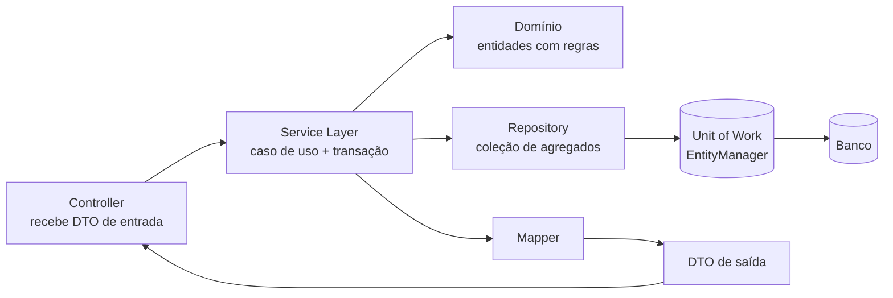

# Padrões enterprise (Repository, Service Layer, DTO, Mapper, Unit of Work, Specification)

> **Resumo:** padrões que organizam o código de uma aplicação de negócio em torno de **persistência, regras e fronteiras de dados**. Vêm do catálogo *Patterns of Enterprise Application Architecture* (Martin Fowler, 2002) e do *Domain-Driven Design* (Eric Evans, 2003). No ecossistema Spring quase todos já existem prontos: `JpaRepository` (Repository), `@Service` + `@Transactional` (Service Layer), o *persistence context* do Hibernate (Unit of Work) e `Specification` do Spring Data (Specification). Entender o padrão evita usá-los por inércia.
> **Pré-requisitos:** [01-introducao](01-introducao.md), [03-estruturais](03-estruturais.md), [09-transacoes](../02-spring-core/09-transacoes.md), [06-spring-data-jpa](../03-spring-boot/06-spring-data-jpa.md), [05-recursos-modernos-da-linguagem](../01-java/05-recursos-modernos-da-linguagem.md) (records).
> **Versões:** Java 25, Spring Framework 7.0.8, Spring Boot 4.1.2 (Spring Data JPA 4.1.2, Hibernate 7). O código das §5.1–5.6 foi compilado e executado (`/tmp/validacao/s15` e `s15b`).

## 1. Definição

| Padrão | Intenção em uma frase | Equivalente pronto no Spring |
|---|---|---|
| **Repository** | tratar o armazenamento como uma **coleção de objetos de domínio** | `Repository`/`CrudRepository`/`JpaRepository` |
| **Service Layer** | uma camada que define a **fronteira de operações** da aplicação (casos de uso) e coordena transações | `@Service` + `@Transactional` |
| **DTO** (*Data Transfer Object*) | objeto só de dados para **atravessar uma fronteira** (rede, camada) | `record` + Jackson |
| **Mapper** | converter entre representações (entidade ↔ DTO) sem acoplar uma à outra | código manual, MapStruct, `ModelMapper` |
| **Unit of Work** | acompanhar o que mudou numa operação de negócio e gravar tudo **de uma vez, de forma consistente** | `EntityManager` / `Session` do Hibernate |
| **Specification** | encapsular uma **regra de seleção** como objeto combinável (`and`, `or`, `not`) | `org.springframework.data.jpa.domain.Specification` |

Estes padrões não são do GoF ([01-introducao §2](01-introducao.md)): são **padrões enterprise**, de granularidade maior, que descrevem como as peças de uma aplicação em camadas se falam.



## 2. Conceitos fundamentais

### 2.1 Repository

**Problema:** se cada serviço escreve SQL/JPQL e conhece a tecnologia de persistência, a regra de negócio fica misturada com detalhes de acesso a dados, e trocar o armazenamento (ou testar sem banco) exige mexer em todo lugar.

**Ideia:** o domínio enxerga um objeto parecido com uma `Collection` (`findById`, `save`, `findAll`). Quem implementa decide se vai a JPA, JDBC, memória ou HTTP. A definição de Evans: um Repository existe **por agregado** (a raiz de consistência, como `Order` com seus `OrderItem`), não por tabela.

Dois estilos convivem no Spring:

- **Repository como porta do domínio:** interface escrita por você, no pacote do domínio, com os métodos que o negócio precisa (`OrderRepository`, §5.1). A implementação (JPA, memória) é um adaptador, como na [arquitetura hexagonal](06-padroes-arquiteturais.md).
- **Repository gerado pelo Spring Data:** você declara `interface OrderRepository extends JpaRepository<Order, Long>` e o Spring cria um proxy em tempo de execução ([06-spring-data-jpa](../03-spring-boot/06-spring-data-jpa.md)). É pragmático e a escolha padrão; o custo é que o domínio passa a depender de tipos do Spring Data (`Page`, `Specification`). Muitas equipes aceitam o custo; outras põem uma interface própria na frente.

### 2.2 Service Layer

Define **o que a aplicação sabe fazer** (`criarPedido`, `pagarPedido`) e onde começam e terminam as transações. Fowler descreve duas formas: um serviço "gordo" que contém a lógica (*transaction script*), e um serviço **fino** que só orquestra enquanto a regra mora nas entidades (modelo de domínio rico). A segunda é a recomendada; a primeira degenera no [Anemic Domain Model](08-anti-padroes.md).

Regra prática: o `@Service` **orquestra** (carrega agregados, chama métodos do domínio, salva, publica eventos); a regra "um pedido vazio não pode ser pago" fica em `Order.pay()`.

### 2.3 DTO e Mapper

**Por que não expor a entidade direto?** (1) a entidade JPA tem associações lazy, que explodem na serialização (`LazyInitializationException`, [06-spring-data-jpa](../03-spring-boot/06-spring-data-jpa.md)); (2) o contrato da API passa a mudar a cada mudança no modelo; (3) campos internos (`passwordHash`, `version`) vazam; (4) *mass assignment*: um cliente poderia preencher campos que não deveria.

Com `record`, o DTO fica de uma linha, imutável e com `equals`/`hashCode`. O **Mapper** isola a conversão. Opções: método estático manual (claro, verificado pelo compilador), **MapStruct** (gera o código em tempo de compilação por *annotation processor*, sem reflection em runtime) ou bibliotecas reflexivas como ModelMapper (mais lentas e sem checagem em compilação).

### 2.4 Unit of Work

**Problema:** uma operação de negócio altera vários objetos. Gravar cada mudança na hora gera muitos `UPDATE`, ordem errada de FKs e estados parciais.

**Ideia:** manter uma lista de objetos **novos, alterados e removidos** e, no `commit`, gravar tudo numa só transação, na ordem certa. O Hibernate faz isso: o `EntityManager`/`Session` é um Unit of Work (e *Identity Map*, §3.3). No Spring, `@Transactional` delimita esse contexto ([09-transacoes](../02-spring-core/09-transacoes.md)).

### 2.5 Specification

**Problema:** critérios como "pedido pago **e** acima de R$ 20 **ou** de cliente VIP" viram uma explosão de métodos (`findByPaidAndTotalGreaterThanOrCustomerVip...`) ou `if` espalhados.

**Ideia (Evans/Fowler):** cada critério é um objeto com `isSatisfiedBy(candidate)`; objetos se **combinam** com `and`/`or`/`not`. A mesma regra serve para validar em memória, filtrar e (na versão do Spring Data) gerar a consulta SQL.

## 3. Como funciona por dentro

### 3.1 Repository do Spring Data: proxy + `SimpleJpaRepository`

A interface não tem implementação escrita por você. No início do contexto, o Spring Data cria um **proxy JDK** cujo alvo é um `SimpleJpaRepository` e que tem interceptadores para os *query methods* ([06-spring-data-jpa](../03-spring-boot/06-spring-data-jpa.md)). Verificado: `repo.getClass()` mostra `com.example.orders.$Proxy124`. Como é um proxy, a tradução de exceções (`PersistenceExceptionTranslationPostProcessor`, ativado para beans `@Repository`) converte exceções do provedor em `DataAccessException`, de modo que o serviço não depende de `jakarta.persistence`.

### 3.2 `JpaSpecificationExecutor` e a Criteria API

`Specification<T>` tem um único método abstrato:

```java
Predicate toPredicate(Root<T> root, CriteriaQuery<?> query, CriteriaBuilder cb)
```

Conferido por `javap` no JAR 4.1.2. Os métodos estáticos `where`, `not`, `allOf`, `anyOf`, `unrestricted` e os `default and`/`or` combinam especificações; o repositório que estende `JpaSpecificationExecutor<Order>` ganha `findAll(Specification)`. Por baixo, o Spring Data monta uma `CriteriaQuery`, aplica o `Predicate` composto e o Hibernate gera o SQL. Ou seja: a Specification do Spring Data é a ligação entre o padrão e a **Criteria API**.

### 3.3 O persistence context como Unit of Work e Identity Map

Dentro de uma transação o `EntityManager` guarda:

- um **Identity Map** (`findById(1)` duas vezes devolve a **mesma instância**, sem segundo `SELECT`);
- um **snapshot** do estado original de cada entidade gerenciada;
- uma fila de ações (inserts, updates, deletes).

No *flush* (antes de uma consulta JPQL, no `commit` ou chamado manualmente), o Hibernate compara cada entidade com o snapshot (*dirty checking*) e emite `UPDATE` só para as que mudaram. Medido na §5.6: após `o.pay()` sem chamar `save`, `updates=0` antes do `flush` e `updates=1` depois.

### 3.4 Service Layer e transação

Um `@Service` com `@Transactional` é envolvido por um proxy AOP; ao entrar no método ele abre a transação, ao sair faz *commit* ou *rollback* ([07-aop-e-proxies](../02-spring-core/07-aop-e-proxies.md)). Por isso a **fronteira de transação deve ser o caso de uso** (o método do serviço), não o método do repositório.

## 4. Evolução histórica

- **1990s:** DAO (*Data Access Object*, Sun J2EE Blueprints) isola o SQL. É o antecessor do Repository, mas centrado em tabela/operação de CRUD, e não em agregado.
- **2002:** *PoEAA* (Fowler) cataloga Repository (via Evans, depois), Service Layer, Unit of Work, Identity Map, DTO, Data Mapper.
- **2003:** *Domain-Driven Design* (Evans) define Repository por agregado e Specification.
- **Spring 2.x–3.x:** `@Repository`, `JdbcTemplate`, tradução de exceções, `@Transactional` consolidam a Service Layer.
- **Spring Data (2010):** gera o Repository a partir da interface; `JpaSpecificationExecutor` traz a Specification.
- **Spring Data recente:** a `Specification` tem hoje `unrestricted()`, `allOf`/`anyOf` e a variante `PredicateSpecification` (vistos no JAR 4.1.2; a versão em que cada um surgiu não foi verificada).
- **Java 16+:** `record` torna DTO e *value objects* triviais ([05-recursos-modernos-da-linguagem](../01-java/05-recursos-modernos-da-linguagem.md)). Veja a linha do tempo geral em [00-evolucao-do-java](../01-java/00-evolucao-do-java.md).

⚠️ VERIFICAR: os anos de DAO/Blueprints e do surgimento do Spring Data (2010) foram escritos de memória; a atribuição de "Repository" a Evans (2003) vs. Fowler (2002) é a convenção usual.

## 5. Exemplos práticos

Domínio comum: sistema de pedidos. Os exemplos 5.1–5.5 estão em Java puro (sem Spring) para mostrar o padrão nu; a §5.6 usa o Spring de verdade.

### 5.1 Entidade com regras e Repository como porta

```java
record Customer(long id, String name, boolean vip) {}
record OrderItem(String sku, int qty, BigDecimal price) {
    BigDecimal subtotal() { return price.multiply(BigDecimal.valueOf(qty)); }
}

final class Order {
    private final long id; private final Customer customer;
    private final List<OrderItem> items = new ArrayList<>();
    private String status = "NEW";
    Order(long id, Customer c) { this.id = id; this.customer = c; }
    long id() { return id; } Customer customer() { return customer; }
    String status() { return status; }
    List<OrderItem> items() { return List.copyOf(items); }   // cópia defensiva
    void add(OrderItem i) { items.add(i); }
    void pay() {                                              // a regra mora no domínio
        if (items.isEmpty()) throw new IllegalStateException("pedido vazio");
        status = "PAID";
    }
    BigDecimal total() { return items.stream().map(OrderItem::subtotal).reduce(BigDecimal.ZERO, BigDecimal::add); }
}

// Porta definida pelo domínio: sem JPA, sem Spring
interface OrderRepository {
    Optional<Order> findById(long id);
    List<Order> findAll();
    void save(Order o);
}

class InMemoryOrderRepository implements OrderRepository {   // adaptador para testes
    final Map<Long, Order> db = new LinkedHashMap<>();
    public Optional<Order> findById(long id) { return Optional.ofNullable(db.get(id)); }
    public List<Order> findAll() { return List.copyOf(db.values()); }
    public void save(Order o) { db.put(o.id(), o); }
}
```

O serviço depende só da interface, então é testável sem banco. A implementação JPA entra na §5.6.

### 5.2 DTO e Mapper

```java
record CreateOrderRequest(long customerId, List<ItemRequest> items) {
    record ItemRequest(String sku, int qty) {}
}
record OrderItemResponse(String sku, int qty, BigDecimal subtotal) {}
record OrderResponse(long id, String customer, String status, BigDecimal total,
                     List<OrderItemResponse> items) {}

final class OrderMapper {
    static OrderResponse toResponse(Order o) {
        return new OrderResponse(o.id(), o.customer().name(), o.status(), o.total(),
            o.items().stream()
              .map(i -> new OrderItemResponse(i.sku(), i.qty(), i.subtotal()))
              .toList());
    }
}
```

Note que o DTO de **entrada** (`CreateOrderRequest`) e o de **saída** (`OrderResponse`) são tipos diferentes: o cliente não escolhe `id` nem `status`.

### 5.3 Service Layer fina

```java
class OrderService {
    private final OrderRepository repo;
    private final Map<Long, Customer> customers;   // no real: CustomerRepository
    OrderService(OrderRepository r, Map<Long, Customer> c) { repo = r; customers = c; }

    OrderResponse create(CreateOrderRequest req) {
        Customer c = Optional.ofNullable(customers.get(req.customerId()))
            .orElseThrow(() -> new NoSuchElementException("cliente " + req.customerId()));
        Order o = new Order(repo.findAll().size() + 1L, c);
        req.items().forEach(i -> o.add(new OrderItem(i.sku(), i.qty(), new BigDecimal("10.00"))));
        repo.save(o);
        return OrderMapper.toResponse(o);
    }

    OrderResponse pay(long id) {
        Order o = repo.findById(id).orElseThrow();
        o.pay();                       // regra no domínio
        repo.save(o);
        return OrderMapper.toResponse(o);
    }
}
```

Executado: criar com cliente inexistente → `erro: cliente 9`; pagar pedido sem itens → `erro: pedido vazio`. O serviço não tem `if` de regra de negócio, só coordena.

### 5.4 Specification

```java
@FunctionalInterface
interface Spec<T> {
    boolean isSatisfiedBy(T t);
    default Spec<T> and(Spec<T> o) { return t -> isSatisfiedBy(t) && o.isSatisfiedBy(t); }
    default Spec<T> or(Spec<T> o)  { return t -> isSatisfiedBy(t) || o.isSatisfiedBy(t); }
    default Spec<T> not()          { return t -> !isSatisfiedBy(t); }
}

static Spec<Order> paid()                  { return o -> o.status().equals("PAID"); }
static Spec<Order> totalAbove(String v)    { return o -> o.total().compareTo(new BigDecimal(v)) > 0; }
static Spec<Order> vipCustomer()           { return o -> o.customer().vip(); }

// (pago E acima de 20) OU (VIP E NÃO pago)
var spec = paid().and(totalAbove("20")).or(vipCustomer().and(paid().not()));
```

Com três pedidos (1: Ana/VIP, 50, pago; 2: Bob, 10, pago; 3: Ana/VIP, 20, não pago) o resultado executado foi `[1, 3]`. Em Java moderno a Specification é um `Predicate` com nome: a `Spec` acima poderia ser simplesmente `java.util.function.Predicate<Order>` (que já tem `and`/`or`/`negate`). O valor do padrão está em **dar nome ao critério de negócio** e reutilizá-lo.

### 5.5 Unit of Work manual (para ver o mecanismo)

```java
class UnitOfWork {
    private final Map<Long, Order> news = new LinkedHashMap<>();
    private final Map<Long, Order> dirty = new LinkedHashMap<>();
    private final InMemoryOrderRepository repo;
    UnitOfWork(InMemoryOrderRepository r) { repo = r; }

    void registerNew(Order o)   { news.put(o.id(), o); }
    void registerDirty(Order o) { if (!news.containsKey(o.id())) dirty.put(o.id(), o); }

    void commit() {
        System.out.println("commit: inserts=" + news.keySet() + " updates=" + dirty.keySet());
        news.values().forEach(repo::save);
        dirty.values().forEach(repo::save);
        news.clear(); dirty.clear();
    }
}
```

Registrando o pedido 10 como novo **e** como sujo, e o 11 como sujo, a saída é `commit: inserts=[10] updates=[11]`: um objeto novo não vira `UPDATE`. É exatamente o que o Hibernate faz, só que automático e com *snapshot*.

### 5.6 Com Spring: Repository, Specification e Unit of Work reais

```java
@Entity @Table(name = "orders")
class Order {
    @Id @GeneratedValue(strategy = GenerationType.IDENTITY) Long id;
    String customerName; String status = "NEW"; BigDecimal total;
    protected Order() {}
    Order(String c, BigDecimal t) { customerName = c; total = t; }
    void pay() { status = "PAID"; }
}

interface OrderRepository extends JpaRepository<Order, Long>, JpaSpecificationExecutor<Order> {}

final class OrderSpecs {
    static Specification<Order> paid() { return (r, q, cb) -> cb.equal(r.get("status"), "PAID"); }
    static Specification<Order> totalAbove(BigDecimal v) { return (r, q, cb) -> cb.greaterThan(r.get("total"), v); }
}
```

Teste (`@DataJpaTest`, H2) com Ana (50), Bob (10), Cid (90):

```java
Order o = repo.findById(a.id).orElseThrow();
o.pay();                                        // sem repo.save(o)
// antes do flush: updates=0   → depois do flush: updates=1
var res = repo.findAll(OrderSpecs.paid().and(OrderSpecs.totalAbove(new BigDecimal("60"))));
// paid & >60: [Cid]      paid ou >60: 2
```

Resultados medidos: `updates=0` antes do `flush` e `updates=1` depois (**dirty checking**: não precisa de `save` em entidade gerenciada); a composição `paid().and(totalAbove(60))` devolveu só `Cid`; com `or`, 2 pedidos. O `repo` é um `$Proxy`, como descrito na §3.1.

Imports relevantes (Boot 4): `org.springframework.data.jpa.domain.Specification`, `org.springframework.data.jpa.repository.JpaRepository`, `JpaSpecificationExecutor`, `org.springframework.boot.data.jpa.test.autoconfigure.DataJpaTest`.

## 6. Configurações e anotações relevantes

| Anotação / API | Para que serve | Exemplo |
|---|---|---|
| `@Repository` | estereótipo; habilita tradução de exceções de persistência | `@Repository class JdbcOrderRepository {}` |
| `Repository`/`CrudRepository`/`ListCrudRepository`/`JpaRepository` | níveis de abstração do Spring Data | `extends JpaRepository<Order, Long>` |
| `JpaSpecificationExecutor<T>` | adiciona `findAll(Specification)`, `count`, `exists` | `extends JpaSpecificationExecutor<Order>` |
| `Specification.where/and/or/not/allOf/anyOf/unrestricted` | combinar critérios | `OrderSpecs.paid().and(...)` |
| `@Service` | estereótipo da Service Layer | `@Service class OrderService {}` |
| `@Transactional` | fronteira do Unit of Work no caso de uso | `@Transactional(readOnly = true)` |
| `@Transactional(readOnly = true)` | dica de leitura; o Hibernate evita o flush/dirty checking | consultas |
| `EntityManager.flush()/clear()/detach()` | controlar o contexto de persistência | `em.flush()` |
| `@Version` | bloqueio otimista, protege o Unit of Work de sobrescrita | `@Version Long version` |
| `@DomainEvents`, `AbstractAggregateRoot.registerEvent` | agregado acumula eventos publicados ao `save` | `registerEvent(new OrderPaid(id))` |
| `spring.jpa.open-in-view` | OSIV (padrão `true`); ver [08-anti-padroes](08-anti-padroes.md) | `=false` |

## 7. Quando usar e quando NÃO usar

**Repository**
- Usar: um por **agregado**, com os métodos que o domínio precisa. Sim, o Spring Data basta na maioria dos casos.
- Evitar: repositório genérico "para tudo" com `findByQualquerCoisa`, ou um Repository por tabela/entidade-filha (quebra a fronteira do agregado). Não embrulhar `JpaRepository` em outra interface apenas por reflexo, sem ganho de teste ou de isolamento.

**Service Layer**
- Usar: casos de uso e fronteira de transação.
- Evitar: serviço que concentra toda a regra enquanto as entidades só têm getters/setters ([08-anti-padroes](08-anti-padroes.md)); serviço que apenas repassa chamadas ao repositório (camada sem função).

**DTO / Mapper**
- Usar: na **borda** (API REST, mensageria). Records resolvem com pouco código.
- Evitar: DTO em cada camada interna "por padrão" (DTO → DTO → entidade → DTO): multiplica código sem proteger nada. Também evitar mapeamento reflexivo mágico quando a conversão tem regra.

**Unit of Work**
- Usar: já vem com JPA. Reconhecê-lo ajuda a explicar dirty checking, `flush` e `LazyInitializationException`.
- Evitar: implementar um à mão sobre JPA/JDBC sem necessidade.

**Specification**
- Usar: filtros dinâmicos (telas de busca com vários campos opcionais), regras de negócio reutilizáveis.
- Evitar: para consultas fixas, prefira *query method* ou `@Query`. Specification com `Root.get("campo")` usa **strings**: erro de digitação só aparece em runtime (use o *metamodel* gerado pelo Hibernate, `Order_.status`, para checar em compilação).

## 8. Erros comuns e boas práticas

1. **Expor a entidade JPA na API.** Gera `LazyInitializationException`, vazamento de campos e acoplamento do contrato ao banco. Retorne DTO.
2. **Chamar `save` em tudo.** Em entidade gerenciada, o `save` é redundante (dirty checking). Chamar `save` fora de transação em uma entidade *detached* faz `merge`, com `SELECT` extra.
3. **`@Transactional` no repositório ou no controlador.** A fronteira é o caso de uso, no `@Service` ([09-transacoes](../02-spring-core/09-transacoes.md)).
4. **Regra de negócio no serviço e entidade burra.** Prefira `order.pay()` a `if (order.getTotal() > 0) order.setStatus("PAID")`.
5. **Lógica em Mapper com acesso ao banco.** O Mapper deve ser puro; carregar dados é do serviço (evita N+1 escondido).
6. **Repository devolvendo `null`.** Use `Optional` (como `findById`).
7. **Specification com N+1.** Uma `Specification` não faz `fetch` sozinha; adicione `root.fetch(...)` quando necessário, ou use `@EntityGraph`.
8. **Paginar com `fetch` de coleção.** O Hibernate pagina em memória (aviso do Hibernate sobre `firstResult/maxResults` com *collection fetch*; ⚠️ VERIFICAR o código exato); ver [06-spring-data-jpa](../03-spring-boot/06-spring-data-jpa.md).
9. **Esquecer a invariante do agregado:** mudar `OrderItem` por um repositório próprio, sem passar pela raiz `Order`, pula as regras.

## 9. Perguntas de revisão

1. Qual a diferença entre Repository e DAO?
   <details><summary>Resposta</summary>O DAO é orientado a tabela/operações de acesso a dados; o Repository é orientado a **agregado do domínio** e se comporta como uma coleção de objetos, escondendo o armazenamento. Na prática, `JpaRepository` é um Repository no sentido de coleção, mas o nome DAO ainda aparece em código legado.</details>
2. Por que, dentro de uma transação, `order.pay()` grava no banco sem chamar `save`?
   <details><summary>Resposta</summary>Porque a entidade é gerenciada pelo persistence context (Unit of Work). No flush, o Hibernate compara com o snapshot (*dirty checking*) e emite o `UPDATE`. Medido: `updates=0` antes do flush e `updates=1` depois.</details>
3. Quais os riscos de expor entidades JPA direto como resposta da API?
   <details><summary>Resposta</summary>Associações lazy fora da transação (`LazyInitializationException`), vazamento de campos internos, acoplamento do contrato ao modelo de dados e *mass assignment* na entrada.</details>
4. Em que a Specification do Spring Data difere da `Spec` em memória da §5.4?
   <details><summary>Resposta</summary>A do Spring Data devolve um `Predicate` da Criteria API (`toPredicate(Root, CriteriaQuery, CriteriaBuilder)`) que vira SQL no banco; a `Spec` da §5.4 avalia objetos já carregados em memória. A ideia (combinar critérios com `and`/`or`/`not`) é a mesma.</details>
5. Onde deve ficar a fronteira da transação e por quê?
   <details><summary>Resposta</summary>No método do `@Service` que representa o caso de uso: assim todas as mudanças de uma operação de negócio compartilham o mesmo Unit of Work e fazem commit/rollback juntas.</details>

## 10. Referências oficiais

- Spring Data JPA (reference): <https://docs.spring.io/spring-data/jpa/reference/> (seções *Repositories* e *Specifications*)
- Spring Data Commons: <https://docs.spring.io/spring-data/commons/reference/>
- Spring Framework, Transaction Management: <https://docs.spring.io/spring-framework/reference/data-access/transaction.html>
- Catálogo de padrões enterprise de Martin Fowler: <https://martinfowler.com/eaaCatalog/>
- *Domain-Driven Design* (Eric Evans) e *Patterns of Enterprise Application Architecture* (Martin Fowler): livros de referência
- Hibernate ORM: <https://hibernate.org/orm/documentation/>
- Próximo: [06-padroes-arquiteturais](06-padroes-arquiteturais.md)
