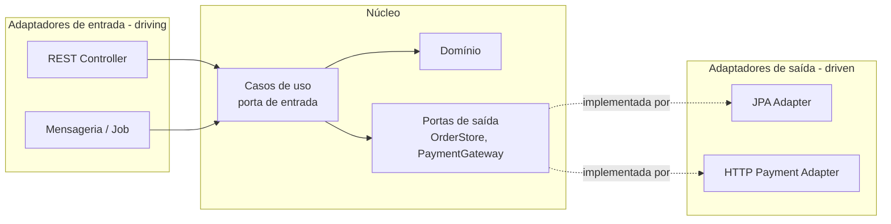
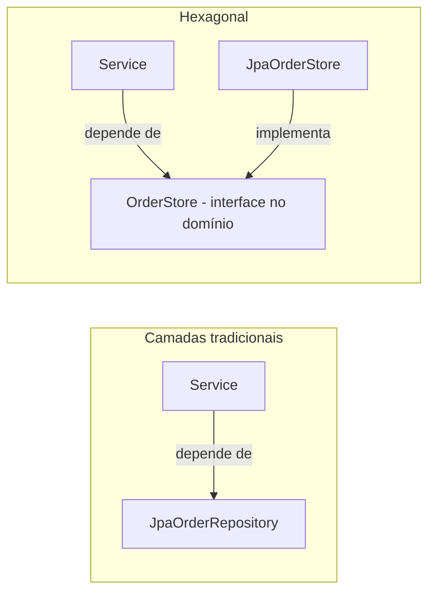

# Padrões arquiteturais (camadas, MVC, Hexagonal, Clean, DDD tático, CQRS, Event Sourcing, monólito modular)

> **Resumo:** se os padrões GoF organizam **classes**, os arquiteturais organizam **a aplicação inteira**: em que pacotes o código vive, quem pode depender de quem e como o domínio é protegido de frameworks e bancos. Esta página compara camadas, MVC, Hexagonal (Ports & Adapters), Clean Architecture, os blocos táticos do DDD, CQRS, Event Sourcing e o monólito modular, sempre com a estrutura de pacotes em Spring Boot. A regra que une todos: **as dependências apontam para o domínio**.
> **Pré-requisitos:** [01-introducao](01-introducao.md) (SOLID, DIP), [05-padroes-enterprise](05-padroes-enterprise.md), [02-ioc-e-injecao-de-dependencia](../02-spring-core/02-ioc-e-injecao-de-dependencia.md), [04-web-mvc](../03-spring-boot/04-web-mvc.md).
> **Versões:** Java 25, Spring Framework 7.0.8, Spring Boot 4.1.2, Spring Modulith 2.1.2. O código Java das §5.2–5.4 foi compilado e executado (`/tmp/validacao/s15`); Modulith foi validado na sessão 12 ([05-outros-projetos-spring](../05-outros-projetos-spring/03-spring-modulith.md)).

## 1. Definição

Um **padrão arquitetural** é uma solução de organização em larga escala para um problema recorrente: separação de responsabilidades entre grandes blocos, regras de dependência entre eles e fluxo dos dados. Ele é mais caro de mudar que um padrão de projeto (trocar de MVC para Hexagonal reorganiza o projeto todo).

| Padrão | Pergunta que responde | Ideia central |
|---|---|---|
| **Camadas** (*layered*) | como separar apresentação, negócio e dados? | cada camada só chama a de baixo |
| **MVC** | como separar UI de dados e controle? | Model, View, Controller |
| **Hexagonal** (Ports & Adapters) | como isolar o domínio de HTTP, banco e filas? | portas (interfaces) no domínio, adaptadores nas bordas |
| **Clean Architecture** / **Onion** | idem, em círculos concêntricos | dependências sempre para dentro |
| **DDD tático** | como modelar o domínio com objetos ricos? | agregados, entidades, *value objects*, eventos |
| **CQRS** | e se leitura e escrita tiverem necessidades diferentes? | modelos separados para comando e consulta |
| **Event Sourcing** | e se o histórico importar tanto quanto o estado? | o estado é a soma de eventos |
| **Monólito modular** | como ter limites claros sem pagar o custo de microsserviços? | módulos com API pública dentro de um deploy único |

## 2. Conceitos fundamentais

### 2.1 Arquitetura em camadas

```mermaid
flowchart TB
    A[Apresentação<br/>@RestController] --> B[Negócio<br/>@Service]
    B --> C[Persistência<br/>@Repository]
    C --> D[(Banco)]
```

Estrutura "por camada" no Spring Boot:

```
com.example.orders
├── controller/   OrderController
├── service/      OrderService
├── repository/   OrderRepository
└── model/        Order, Customer
```

**Vantagem:** simples, todo mundo entende, o Spring Initializr induz isso. **Problema:** a dependência desce até a camada de dados e o **negócio passa a depender da persistência**; a organização por camada técnica espalha uma funcionalidade por 4 pacotes, e tudo acaba `public` para ser visível entre pacotes. Em projetos grandes vira "big ball of mud" em camadas.

### 2.2 MVC

Divide a interface em **Model** (dados a exibir), **View** (renderização) e **Controller** (recebe a requisição, chama o negócio, escolhe a view). No Spring MVC o `DispatcherServlet` é o *front controller* ([04-web-mvc](../03-spring-boot/04-web-mvc.md)). Em APIs REST, "View" vira a serialização JSON. MVC organiza a **borda web**; não diz nada sobre como estruturar o negócio. Combina-se com camadas ou Hexagonal.

### 2.3 Hexagonal (Ports & Adapters)

Proposta por Alistair Cockburn (2005). O núcleo (domínio + casos de uso) fica no centro e **não conhece** web, banco nem filas. Ele expõe **portas** (interfaces) e o mundo externo se conecta por **adaptadores**.



- **Porta de entrada (driving/primary):** o que a aplicação oferece (`PlaceOrderUseCase`).
- **Porta de saída (driven/secondary):** o que a aplicação precisa do mundo (`OrderStore`, `PaymentGateway`).
- É o **DIP** ([01-introducao](01-introducao.md)) aplicado à arquitetura: o domínio define a interface, a infraestrutura a implementa.

### 2.4 Clean Architecture e Onion

Robert C. Martin (2012) e Jeffrey Palermo (Onion, 2008) chegam à mesma ideia por camadas concêntricas: **Entidades** → **Casos de uso** → **Adaptadores de interface** → **Frameworks e drivers**. A **regra de dependência**: o código de um círculo só conhece círculos mais internos. Na prática, Hexagonal, Onion e Clean são variações do mesmo princípio; as diferenças são de vocabulário e de quantos anéis se desenham.

### 2.5 DDD tático

*Domain-Driven Design* tem uma parte **estratégica** (linguagem ubíqua, *bounded contexts*, mapa de contextos) e uma **tática** (blocos de código):

| Bloco | Definição | Exemplo em Java |
|---|---|---|
| **Entity** | tem identidade que persiste ao longo do tempo | `Order` (id) |
| **Value Object** | definido por seus valores, imutável | `record Money(BigDecimal amount)` |
| **Aggregate** | cluster de objetos com **uma raiz** que garante as invariantes | `Order` + `OrderItem` |
| **Repository** | acesso ao agregado ([05](05-padroes-enterprise.md)) | `OrderRepository` |
| **Domain Service** | regra que não cabe em uma entidade | `PricingService` |
| **Domain Event** | fato ocorrido no domínio | `record OrderPaid(long id)` |
| **Factory** | criação complexa de agregados | `Order.place(...)` |

Regras do agregado: (1) o mundo externo só referencia a **raiz**; (2) uma transação altera **um** agregado; (3) agregados referenciam outros **por identidade** (`customerId`), não por objeto; (4) consistência entre agregados é **eventual**, via eventos.

### 2.6 CQRS

*Command Query Responsibility Segregation* (Greg Young, a partir do CQS de Bertrand Meyer): **comandos** mudam estado e não devolvem dados; **consultas** devolvem dados e não mudam estado. Em sua forma leve, apenas separam-se *services*/classes; na forma completa há **dois modelos**: um normalizado para escrita e uma projeção (*read model*) desnormalizada para leitura, atualizada por eventos. Essa segunda forma troca simplicidade por escalabilidade e consultas rápidas, e introduz **consistência eventual** entre os lados.

### 2.7 Event Sourcing

Em vez de guardar o estado atual, guarda-se a **sequência de eventos** imutáveis (`OrderPlaced`, `OrderPaid`). O estado é obtido por *replay* (dobra/`fold`) dos eventos. Ganhos: auditoria total, "viagem no tempo", novas projeções a partir do histórico. Custos: evolução de esquema dos eventos, reconstrução cara sem *snapshots*, consultas exigem projeções (por isso quase sempre vem com CQRS) e modelo mental mais difícil.

### 2.8 Monólito modular

Um único artefato implantável, mas dividido em **módulos** com fronteiras explícitas: cada módulo expõe uma API pública pequena e esconde o resto; a comunicação entre módulos passa por essa API ou por eventos. Dá a maior parte dos benefícios de microsserviços (limites, equipes independentes) sem rede, deploys múltiplos e consistência distribuída. É o ponto de partida recomendado antes de [microsserviços](07-padroes-de-microsservicos.md). O Spring Modulith ([05-outros-projetos-spring](../05-outros-projetos-spring/03-spring-modulith.md)) verifica essas fronteiras.

## 3. Como funciona por dentro

### 3.1 A regra de dependência em código

O ponto técnico de Hexagonal/Clean é **inverter o sentido da dependência** em tempo de compilação, mantendo o fluxo de controle em tempo de execução:



Em tempo de execução, o `Service` ainda chama o banco; mas o `import` do pacote do domínio nunca inclui `jakarta.persistence`/Spring Data. O **contêiner de DI** é o que liga os dois lados: ele instancia o adaptador e o injeta onde a porta é pedida ([02-ioc-e-injecao-de-dependencia](../02-spring-core/02-ioc-e-injecao-de-dependencia.md)).

### 3.2 Onde cada coisa cai na JVM e no Spring

- **Fronteira de transação:** `@Transactional` no caso de uso (proxy AOP, [09-transacoes](../02-spring-core/09-transacoes.md)). Se o domínio ficar livre de anotações do Spring, a anotação vai na classe de aplicação, não nas entidades.
- **Eventos de domínio:** `ApplicationEventPublisher` + `@EventListener`/`@TransactionalEventListener` ([08-eventos-validacao-e-conversao](../02-spring-core/08-eventos-validacao-e-conversao.md)) ou `AbstractAggregateRoot.registerEvent` do Spring Data, publicado quando o repositório chama `save`.
- **Verificação de arquitetura:** o compilador não impede `import` indevido num mesmo módulo Maven. Opções: módulos Maven/JPMS separados ([14-modulos-e-build](../01-java/14-modulos-e-build.md)), testes de arquitetura (ArchUnit) ou o `ApplicationModules.verify()` do Spring Modulith.

### 3.3 CQRS e Event Sourcing por dentro

O núcleo do Event Sourcing são duas funções: `decide(estado, comando) → eventos` e `evolve(estado, evento) → estado`. O estado atual é `eventos.reduce(inicial, evolve)`. Com `sealed interface` e `switch` exaustivo, o compilador garante que todo evento novo seja tratado em `evolve` ([05-recursos-modernos-da-linguagem](../01-java/05-recursos-modernos-da-linguagem.md)). O CQRS completo acrescenta assinantes do log que atualizam o *read model*; isso é um **Observer** ([04-comportamentais](04-comportamentais.md)) assíncrono na prática.

## 4. Evolução histórica

| Ano | Marco |
|---|---|
| 1979 | MVC (Trygve Reenskaug, Smalltalk) |
| 1996 | arquitetura em camadas como padrão dominante em J2EE (POSA, 1996) |
| 2002–2003 | PoEAA (Fowler) e DDD (Evans) |
| 2005 | Hexagonal (Cockburn) |
| 2008 | Onion Architecture (Palermo) |
| 2010 | CQRS e Event Sourcing popularizados por Greg Young; Fowler descreve CQRS em 2011 |
| 2012 | Clean Architecture (R. Martin) |
| 2014+ | microsserviços; depois o movimento de **monólito modular** como contrapeso |
| 2022+ | Spring Modulith 1.0 (2023) traz verificação de módulos ao Spring |

Contexto de Java/Spring: [00-evolucao-do-java](../01-java/00-evolucao-do-java.md), [01-o-que-e-spring](../02-spring-core/01-o-que-e-spring.md).

⚠️ VERIFICAR: anos e atribuições da tabela foram escritos de memória (MVC 1979, POSA 1996, Cockburn 2005, Palermo 2008, Young 2010, Martin 2012, Modulith 1.0 em 2023).

## 5. Exemplos práticos

### 5.1 Estrutura de pacotes em Spring Boot: três organizações

**(a) Por camada técnica** (§2.1): simples, mas espalha a funcionalidade.

**(b) Por funcionalidade (*package by feature*):** um pacote por capacidade de negócio; dentro dele, tudo que a funcionalidade precisa. Permite deixar classes **package-private** e expor só a API.

```
com.example.orders
├── Application.java
├── order/
│   ├── Order.java                (package-private ou public conforme a API)
│   ├── OrderRepository.java
│   ├── OrderService.java         (public: API do módulo)
│   └── OrderController.java
├── inventory/
│   ├── InventoryService.java     (public)
│   └── StockItem.java
└── customer/
```

**(c) Hexagonal por módulo:** dentro de cada funcionalidade, separar domínio, aplicação e adaptadores.

```
com.example.orders.order
├── domain/            Order, OrderId, Money, OrderPaid   (sem Spring, sem JPA)
├── application/       PlaceOrderUseCase, PlaceOrderService
│   └── port/out/      OrderStore, PaymentGateway
└── adapter/
    ├── in/web/        OrderController, CreateOrderRequest
    └── out/
        ├── persistence/   JpaOrderStore, OrderJpaEntity
        └── payment/       HttpPaymentGateway
```

Observação sobre custos: o modelo (c) costuma exigir uma **entidade JPA separada** do objeto de domínio (`OrderJpaEntity` ↔ `Order`) mais um Mapper. É o preço de manter o domínio sem anotações. Muitas equipes aceitam anotações JPA no domínio (`@Entity` é só metadado) para evitar a duplicação; é um compromisso legítimo, desde que consciente.

### 5.2 Hexagonal em Java puro

Domínio, portas, caso de uso e adaptadores, em um arquivo para caber aqui (executado com Java 25):

```java
// ----- domínio (sem frameworks)
record OrderId(long value) {}
record Money(BigDecimal amount) {
    Money { if (amount.signum() < 0) throw new IllegalArgumentException("negativo"); }
    Money plus(Money o) { return new Money(amount.add(o.amount)); }
}
final class Order {
    private final OrderId id; private Money total = new Money(BigDecimal.ZERO); private boolean paid;
    Order(OrderId id) { this.id = id; }
    OrderId id() { return id; }
    void addItem(Money price) { if (paid) throw new IllegalStateException("já pago"); total = total.plus(price); }
    void pay() { if (total.amount().signum() == 0) throw new IllegalStateException("pedido vazio"); paid = true; }
    boolean paid() { return paid; } Money total() { return total; }
}

// ----- aplicação: portas
interface PlaceOrderUseCase { OrderId place(List<BigDecimal> prices); }        // entrada
interface OrderStore { void save(Order o); Optional<Order> find(OrderId id); } // saída
interface PaymentGateway { boolean charge(OrderId id, Money m); }              // saída

// ----- aplicação: caso de uso, que só conhece as portas
class PlaceOrderService implements PlaceOrderUseCase {
    private final OrderStore store; private final PaymentGateway pay; private long seq = 0;
    PlaceOrderService(OrderStore s, PaymentGateway p) { store = s; pay = p; }
    public OrderId place(List<BigDecimal> prices) {
        var o = new Order(new OrderId(++seq));
        prices.forEach(p -> o.addItem(new Money(p)));
        if (pay.charge(o.id(), o.total())) o.pay();
        store.save(o);
        return o.id();
    }
}

// ----- adaptadores (nas bordas)
class MemoryOrderStore implements OrderStore { /* HashMap */ }
class FakeGateway implements PaymentGateway {
    public boolean charge(OrderId id, Money m) { System.out.println("cobrando " + m.amount()); return true; }
}
```

Execução: `cobrando 50` e `pago? true total=50`. Para testar o caso de uso basta passar `MemoryOrderStore` e `FakeGateway`; nenhum teste precisa de banco, HTTP ou contêiner Spring. Em produção, os dois adaptadores seriam `@Component`s (JPA e `RestClient`), e o contêiner injetaria no construtor do caso de uso.

### 5.3 CQRS com *read model* (em memória)

O lado de escrita publica eventos; o lado de leitura mantém uma projeção desnormalizada:

```java
sealed interface OrderEvent permits Placed, Paid {}
record Placed(long id, BigDecimal total) implements OrderEvent {}
record Paid(long id) implements OrderEvent {}

record OrderSummary(long id, BigDecimal total, boolean paid) {}

class OrderReadModel {                       // lado da consulta
    final Map<Long, OrderSummary> view = new TreeMap<>();
    void on(OrderEvent e) {
        switch (e) {
            case Placed p -> view.put(p.id(), new OrderSummary(p.id(), p.total(), false));
            case Paid p   -> view.computeIfPresent(p.id(), (k, v) -> new OrderSummary(k, v.total(), true));
        }
    }
}
```

Saída executada: após `Placed(1, 50)`, `{1=OrderSummary[id=1, total=50, paid=false]}`; após `Paid(1)` e `Placed(2, 9)`, `{1=...paid=true, 2=...paid=false}`. Note que o `switch` sem `default` seria erro de compilação se alguém adicionasse `Cancelled` ao `sealed` sem tratar. No mundo real, a projeção vive em outra tabela, índice ou cache, e a atualização é **assíncrona** (consistência eventual).

### 5.4 Event Sourcing: estado como dobra de eventos

```java
record OrderState(long id, BigDecimal total, boolean paid) {
    static OrderState empty() { return new OrderState(0, BigDecimal.ZERO, false); }
    OrderState apply(OrderEvent e) {                       // evolve
        return switch (e) {
            case Placed p -> new OrderState(p.id(), p.total(), false);
            case Paid p   -> new OrderState(id, total, true);
        };
    }
}

class EventStore {
    private final List<OrderEvent> log = new ArrayList<>();      // append-only
    private final List<Consumer<OrderEvent>> subs = new ArrayList<>();
    void append(OrderEvent e) { log.add(e); subs.forEach(s -> s.accept(e)); }
    void subscribe(Consumer<OrderEvent> s) { subs.add(s); }
    OrderState replay(long id) {
        return log.stream()
            .filter(e -> switch (e) { case Placed p -> p.id() == id; case Paid p -> p.id() == id; })
            .reduce(OrderState.empty(), OrderState::apply, (a, b) -> b);
    }
}
```

Executado: com 3 eventos no log, `replay(1)` → `OrderState[id=1, total=50, paid=true]` e `replay(2)` → `OrderState[id=2, total=9, paid=false]`. Em produção (Axon, EventStoreDB, tabela de eventos em PostgreSQL) acrescentam-se: versão do agregado para concorrência otimista, *snapshots*, **upcasting** de eventos antigos e serialização versionada.

### 5.5 DDD tático e eventos no Spring Data

O Spring Data permite que a raiz do agregado acumule eventos e os publique no `save`:

<!-- não compilado -->
```java
class Order extends AbstractAggregateRoot<Order> {
    void pay() {
        // ... regra ...
        registerEvent(new OrderPaid(id));   // publicado quando o repositório chamar save(order)
    }
}
```

`AbstractAggregateRoot` (`registerEvent`, `andEvent`, `domainEvents`, `clearDomainEvents`) e as anotações `@DomainEvents`/`@AfterDomainEventPublication` existem no JAR do Spring Data Commons 4.1.2 (conferido). Os eventos são entregues aos `@EventListener` / `@TransactionalEventListener(phase = AFTER_COMMIT)` ([08-eventos-validacao-e-conversao](../02-spring-core/08-eventos-validacao-e-conversao.md)). Atenção: o evento só sai se o repositório chamar `save`; em dirty checking puro (§5.6 de [05](05-padroes-enterprise.md)) nenhum `save` ocorre.

### 5.6 Monólito modular com Spring Modulith

Cada subpacote direto do pacote da aplicação (`order`, `inventory`) é um **módulo**. Só o pacote raiz do módulo é API pública; subpacotes são internos. Verificado na sessão 12: `ApplicationModules.of(App.class).verify()` falha se um módulo acessar tipo interno de outro ou se houver dependência cíclica, e `@ApplicationModuleListener` (assíncrono, transacional, `org.springframework.modulith.events`) liga módulos por evento. Detalhes e armadilhas (sem `@Transactional` o evento é descartado) em [05-outros-projetos-spring](../05-outros-projetos-spring/03-spring-modulith.md).

## 6. Configurações e anotações relevantes

| Item | Para que serve | Exemplo |
|---|---|---|
| `@RestController`, `@Controller` | adaptador de entrada web (MVC) | `@RestController @RequestMapping("/orders")` |
| `@Service`, `@Component` | casos de uso e adaptadores como beans | `@Service class PlaceOrderService` |
| `@Repository` | adaptador de saída de persistência | `@Repository class JpaOrderStore` |
| `@Transactional` | fronteira do caso de uso | no método do caso de uso |
| `@TransactionalEventListener` | reagir a evento após o commit | `phase = AFTER_COMMIT` |
| `AbstractAggregateRoot`, `@DomainEvents` | eventos de domínio no agregado | `registerEvent(...)` |
| `@ApplicationModuleListener` | listener assíncrono entre módulos (Modulith) | método que recebe o evento |
| `@ApplicationModule` / `package-info.java` | declarar módulo e dependências permitidas | `@ApplicationModule(allowedDependencies = "inventory")` |
| `ApplicationModules.of(...).verify()` | falhar o build ao violar fronteiras | em um teste |
| `@Primary`, `@Qualifier`, `@Profile` | escolher o adaptador (real vs. fake) | `@Profile("test")` |

## 7. Quando usar e quando NÃO usar

| Padrão | Usar quando | Evitar quando |
|---|---|---|
| **Camadas** | CRUD simples, equipe pequena, prazo curto | domínio rico: o negócio vira dependente de persistência |
| **MVC** | sempre na borda web | confundir com arquitetura do sistema inteiro |
| **Hexagonal / Clean** | domínio com regras de verdade, várias integrações, longa vida, testabilidade | CRUD puro: gera mappers e interfaces com uma só implementação |
| **DDD tático** | regras complexas e linguagem de negócio relevante | domínio trivial ou *data-centric* (relatórios, CRUD) |
| **CQRS** | leitura e escrita com perfis muito diferentes (ex.: 100× mais leitura, telas agregadas) | quando um único modelo atende; a forma leve (separar classes) quase sempre vale |
| **Event Sourcing** | auditoria legal, reconstrução histórica, domínios baseados em eventos (finanças, logística) | CRUD comum, equipe sem experiência: é a decisão mais difícil de desfazer |
| **Monólito modular** | ponto de partida, domínio ainda se descobrindo, equipe < ~50 | equipes/escala que de fato exigem deploy independente |

Regra de bolso: comece por **monólito modular, package by feature, camadas finas**; adote Hexagonal onde o domínio justificar e CQRS/Event Sourcing **só** com necessidade comprovada.

## 8. Erros comuns e boas práticas

1. **Hexagonal de fachada:** criar uma interface para cada classe, com uma única implementação, sem isolar nada. Interface só vale onde há variação real ou fronteira de teste.
2. **Domínio anêmico com pacote `domain`:** mover as classes para outro pacote não é DDD. Se as regras estão nos serviços, o domínio é anêmico ([08-anti-padroes](08-anti-padroes.md)).
3. **Vazar a entidade JPA pelo controlador** em arquitetura em camadas (ver [05 §8](05-padroes-enterprise.md)).
4. **Agregado gigante:** um `Customer` com todos os pedidos dentro. O agregado deve ser pequeno e referenciar outros por id.
5. **Transação que altera vários agregados** em vez de eventos com consistência eventual (e `Saga` quando cruza serviços, [07](07-padroes-de-microsservicos.md)).
6. **CQRS/ES "por currículo":** adotar sem necessidade. O custo (eventual consistency, versionamento de eventos, projeções) é permanente.
7. **Esquecer a idempotência** nos consumidores de eventos: a entrega é "ao menos uma vez".
8. **Sem verificação automatizada** da arquitetura: regras só no papel apodrecem. Use módulos Maven, ArchUnit ou Modulith `verify()`.
9. **Confundir eventos de domínio** (fato interno) **com eventos de integração** (contrato público entre sistemas): versionam e evoluem de forma diferente.
10. **Acoplar o domínio ao framework** por conveniência sem perceber (`@Autowired` em entidade, `ApplicationContext` no domínio).

## 9. Perguntas de revisão

1. Qual a regra de dependência da Clean Architecture/Hexagonal e como o Spring a viabiliza?
   <details><summary>Resposta</summary>Dependências de código apontam para dentro (o domínio não importa infraestrutura). O domínio define interfaces (portas) e a infraestrutura as implementa; o contêiner de DI injeta o adaptador no caso de uso em tempo de execução.</details>
2. Qual a diferença entre porta de entrada (*driving*) e de saída (*driven*)?
   <details><summary>Resposta</summary>Entrada: o que a aplicação oferece ao mundo (`PlaceOrderUseCase`), implementada pelo caso de uso e chamada por controladores/consumidores. Saída: o que a aplicação precisa do mundo (`OrderStore`, `PaymentGateway`), definida pelo núcleo e implementada por adaptadores (JPA, HTTP).</details>
3. Por que um agregado deve referenciar outros por id e ser alterado em uma transação?
   <details><summary>Resposta</summary>Para manter o agregado pequeno, as invariantes locais e evitar bloqueios e carregamento de grafos enormes; a consistência entre agregados é eventual, via eventos.</details>
4. O que o CQRS complica em relação a um CRUD tradicional?
   <details><summary>Resposta</summary>Há dois modelos para manter e sincronizar, a leitura pode estar defasada (consistência eventual), é preciso reconstruir projeções, tratar idempotência e falhas de entrega.</details>
5. Por que o monólito modular costuma ser o melhor ponto de partida?
   <details><summary>Resposta</summary>Entrega fronteiras claras sem custo de rede, de deploys múltiplos e de transações distribuídas; as fronteiras bem desenhadas permitem extrair um módulo para serviço depois, se houver necessidade real.</details>

## 10. Referências oficiais

- Hexagonal Architecture (Alistair Cockburn): <https://alistair.cockburn.us/hexagonal-architecture/>
- The Clean Architecture (R. C. Martin): <https://blog.cleancoder.com/>
- Martin Fowler: <https://martinfowler.com/bliki/CQRS.html>, <https://martinfowler.com/eaaDev/EventSourcing.html>, <https://martinfowler.com/bliki/BoundedContext.html>
- Domain-Driven Design Reference (Evans): <https://www.domainlanguage.com/ddd/reference/>
- Spring Modulith (reference): <https://docs.spring.io/spring-modulith/reference/>
- Spring Data, domain events: <https://docs.spring.io/spring-data/commons/reference/>
- Spring Framework, MVC: <https://docs.spring.io/spring-framework/reference/web/webmvc.html>
- Anterior: [05-padroes-enterprise](05-padroes-enterprise.md). Próximo: [07-padroes-de-microsservicos](07-padroes-de-microsservicos.md)
