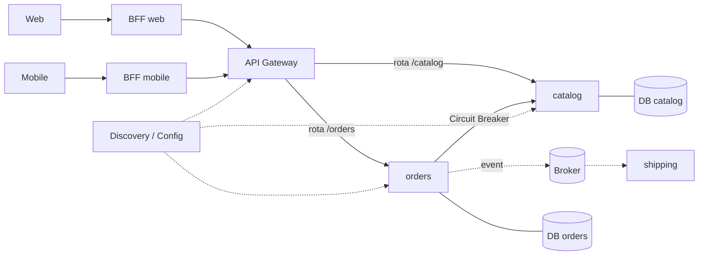
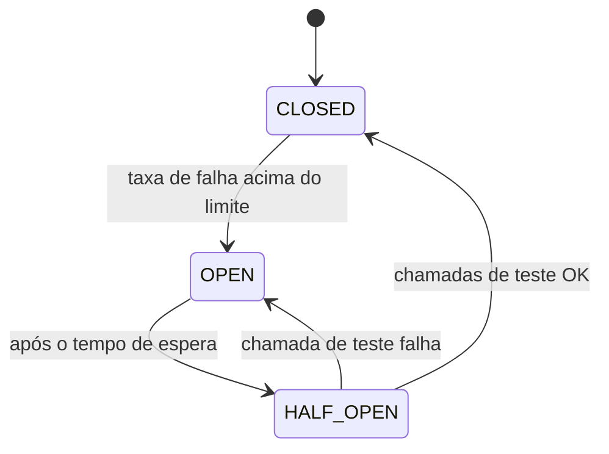

# Padrões de microsserviços (API Gateway, Discovery, Circuit Breaker, Saga, Outbox, Database per Service, Strangler Fig, BFF)

> **Resumo:** quando um sistema é dividido em serviços independentes, surgem problemas que não existem num monólito: como o cliente encontra os serviços, como falhas se propagam, como manter dados consistentes sem transação única, como migrar sem reescrever tudo. Esta página cataloga os padrões mais usados (catálogo de Chris Richardson, `microservices.io`) e liga cada um ao projeto Spring que o implementa. A mensagem central: **cada padrão existe para pagar uma conta que a distribuição criou**; sem o problema, não há por que adotar o padrão.
> **Pré-requisitos:** [06-padroes-arquiteturais](06-padroes-arquiteturais.md), [01-visao-geral](../04-spring-cloud/01-visao-geral.md) (Spring Cloud), [09-transacoes](../02-spring-core/09-transacoes.md), [07-mensageria](../04-spring-cloud/07-mensageria.md).
> **Versões:** Java 25, Spring Boot 4.1.2, Spring Cloud 2025.1.4 (Oakwood), Spring Cloud Stream 5.0.4. O código das §5.1–5.2 foi compilado e executado (`/tmp/validacao/s15` e `s15b`); as demos de Gateway, Eureka, Circuit Breaker, mensageria e tracing já foram executadas nas sessões 10–11 e são referenciadas, não repetidas.

## 1. Definição

Um **microsserviço** é um serviço pequeno, com um contexto de negócio próprio, implantado e escalado de forma independente e dono dos seus dados. Os padrões abaixo respondem a perguntas que essa decisão provoca:

| Problema | Padrão | Projeto Spring |
|---|---|---|
| Como o cliente chama dezenas de serviços? | **API Gateway** | Spring Cloud Gateway ([04-api-gateway](../04-spring-cloud/04-api-gateway.md)) |
| Como achar instâncias que sobem e caem? | **Service Discovery** (client-side) | Eureka / Consul / Kubernetes ([03-service-discovery](../04-spring-cloud/03-service-discovery.md), [09](../04-spring-cloud/09-spring-cloud-e-kubernetes.md)) |
| Onde ficam as configurações? | **Externalized Configuration** | Config Server ([02-config-server](../04-spring-cloud/02-config-server.md)) |
| Como evitar que a falha de um derrube todos? | **Circuit Breaker**, Timeout, Retry, Bulkhead | `CircuitBreakerFactory` + Resilience4j ([06-resiliencia](../04-spring-cloud/06-resiliencia.md)) |
| Como cada serviço tem seu esquema sem acoplar? | **Database per Service** | Spring Data + Flyway por serviço |
| Como manter consistência entre serviços? | **Saga** | orquestração própria, Spring Statemachine/Camunda, eventos (Stream) |
| Como gravar no banco **e** publicar evento sem perder um deles? | **Transactional Outbox** | `@Transactional` + relay (Spring Integration/Stream, Debezium) |
| Como diferentes clientes têm necessidades diferentes? | **BFF** (*Backend for Frontend*) | Spring Cloud Gateway / Spring MVC por cliente |
| Como migrar um monólito aos poucos? | **Strangler Fig** | Gateway roteando por caminho |
| Como rastrear uma requisição entre serviços? | **Distributed Tracing** | Micrometer Tracing ([08-tracing-distribuido](../04-spring-cloud/08-tracing-distribuido.md)) |
| Como chamar outro serviço de forma declarativa? | **Service client** | HTTP Service Clients ([05-comunicacao-entre-servicos](../04-spring-cloud/05-comunicacao-entre-servicos.md)) |



## 2. Conceitos fundamentais

### 2.1 API Gateway e BFF

**API Gateway:** ponto único de entrada que roteia, autentica, aplica limites e traduz. O cliente conhece um endereço; os serviços podem mudar de lugar. No Spring Cloud Gateway: `Route` + `Predicate` + `Filter` ([04-api-gateway](../04-spring-cloud/04-api-gateway.md)).

**BFF (*Backend for Frontend*, Sam Newman):** um gateway/serviço **por tipo de cliente** (web, mobile, parceiros), que agrega e adapta respostas para aquele cliente. Evita um gateway único que atende a todos com respostas genéricas e cheias de campos inúteis. Custo: mais componentes para manter e risco de duplicar lógica entre BFFs.

### 2.2 Service Discovery e Configuração Externa

Em ambientes dinâmicos o endereço de uma instância muda. No **discovery client-side** o cliente consulta um registro (Eureka) e balanceia (Spring Cloud LoadBalancer); no **server-side** quem faz isso é a plataforma (o `Service` do Kubernetes e o `kube-proxy`) ([09-spring-cloud-e-kubernetes](../04-spring-cloud/09-spring-cloud-e-kubernetes.md)). Em Kubernetes, a recomendação é usar o discovery e a configuração **da plataforma** (DNS, ConfigMap) e dispensar Eureka e Config Server. A **configuração externa** tira do artefato o que varia por ambiente, mas segredos exigem cuidado próprio.

### 2.3 Circuit Breaker, Timeout, Retry, Bulkhead

- **Timeout:** nenhuma chamada remota deve esperar para sempre.
- **Retry:** repetir erros transitórios, com *backoff* e **só para operações idempotentes**.
- **Circuit Breaker:** depois de falhas demais, "abre" e falha rápido; após um tempo, "meio-aberto" testa; se der certo, fecha.
- **Bulkhead:** limita a concorrência por dependência, para que uma lenta não esgote todas as threads.
- **Fallback:** resposta degradada quando tudo falha.

Executado na sessão 11: `CLOSED → OPEN → HALF_OPEN → CLOSED` e `CallNotPermittedException` ([06-resiliencia](../04-spring-cloud/06-resiliencia.md)).



### 2.4 Database per Service

Cada serviço é dono **exclusivo** do seu esquema; ninguém lê tabelas de outro. Isso permite evolução e escala independentes, mas elimina `JOIN` e `@Transactional` entre serviços. Variações: banco por serviço, esquema por serviço no mesmo servidor (aceitável no início), ou tabelas por módulo no [monólito modular](06-padroes-arquiteturais.md). Migrações por serviço: [12-migracoes-de-banco](../03-spring-boot/12-migracoes-de-banco.md).

### 2.5 Saga

**Problema:** o pedido envolve `orders`, `inventory` e `payment`, cada um com seu banco. Não há transação ACID global (2PC é frágil e quase não é usado entre serviços HTTP/mensageria). A **Saga** (Garcia-Molina e Salem, 1987) divide a operação em **transações locais** em sequência; se um passo falha, executam-se **transações compensatórias** dos passos anteriores, em ordem inversa.

Duas formas de coordenar:

| | **Coreografia** | **Orquestração** |
|---|---|---|
| Coordenação | cada serviço reage a eventos e publica outros | um orquestrador diz quem faz o quê |
| Acoplamento | baixo, mas o fluxo fica implícito e difícil de ver | o orquestrador conhece todos |
| Visibilidade do fluxo | espalhada | num só lugar |
| Bom para | poucos passos | fluxos longos, com ramificações |

Compensação **não é rollback**: o efeito já foi visível (e-mail enviado, estoque reservado). Compensa-se com uma ação nova (liberar estoque, estornar), que também pode falhar, então precisa ser idempotente e *retryable*.

### 2.6 Transactional Outbox

**Problema do dual write:** o serviço grava o pedido no banco **e** publica `OrderPlaced` no broker. Se o commit ocorre e a publicação falha (ou o contrário), o sistema fica inconsistente. Não há transação que abranja banco e broker.

**Solução:** na **mesma transação local**, gravar a mudança de negócio e uma linha em uma tabela `outbox`. Um processo separado (*relay*, por polling ou por CDC como o Debezium) lê as linhas pendentes, publica no broker e as marca como enviadas. Como o relay pode cair depois de publicar e antes de marcar, a entrega é **ao menos uma vez**: os consumidores precisam ser **idempotentes** ([07-mensageria](../04-spring-cloud/07-mensageria.md)).

### 2.7 Strangler Fig

Nome vindo da figueira-estranguladora (Fowler, 2004): em vez de reescrever o monólito de uma vez, coloca-se um **gateway/proxy na frente** e migra-se **uma funcionalidade por vez** para um novo serviço, mudando a rota. O monólito encolhe até ser desligado. Reduz o risco (migração reversível, por rota) e entrega valor no caminho. Exige que o tráfego passe por um ponto controlável.

### 2.8 Outros que aparecem em conjunto

- **Anti-Corruption Layer (ACL):** camada que traduz entre o modelo de um sistema legado/externo e o seu, para que o modelo alheio não "contamine" o seu domínio (uma aplicação de Adapter/Facade, [03-estruturais](03-estruturais.md)).
- **Sidecar / Service Mesh** (Istio, Linkerd): move resiliência, mTLS e telemetria para um proxy ao lado do serviço. Sobrepõe-se a parte do Spring Cloud.
- **CQRS / Event Sourcing:** [06-padroes-arquiteturais](06-padroes-arquiteturais.md).
- **Idempotent Consumer, Inbox:** descartar mensagens duplicadas; é a contraparte do Outbox.
- **Consumer-Driven Contracts** (Spring Cloud Contract): testes de contrato entre serviços. ⚠️ VERIFICAR o status do projeto em `spring.io/projects`.

## 3. Como funciona por dentro

### 3.1 Por que não há transação distribuída

Uma transação local ACID depende de um único gerenciador (o banco) com *locks* e *log*. Entre serviços, cada chamada é uma requisição de rede que pode: falhar, estourar o tempo e ainda assim ter sido executada, chegar duplicada ou fora de ordem. O **2PC** exige coordenador e bloqueia recursos durante a espera, o que reduz disponibilidade (teorema CAP). Sagas aceitam **consistência eventual** em troca de disponibilidade, o que obriga a modelar estados intermediários (`PENDING`, `PAID`, `CANCELLED`).

### 3.2 O que o `@Transactional` garante e o que não garante no Outbox

O `@Transactional` abre uma transação JDBC (via proxy AOP, [09-transacoes](../02-spring-core/09-transacoes.md)) e todas as escritas feitas com o mesmo `DataSource` participam dela, incluindo a linha do outbox. Se uma exceção `RuntimeException` sair do método, tudo sofre rollback; se não, o commit grava os dois de forma atômica. O que ele **não** faz é publicar no broker: o `KafkaTemplate.send` não participa da transação do banco. Por isso o relay é um passo separado.

### 3.3 O relay: polling versus CDC

- **Polling:** um `@Scheduled` lê `select ... where sent = false order by id`, publica e marca. Simples; atrasa pelo intervalo e, com várias instâncias, precisa de coordenação (`SELECT ... FOR UPDATE SKIP LOCKED`, ShedLock) porque `@Scheduled` não coordena entre instâncias ([11-cache-agendamento-e-async](../03-spring-boot/11-cache-agendamento-e-async.md)).
- **CDC** (*Change Data Capture*, ex.: Debezium): lê o log de transações do banco e emite as linhas do outbox; baixa latência, sem polling, mas aumenta a infraestrutura.

### 3.4 Strangler Fig na prática com o Gateway

O Gateway avalia as `Route`s em ordem; a primeira cujo `Predicate` casa vence ([04-api-gateway](../04-spring-cloud/04-api-gateway.md)). Basta ter uma rota específica `/orders/**` para o novo serviço **antes** da rota "pega-tudo" `/**` do monólito. Migrar um caminho é adicionar uma rota; reverter é removê-la.

## 4. Evolução histórica

| Ano | Marco |
|---|---|
| 1987 | artigo *Sagas* (Garcia-Molina e Salem) |
| 2004 | Strangler Fig (Fowler) |
| 2007–2011 | SOA e ESB; Netflix migra para a nuvem e cria Eureka, Ribbon, Hystrix, Zuul |
| 2007 | *Release It!* (Nygard) populariza Circuit Breaker e Bulkhead |
| 2015 | Spring Cloud Netflix leva Eureka, Ribbon, Hystrix e Zuul ao Spring |
| 2014 | artigo *Microservices* (Lewis e Fowler); BFF (Newman) |
| 2015+ | Docker e Kubernetes; Service Mesh (2016–2017) |
| ~2018–2019 | Hystrix, Ribbon e Zuul 1 entram em manutenção; Spring Cloud Gateway e Resilience4j assumem |
| 2019 | *Microservices Patterns* (Richardson) organiza o catálogo; Outbox e Saga ganham nomes consolidados |
| 2020–2023 | Spring Cloud removeu os módulos Netflix (exceto Eureka); Micrometer Tracing substitui o Sleuth (Boot 3) |
| 2024+ | "volta ao monólito modular" em parte do mercado |

Veja também [01-visao-geral](../04-spring-cloud/01-visao-geral.md).

⚠️ VERIFICAR: todos os anos e atribuições da tabela são de memória (inclusive datas de remoção dos módulos Netflix e a publicação do artigo de Lewis e Fowler).

## 5. Exemplos práticos

### 5.1 Saga orquestrada com compensação

Orquestrador mínimo em Java: executa os passos e, na primeira falha, compensa os já concluídos **em ordem inversa**.

```java
interface Step {
    String name();
    void execute(Map<String, Object> ctx);
    void compensate(Map<String, Object> ctx);
}

static boolean runSaga(List<Step> steps) {
    var ctx = new HashMap<String, Object>();
    var done = new ArrayDeque<Step>();            // pilha: o último concluído é o primeiro a compensar
    for (Step s : steps) {
        try { s.execute(ctx); done.push(s); }
        catch (RuntimeException e) {
            System.out.println("  ! " + e.getMessage() + " -> compensando");
            while (!done.isEmpty()) done.pop().compensate(ctx);
            return false;
        }
    }
    return true;
}
```

Saída com os passos `reservar estoque → cobrar → agendar entrega`:

```
saga ok:
  + reservar estoque
  + cobrar
  + agendar entrega
true
saga falha no pagamento:
  + reservar estoque
  ! cobrar falhou -> compensando
  - desfaz reservar estoque
false
```

Em produção cada `Step` é uma chamada remota (HTTP ou mensagem), o estado da saga é **persistido** (para sobreviver a reinício do orquestrador), cada passo e cada compensação são **idempotentes** (chave de idempotência) e há *timeouts*. Ferramentas: Camunda/Temporal (workflow engines), Spring Statemachine ⚠️ VERIFICAR status em `spring.io/projects`, ou Spring Cloud Stream para a coreografia.

### 5.2 Outbox transacional com Spring (H2)

Duas tabelas na mesma transação:

```java
@Service
class Placer {
    private final JdbcClient jdbc;
    Placer(JdbcClient j) { jdbc = j; }

    @Transactional
    void place(String customer, boolean fail) {
        jdbc.sql("insert into orders(customer_name, status, total) values (?, 'NEW', 1)")
            .param(customer).update();
        jdbc.sql("insert into outbox(topic, payload, sent) values ('orders.placed', ?, false)")
            .param(customer).update();
        if (fail) throw new IllegalStateException("falha antes do commit");
    }
}
```

Executado (`@SpringBootTest`, H2): `place("ana", false)` confirma; `place("bob", true)` lança. Resultado:

```
erro: falha antes do commit
orders=[ana]
outbox=[ana]
```

Nada de `bob` em nenhuma tabela: a escrita de negócio e a mensagem são atômicas. O relay (polling) lê os pendentes e marca como enviados:

```java
List<Long> ids = jdbc.sql("select id from outbox where sent = false order by id")
                     .query(Long.class).list();
ids.forEach(id -> {
    // 1) publicar no broker (StreamBridge.send, KafkaTemplate...)
    // 2) só então marcar como enviado
    jdbc.sql("update outbox set sent = true where id = ?").param(id).update();
});
```

Saída: `publicando 1` e `pendentes=0`. A ordem **publicar, depois marcar** é proposital: se o relay cair no meio, a mensagem será reenviada (at-least-once), nunca perdida.

### 5.3 O lado do consumidor: idempotência

Simulação em memória do cenário "relay caiu depois de enviar e reenviou":

```java
static Set<Long> processed = new HashSet<>();   // no real: tabela com chave única (inbox)
static void consume(List<String> broker) {
    for (String s : broker) {
        long id = Long.parseLong(s.split(":")[0]);
        System.out.println("  msg " + s + (processed.add(id) ? " processada" : " DUPLICADA, ignorada"));
    }
}
```

Executado: o broker recebeu `2:pedido-2` duas vezes (o relay "caiu" após enviar, e na repetição reenviou); a saída foi `msg 2:pedido-2 processada` seguida de `msg 2:pedido-2 DUPLICADA, ignorada`. No mundo real, `processed` é uma tabela com **chave primária no id da mensagem** gravada na mesma transação do efeito (padrão *Inbox*), ou a operação é naturalmente idempotente (`upsert`).

### 5.4 Strangler Fig e BFF com Spring Cloud Gateway

<!-- não compilado: variações das rotas validadas em 04-api-gateway -->
```yaml
spring:
  cloud:
    gateway:
      server:
        webflux:
          routes:
            - id: orders-new          # já migrado: vence por vir primeiro
              uri: lb://orders
              predicates: [ Path=/orders/** ]
            - id: legacy              # todo o resto continua no monólito
              uri: http://legacy-monolith:8080
              predicates: [ Path=/** ]
```

O prefixo `spring.cloud.gateway.server.webflux.*` foi confirmado no metadado do JAR na sessão 10 ([04-api-gateway](../04-spring-cloud/04-api-gateway.md)). Para um **BFF**, cria-se uma aplicação (Gateway ou Spring MVC) por cliente, cada uma com suas rotas e agregações, atrás do gateway de borda ou no lugar dele.

### 5.5 Circuit Breaker, Discovery e tracing

Não são repetidos aqui porque já foram executados: Circuit Breaker em [06-resiliencia](../04-spring-cloud/06-resiliencia.md), Eureka e balanceamento em [03-service-discovery](../04-spring-cloud/03-service-discovery.md) (incluindo a armadilha do `@LoadBalanced RestClient.Builder` que quebra o registro), propagação de `traceparent`/`b3` em [08-tracing-distribuido](../04-spring-cloud/08-tracing-distribuido.md).

## 6. Configurações e anotações relevantes

| Item | Para que serve | Exemplo |
|---|---|---|
| `spring.cloud.gateway.server.webflux.routes[*]` | rotas do Gateway (Strangler, BFF) | `uri: lb://orders` |
| `@EnableDiscoveryClient` / `eureka.client.*` | registrar/descobrir serviços | `eureka.client.service-url.defaultZone` |
| `CircuitBreakerFactory#create(id).run(supplier, fallback)` | circuit breaker programático | `factory.create("catalog").run(...)` |
| `@Retryable`, `@ConcurrencyLimit`, `@EnableResilientMethods` | retry e bulkhead nativos do Framework 7 | `org.springframework.resilience.annotation` |
| `@ImportHttpServices` + `@HttpExchange` | cliente declarativo de serviço | base-url ausente ou `lb://` = balanceado |
| `@Transactional` | atomicidade do Outbox e de cada passo da saga | no método do caso de uso |
| `StreamBridge`, bindings `<fn>-in-0` | publicar/consumir mensagens | Spring Cloud Stream |
| `spring.cloud.stream.bindings.<b>.group` | consumer group (competição entre instâncias) | `group: shipping` |
| DLQ (`enableDlq`/`x-exception-*`) | mensagens venenosas isoladas | [07-mensageria](../04-spring-cloud/07-mensageria.md) |
| `management.tracing.*` | amostragem e propagação | [08-tracing-distribuido](../04-spring-cloud/08-tracing-distribuido.md) |
| `SELECT ... FOR UPDATE SKIP LOCKED` | várias instâncias do relay sem duplicar trabalho | SQL do outbox |

## 7. Quando usar e quando NÃO usar

**Microsserviços como um todo:** só se houver necessidade de **escalar, implantar e evoluir partes de forma independente** (equipes autônomas, cargas muito diferentes). Para equipes pequenas ou domínio ainda incerto, prefira o [monólito modular](06-padroes-arquiteturais.md). O custo operacional (rede, observabilidade, consistência, versionamento de contratos) é permanente.

| Padrão | Usar | Evitar |
|---|---|---|
| **API Gateway** | muitos clientes/serviços, autenticação e limites centrais | um só serviço; vira gargalo e "monólito de rotas" se tiver lógica de negócio |
| **BFF** | clientes com necessidades bem diferentes | um só tipo de cliente |
| **Discovery** | ambiente dinâmico sem plataforma | **Kubernetes**: use Service/DNS |
| **Circuit Breaker / Retry** | toda chamada remota (timeout sempre) | retry em operação **não idempotente**; retry em cascata multiplica carga |
| **Database per Service** | serviços realmente autônomos | quando precisam de `JOIN`/transação entre si: provavelmente são o mesmo serviço |
| **Saga** | operação que cruza serviços e tolera consistência eventual | quando um único serviço/banco resolve; fluxos que exigem consistência imediata |
| **Outbox** | sempre que "gravar e publicar" precisa ser atômico | eventos que podem ser perdidos sem dano |
| **Strangler Fig** | migrar sistema legado grande, em produção | sistema pequeno que cabe reescrever |

## 8. Erros comuns e boas práticas

1. **"Monólito distribuído":** serviços que precisam ser implantados juntos, compartilham banco ou se chamam em cadeia síncrona longa. Tem os custos dos dois mundos.
2. **Compartilhar banco entre serviços:** acopla esquemas e impede evoluir.
3. **Sem timeout** nas chamadas remotas (o padrão de muitos clientes é infinito ou muito longo): uma dependência lenta esgota as threads de todos.
4. **Retry sem idempotência ou sem *backoff*:** duplica pedidos ou derruba o serviço que já está sofrendo (*retry storm*).
5. **Dual write:** `repository.save(...)` seguido de `kafka.send(...)` no mesmo método não é atômico. Use Outbox.
6. **Publicar evento dentro da transação** e o consumidor ler antes do commit: use `@TransactionalEventListener(AFTER_COMMIT)` ou Outbox.
7. **Compensação que não é idempotente** ou não existe para um passo; saga sem estado persistido.
8. **Esquecer a ordem e a duplicidade** das mensagens: projete consumidores idempotentes e tolerantes a reordenação.
9. **Gateway com regras de negócio.** O Gateway deve rotear, autenticar e limitar, não decidir negócio.
10. **Sem observabilidade desde o início:** sem `traceId` nos logs, depurar uma saga é adivinhação ([08-tracing-distribuido](../04-spring-cloud/08-tracing-distribuido.md)).
11. **Versionar contrato mal:** mudar um evento/endpoint de forma incompatível quebra consumidores; prefira mudanças aditivas e testes de contrato.

## 9. Perguntas de revisão

1. Por que `repository.save(order); kafka.send(event);` é um problema e como o Outbox resolve?
   <details><summary>Resposta</summary>São duas operações em sistemas diferentes sem transação comum (*dual write*): uma pode ocorrer e a outra não. O Outbox grava o evento numa tabela na mesma transação local da mudança de negócio; um relay publica depois, com entrega ao menos uma vez.</details>
2. Qual a diferença entre rollback e compensação numa saga?
   <details><summary>Resposta</summary>Rollback desfaz uma transação ainda não confirmada, de forma invisível a terceiros. Compensação é uma nova ação de negócio que reverte o efeito de um passo já confirmado (e visível), por exemplo estornar um pagamento; pode falhar e deve ser idempotente.</details>
3. Por que o consumidor de mensagens precisa ser idempotente?
   <details><summary>Resposta</summary>Brokers e relays garantem entrega ao menos uma vez; falhas e reenvios geram duplicatas (demonstrado: `msg 2:pedido-2 DUPLICADA, ignorada`). Sem idempotência, o efeito seria aplicado duas vezes.</details>
4. Quando Eureka e Config Server deixam de fazer sentido?
   <details><summary>Resposta</summary>Em Kubernetes, onde a plataforma já fornece descoberta (Service/DNS) e configuração (ConfigMap/Secret); Spring Cloud Kubernetes ou a própria plataforma substituem esses componentes.</details>
5. Como o Strangler Fig reduz o risco de migração?
   <details><summary>Resposta</summary>A migração ocorre por rota, atrás de um gateway: cada funcionalidade passa para o novo serviço de forma incremental e reversível (remover a rota devolve o tráfego ao monólito), em vez de uma reescrita completa.</details>

## 10. Referências oficiais

- Catálogo de padrões de microsserviços (Chris Richardson): <https://microservices.io/patterns/>
- Martin Fowler: <https://martinfowler.com/bliki/StranglerFigApplication.html>, <https://martinfowler.com/articles/microservices.html>
- Spring Cloud (projeto e docs): <https://spring.io/projects/spring-cloud>, <https://docs.spring.io/spring-cloud/docs/current/reference/html/>
- Spring Cloud Gateway: <https://docs.spring.io/spring-cloud-gateway/reference/>
- Spring Cloud Circuit Breaker: <https://docs.spring.io/spring-cloud-circuitbreaker/reference/>
- Spring Cloud Stream: <https://docs.spring.io/spring-cloud-stream/reference/>
- Resilience4j: <https://resilience4j.readme.io/>
- Debezium (CDC para Outbox): <https://debezium.io/documentation/>
- Anterior: [06-padroes-arquiteturais](06-padroes-arquiteturais.md). Próximo: [08-anti-padroes](08-anti-padroes.md)
