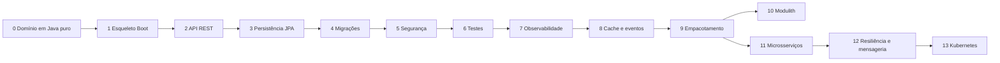

# Projeto prático: API de pedidos, passo a passo

> **Resumo:** roteiro incremental para construir uma API de pedidos (`Customer`, `Product`, `Order`, `OrderItem`) com Spring Boot, começando no Java puro e terminando em microsserviços opcionais. Cada checkpoint aponta para a teoria que o sustenta e diz o que você deve ser capaz de verificar antes de seguir.
> **Pré-requisitos:** ter lido ao menos [01-java](../01-java/05-recursos-modernos-da-linguagem.md) (arquivos 03 a 09) e [02-spring-core](../02-spring-core/06-como-java-e-spring-conversam.md).
> **Versões:** Java 25, Spring Boot 4.1.x, Spring Cloud 2025.1.x. Este roteiro **não traz o projeto pronto**: os trechos de código são esqueletos para guiar o seu. Os mecanismos citados foram validados nas sessões anteriores (ver cada arquivo linkado). ⚠️ VERIFICAR coordenadas de starters ao criar o `pom.xml` (use [start.spring.io](https://start.spring.io)).

## Como usar

1. Faça um checkpoint por vez, em um repositório Git seu, com um commit por checkpoint.
2. Antes de codar, leia a teoria linkada. Depois de codar, responda a pergunta de **verificação**.
3. Pacote base: `com.example.orders`. Identificadores em inglês, comentários em português.
4. Os checkpoints 0 a 9 formam o projeto principal (monólito bem feito). Os checkpoints 10 a 13 são extensões opcionais.



## Domínio

| Tipo | Campos principais | Observação |
|---|---|---|
| `Customer` | `id`, `name`, `email` | e-mail único |
| `Product` | `id`, `name`, `price` (`BigDecimal`), `stock` | nunca use `double` para dinheiro |
| `Order` | `id`, `customerId`, `items`, `status`, `createdAt` | raiz de agregado |
| `OrderItem` | `productId`, `quantity`, `unitPrice` | preço copiado no momento da compra |
| `OrderStatus` | `NEW`, `PAID`, `SHIPPED`, `CANCELED` | `enum` |

Regras: pedido sem itens é inválido; quantidade > 0; só se cancela pedido que não foi enviado; o total é soma de `quantity * unitPrice`.

## Checkpoint 0: domínio em Java puro (sem Spring)

**Objetivo:** modelar as regras sem nenhum framework, para que elas sejam testáveis em milissegundos.

- `record Money`/`OrderItem` imutáveis; `Order` com método `cancel()` que protege a regra de status; `sealed interface` para o resultado de operações que podem falhar.
- Teoria: [03-tipos-e-memoria](../01-java/03-tipos-e-memoria.md) (`BigDecimal`, `equals`/`hashCode`), [05-recursos-modernos](../01-java/05-recursos-modernos-da-linguagem.md) (records, sealed), [08-excecoes](../01-java/08-excecoes.md), [06-padroes arquiteturais](../06-padroes-de-projeto/06-padroes-arquiteturais.md) (Domain Model).
- Teste: JUnit 5 + AssertJ, sem contexto Spring ([15-testes-em-java](../01-java/15-testes-em-java.md)).
- **Verificação:** por que `Order` não deve expor `List<OrderItem>` mutável? (Veja `List.copyOf` em [07-colecoes](../01-java/07-colecoes.md).)

## Checkpoint 1: esqueleto Spring Boot

- Gere o projeto em start.spring.io com Java 25, Maven, `webmvc`, `validation`, `actuator`. Rode a aplicação e abra `/actuator/health`.
- Rode com `--debug` e leia o relatório de condições: descubra por que o Tomcat subiu.
- Teoria: [01-o-que-e-spring-boot](../03-spring-boot/01-o-que-e-spring-boot.md), [02-auto-configuracao](../03-spring-boot/02-auto-configuracao.md), [03-configuracao-externalizada](../03-spring-boot/03-configuracao-externalizada.md), e o mecanismo por trás em [06-como-java-e-spring-conversam](../02-spring-core/06-como-java-e-spring-conversam.md).
- **Verificação:** liste três beans criados por auto-configuração e a condição que os ativou.

## Checkpoint 2: API REST

- `POST /customers`, `GET /customers/{id}`, `POST /orders`, `GET /orders/{id}`, `POST /orders/{id}/cancel`.
- DTOs como `record` com Bean Validation; `@RestControllerAdvice` devolvendo `ProblemDetail`; construtor único para injeção.
- Teoria: [04-web-mvc](../03-spring-boot/04-web-mvc.md), [08-eventos-validacao-e-conversao](../02-spring-core/08-eventos-validacao-e-conversao.md), [02-ioc-e-injecao](../02-spring-core/02-ioc-e-injecao-de-dependencia.md).
- Esqueleto:

```java
// Controller fino: só traduz HTTP <-> serviço
@RestController
@RequestMapping("/orders")
class OrderController {
    private final OrderService service;
    OrderController(OrderService service) { this.service = service; }

    @PostMapping
    ResponseEntity<OrderResponse> create(@Valid @RequestBody CreateOrderRequest request) {
        // ... devolver 201 com Location
    }
}
```

- **Verificação:** o que acontece se `quantity` for negativo? Em qual camada a regra mora (validação de entrada vs regra de domínio)?

## Checkpoint 3: persistência com JPA

- `spring-boot-starter-data-jpa`, PostgreSQL (via Docker) e `JpaRepository`. Mapeie `Order` com `@OneToMany`/`@Embeddable` conforme o desenho do agregado.
- Provoque e corrija um **N+1** (`@EntityGraph` ou `join fetch`); desligue o OSIV e observe o `LazyInitializationException`.
- Transação no serviço, não no controller.
- Teoria: [06-spring-data-jpa](../03-spring-boot/06-spring-data-jpa.md), [09-transacoes](../02-spring-core/09-transacoes.md), [05-padroes-enterprise](../06-padroes-de-projeto/05-padroes-enterprise.md) (Repository, Unit of Work), [08-anti-padroes](../06-padroes-de-projeto/08-anti-padroes.md).
- **Verificação:** com `@Transactional` e uma `RuntimeException` vs uma exceção checada, o pedido é gravado ou não? (Matriz em 09-transacoes.)

## Checkpoint 4: migrações de banco

- Flyway: `V1__create_tables.sql`, `V2__add_status.sql`; `spring.jpa.hibernate.ddl-auto=validate`.
- Teoria: [12-migracoes-de-banco](../03-spring-boot/12-migracoes-de-banco.md).
- **Verificação:** por que nunca editar uma migração já aplicada?

## Checkpoint 5: segurança

- `spring-boot-starter-security` com resource server JWT; `ADMIN` cancela qualquer pedido, `USER` só os próprios (`@PreAuthorize`, que depende de proxy: [07-aop-e-proxies](../02-spring-core/07-aop-e-proxies.md)).
- Teoria: [08-spring-security](../03-spring-boot/08-spring-security.md). Opcional: emitir tokens com [Authorization Server](../05-outros-projetos-spring/04-spring-authorization-server.md).
- **Verificação:** por que chamar um método `@PreAuthorize` de outro método da mesma classe não aplica a regra?

## Checkpoint 6: testes em camadas

| Camada | Ferramenta | Teoria |
|---|---|---|
| Domínio | JUnit 5 + AssertJ, sem Spring | [15-testes-em-java](../01-java/15-testes-em-java.md) |
| Controller | `@WebMvcTest` + `@MockitoBean` | [10-testes-no-spring-boot](../03-spring-boot/10-testes-no-spring-boot.md) |
| Repositório | `@DataJpaTest` ou Testcontainers + `@ServiceConnection` | idem |
| Fluxo completo | `@SpringBootTest` + Testcontainers | idem |

- **Verificação:** por que `@WebMvcTest` não carrega `@Service`? Qual o custo de variar `@MockitoBean` entre classes de teste (cache de contextos)?

## Checkpoint 7: observabilidade

- Actuator (`health`, `metrics`, `prometheus` se desejar), logs estruturados, `/actuator/health/readiness` e `liveness`.
- Teoria: [09-actuator-e-observabilidade](../03-spring-boot/09-actuator-e-observabilidade.md). Não exponha todos os endpoints sem autenticação.
- **Verificação:** que métrica mostra o tempo das requisições a `POST /orders`?

## Checkpoint 8: cache, eventos e tarefas

- Cache de leitura de `Product` (Caffeine), `@Scheduled` para expirar pedidos `NEW` antigos, evento `OrderCreated` com `@TransactionalEventListener(AFTER_COMMIT)`.
- Teoria: [11-cache-agendamento-e-async](../03-spring-boot/11-cache-agendamento-e-async.md), [08-eventos](../02-spring-core/08-eventos-validacao-e-conversao.md), [04-comportamentais](../06-padroes-de-projeto/04-comportamentais.md) (Observer).
- **Verificação:** o que acontece com o evento se a transação der rollback? E se o listener lançar exceção após o commit?

## Checkpoint 9: empacotamento

- Jar executável, imagem de contêiner em camadas (`docker build` multi-stage ou buildpacks), configuração por variáveis de ambiente.
- Opcional: cache AOT/CDS e virtual threads.
- Teoria: [13-empacotamento-e-deploy](../03-spring-boot/13-empacotamento-e-deploy.md), [10-aot-e-native](../02-spring-core/10-aot-e-native.md), [12-concorrencia](../01-java/12-concorrencia.md) (virtual threads).
- **Verificação:** como o `JarLauncher` encontra as classes dentro do jar?

## Extensões opcionais

Só faça se tiver motivo: microsserviços aumentam a complexidade (ver [01-visao-geral](../04-spring-cloud/01-visao-geral.md) e [08-anti-padroes](../06-padroes-de-projeto/08-anti-padroes.md)).

### Checkpoint 10: monólito modular

Separe `customers`, `catalog` e `orders` em módulos com [Spring Modulith](../05-outros-projetos-spring/03-spring-modulith.md) e valide as fronteiras com teste. Muitas vezes é o ponto final correto.

### Checkpoint 11: dois serviços

Extraia `catalog` e `orders`. Use [Config Server](../04-spring-cloud/02-config-server.md), [Discovery](../04-spring-cloud/03-service-discovery.md), [Gateway](../04-spring-cloud/04-api-gateway.md) e [comunicação entre serviços](../04-spring-cloud/05-comunicacao-entre-servicos.md) (HTTP Service Client). Cada serviço com seu banco ([padrões de microsserviços](../06-padroes-de-projeto/07-padroes-de-microsservicos.md)).

### Checkpoint 12: resiliência e mensageria

Timeout, retry e circuit breaker na chamada `orders → catalog` ([06-resiliencia](../04-spring-cloud/06-resiliencia.md)). Publique `OrderCreated` com **Outbox** e consuma via [mensageria](../04-spring-cloud/07-mensageria.md); acompanhe uma requisição com [tracing](../04-spring-cloud/08-tracing-distribuido.md).

### Checkpoint 13: Kubernetes

Probes, ConfigMap/Secret e deploy local ([09-spring-cloud-e-kubernetes](../04-spring-cloud/09-spring-cloud-e-kubernetes.md)).

## Critérios de conclusão

- [ ] Regras de domínio testadas sem Spring.
- [ ] Nenhum `double` para dinheiro; nenhuma entidade JPA exposta na API.
- [ ] Banco versionado por migrações; `ddl-auto=validate`.
- [ ] Testes de fatia e de integração com banco real em contêiner.
- [ ] Endpoints sensíveis protegidos e testados.
- [ ] Imagem rodando com configuração por ambiente.
- [ ] Você sabe explicar, sem consultar, o que o contêiner faz entre `main` e a primeira requisição.

## Referências oficiais

- Spring Initializr: https://start.spring.io
- Spring Boot reference: https://docs.spring.io/spring-boot/
- Spring Framework reference: https://docs.spring.io/spring-framework/reference/
- Projetos Spring: https://spring.io/projects
